# Raccolta Completa Sorgenti Mermaid — LIMEN Vault v7Mini

Il presente documento raccoglie tutti i **18 diagrammi Mermaid** del pacchetto di documentazione di LIMEN Vault (0.7.0).  
Ogni diagramma è racchiuso in un blocco di codice fenced (` ```mermaid `) ed è immediatamente renderizzabile all'interno di Obsidian, GitHub, GitLab o visualizzatori Markdown compatibili.

---

## Indice dei Diagrammi

1. [MMD-001: Mappa di Navigazione Completa del Sistema](#1-mmd-001-mappa-di-navigazione-completa-del-sistema)
2. [MMD-002: Ciclo di Avvio, Verifica Requisiti e Setup Wizard](#2-mmd-002-ciclo-di-avvio-verifica-requisiti-e-setup-wizard)
3. [MMD-003: WF-001 — Configurazione Iniziale e Setup Wizard](#3-mmd-003-wf-001--configurazione-iniziale-e-setup-wizard)
4. [MMD-004: WF-002 — Chiedi al Vault (Ricerca RAG e Chat)](#4-mmd-004-wf-002--chiedi-al-vault-ricerca-rag-e-chat)
5. [MMD-005: WF-003 — Ispezione Fonti nel Lettore Documenti](#5-mmd-005-wf-003--ispezione-fonti-nel-lettore-documenti)
6. [MMD-006: WF-004 — Caricamento e Ingestione Documenti](#6-mmd-006-wf-004--caricamento-e-ingestione-documenti)
7. [MMD-007: WF-005 — Esplorazione e Navigazione Memoria](#7-mmd-007-wf-005--esplorazione-e-navigazione-memoria)
8. [MMD-008: WF-006 — Revisione e Approvazione Bozze Note](#8-mmd-008-wf-006--revisione-e-approvazione-bozze-note)
9. [MMD-009: WF-007 — Gestione Snapshot e Ripristino Vault](#9-mmd-009-wf-007--gestione-snapshot-e-ripristino-vault)
10. [MMD-010: WF-008 — Gestione Catalogo Modelli LLM e llama.cpp](#10-mmd-010-wf-008--gestione-catalogo-modelli-llm-e-llamacpp)
11. [MMD-011: WF-009 — Sincronizzazione Cloud S3/R2](#11-mmd-011-wf-009--sincronizzazione-cloud-s3r2)
12. [MMD-012: WF-010 — Compilazione Manuale Rete Zero](#12-mmd-012-wf-010--compilazione-manuale-rete-zero)
13. [MMD-013: WF-011 — Commutazione Lingua Interfaccia (IT / EN)](#13-mmd-013-wf-011--commutazione-lingua-interfaccia-it--en)
14. [MMD-014: WF-012 — Apertura Diretta del Vault in Obsidian](#14-mmd-014-wf-012--apertura-diretta-del-vault-in-obsidian)
15. [MMD-015: PIPE-001 — Ingestione, Chunking ed Embedding bge-m3](#15-mmd-015-pipe-001--ingestione-chunking-ed-embedding-bge-m3)
16. [MMD-016: PIPE-002 — Generazione Risposte e Routing Ibrido](#16-mmd-016-pipe-002--generazione-risposte-e-routing-ibrido)
17. [MMD-017: PIPE-003 — Streaming SSE e Reasoning Trace](#17-mmd-017-pipe-003--streaming-sse-e-reasoning-trace)
18. [MMD-018: PIPE-004 — Integrità Crittografica SHA-256](#18-mmd-018-pipe-004--integrità-crittografica-sha-256)

---

### 1. MMD-001: Mappa di Navigazione Completa del Sistema
*File sorgente: `04_MERMAID/SYSTEM_NAVIGATION.mmd`*

```mermaid
graph TD
    classDef headerStyle fill:#1e293b,stroke:#3b82f6,stroke-width:2px,color:#f8fafc;
    classDef navStyle fill:#1e293b,stroke:#64748b,stroke-width:1px,color:#f8fafc;
    classDef areaStyle fill:#0f172a,stroke:#334155,stroke-width:1px,color:#94a3b8;
    classDef modalStyle fill:#1e293b,stroke:#c8ff00,stroke-width:2px,color:#f8fafc;
    classDef drawerStyle fill:#1e293b,stroke:#eab308,stroke-width:1px,color:#f8fafc;

    subgraph Header ["BARRA SUPERIORE (GLOBAL HEADER)"]
        H1["Logo LIMEN Vault & Badge 0.7.0"]:::headerStyle
        H2["Stato Rete: 100% Locale / Ibrido"]:::headerStyle
        H3["Pulsante Apri in Obsidian"]:::headerStyle
        H4["Selettore Lingua: IT / EN"]:::headerStyle
        H5["Pulsante Globale: Carica Documenti"]:::headerStyle
    end

    subgraph NavArea ["BARRA DI NAVIGAZIONE PRINCIPALE"]
        N1["1. Chiedi al Vault"]:::navStyle
        N2["2. Documenti"]:::navStyle
        N3["3. Memoria"]:::navStyle
        N4["4. Avanzate"]:::navStyle
    end

    subgraph Area1 ["1. CHIEDI AL VAULT (Chat RAG)"]
        A1_1["Thread Storico Conversazioni"]:::areaStyle
        A1_2["Pannello Reasoning Trace (DeepSeek-R1)"]:::areaStyle
        A1_3["Output Risposta con Fonti Verificate"]:::areaStyle
        A1_4["Input Prompt con Invio e Modello"]:::areaStyle
    end

    subgraph Area2 ["2. DOCUMENTI"]
        A2_1["Filtro Ricerca Testuale & Ordinamento"]:::areaStyle
        A2_2["Tabella File: Nome, Tipo, Data, Hash"]:::areaStyle
        A2_3["Pulsante Leggi (Apre Lettore)"]:::areaStyle
    end

    subgraph Area3 ["3. MEMORIA"]
        A3_1["Tag Cloud & Categorie Semantiche"]:::areaStyle
        A3_2["Mappa Concettuale / Grafo di Memoria"]:::areaStyle
        A3_3["Elenco Note Consolidate del Vault"]:::areaStyle
    end

    subgraph Area4 ["4. SEZIONI AVANZATE"]
        A4_1["A. Approvazione Note (Bozze 00_INBOX)"]:::areaStyle
        A4_2["B. Snapshot e Ripristino"]:::areaStyle
        A4_3["C. Catalogo Modelli LLM & llama.cpp"]:::areaStyle
        A4_4["D. Sincronizzazione Cloud S3/R2"]:::areaStyle
        A4_5["E. Compilazione Manuale Rete Zero"]:::areaStyle
        A4_6["F. Configurazione e Impostazioni"]:::areaStyle
        A4_7["G. Diagnostica e Log di Sistema"]:::areaStyle
    end

    subgraph Overlays ["MODALI E CASSETTI CONTESTUALI"]
        M1["SetupWizardModal: Configurazione Vault e LLM"]:::modalStyle
        M2["DocumentReaderModal: Viewer TXT/MD/PDF con Hash SHA-256"]:::modalStyle
        D1["UploadDrawer: Caricamento File e Directory"]:::drawerStyle
        D2["ModelDownloadDrawer: Avanzamento Download GGUF"]:::drawerStyle
    end

    H5 -->|Clicca| D1
    N1 --> Area1
    N2 --> Area2
    N3 --> Area3
    N4 --> Area4

    A2_3 -->|Clicca| M2
    A1_3 -->|Clicca Fonte| M2
    A4_3 -->|Download Modello| D2
    H1 -->|Primo Avvio o Reset| M1
```

---

### 2. MMD-002: Ciclo di Avvio, Verifica Requisiti e Setup Wizard
*File sorgente: `04_MERMAID/AUTH_LIFECYCLE.mmd`*

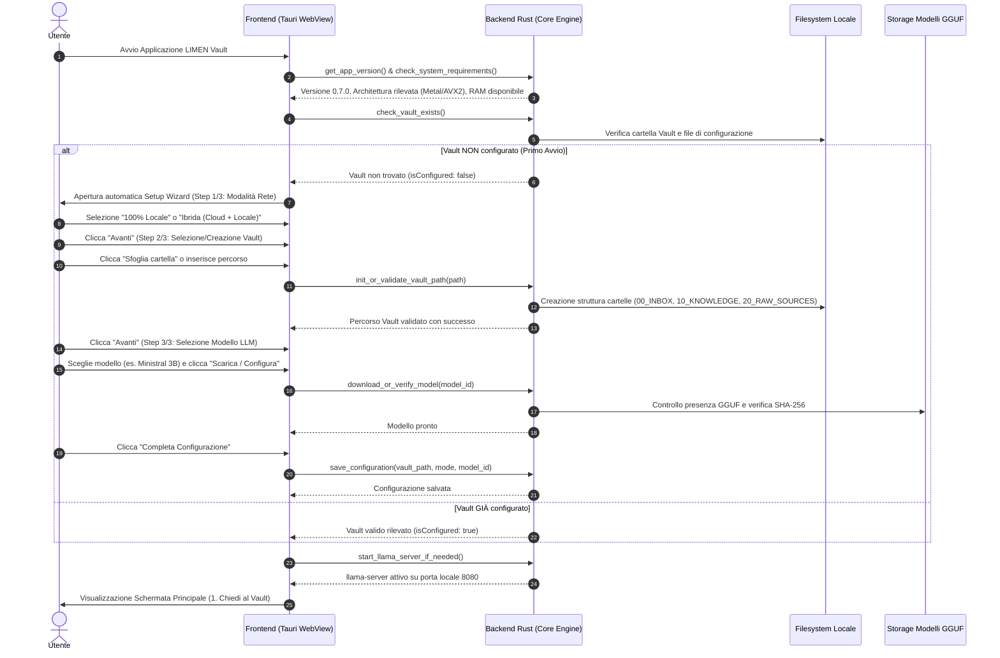

---

### 3. MMD-003: WF-001 — Configurazione Iniziale e Setup Wizard
*File sorgente: `04_MERMAID/WF-001.mmd`*

```mermaid
graph TD
    Start(["Avvio Setup Wizard (SCR-001)"]) --> Step1["Step 1: Scelta Modalità Operativa"]
    Step1 -->|Opzione A| ModeLocal["Modalità 100% Locale (Zero-Rete)"]
    Step1 -->|Opzione B| ModeHybrid["Modalità Ibrida (Cloud OpenAI + Locale)"]
    
    ModeHybrid --> InputKey["Inserimento Chiave OPENAI_API_KEY"]
    InputKey --> Step2["Step 2: Configurazione Percorso Vault"]
    ModeLocal --> Step2

    Step2 --> ChoosePath{"Scelta Percorso Cartella"}
    ChoosePath -->|Nuovo Vault| CreateDirs["Creazione Struttura (00_INBOX, 10_KNOWLEDGE, 20_RAW_SOURCES)"]
    ChoosePath -->|Vault Esistente| ValidateDirs["Validazione Struttura Directory Esistente"]

    CreateDirs --> Step3["Step 3: Selezione Modello LLM Predefinito"]
    ValidateDirs --> Step3

    Step3 --> SelectModel{"Modello Selezionato"}
    SelectModel -->|Ministral 3B / Qwen 7B| CheckModel{"File GGUF Presente?"}
    SelectModel -->|OpenAI Cloud (Se Ibrido)| SkipDownload["Verifica Connessione API"]

    CheckModel -->|Sì| Ready["Stato Pronto"]
    CheckModel -->|No| TriggerDownload["Download Asincrono con Barra Avanzamento"]
    TriggerDownload --> VerifyHash["Verifica Hash SHA-256 Integrità"]
    VerifyHash --> Ready

    SkipDownload --> Ready
    Ready --> Finish["Clicca 'Completa Configurazione'"]
    Finish --> MainUI(["Apertura Interfaccia Principale (SCR-002)"])
```

---

### 4. MMD-004: WF-002 — Chiedi al Vault (Ricerca RAG e Chat)
*File sorgente: `04_MERMAID/WF-002.mmd`*

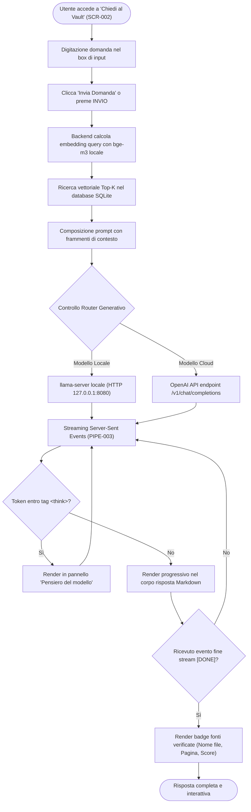

---

### 5. MMD-005: WF-003 — Ispezione Fonti nel Lettore Documenti
*File sorgente: `04_MERMAID/WF-003.mmd`*

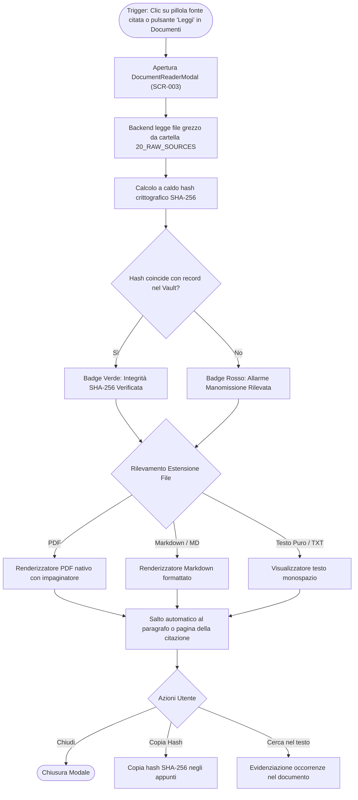

---

### 6. MMD-006: WF-004 — Caricamento e Ingestione Documenti
*File sorgente: `04_MERMAID/WF-004.mmd`*

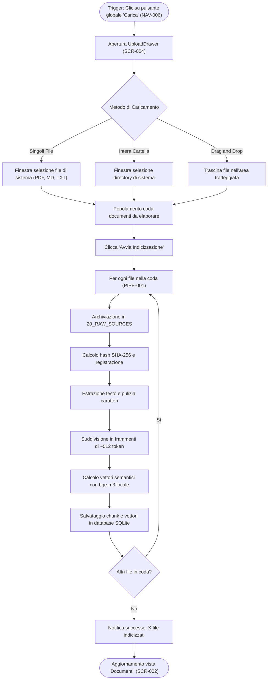

---

### 7. MMD-007: WF-005 — Esplorazione e Navigazione Memoria
*File sorgente: `04_MERMAID/WF-005.mmd`*

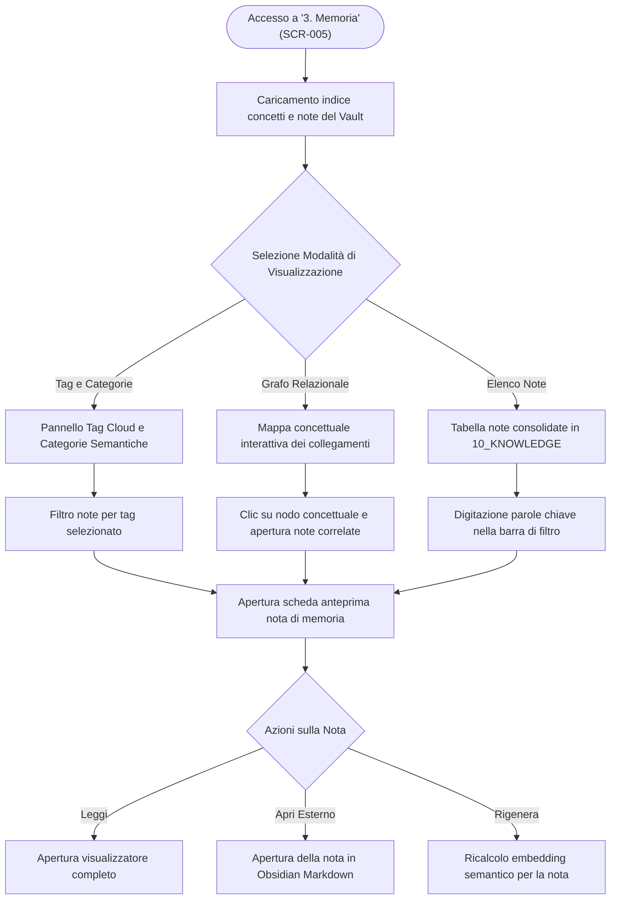

---

### 8. MMD-008: WF-006 — Revisione e Approvazione Bozze Note
*File sorgente: `04_MERMAID/WF-006.mmd`*

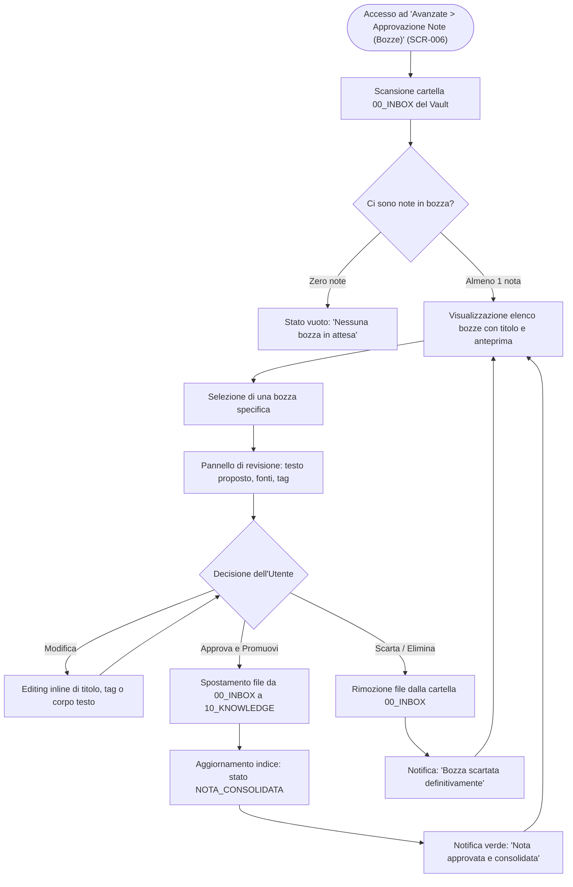

---

### 9. MMD-009: WF-007 — Gestione Snapshot e Ripristino Vault
*File sorgente: `04_MERMAID/WF-007.mmd`*

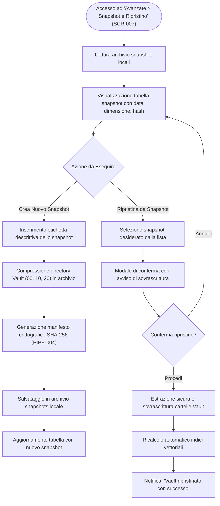

---

### 10. MMD-010: WF-008 — Gestione Catalogo Modelli LLM e llama.cpp
*File sorgente: `04_MERMAID/WF-008.mmd`*

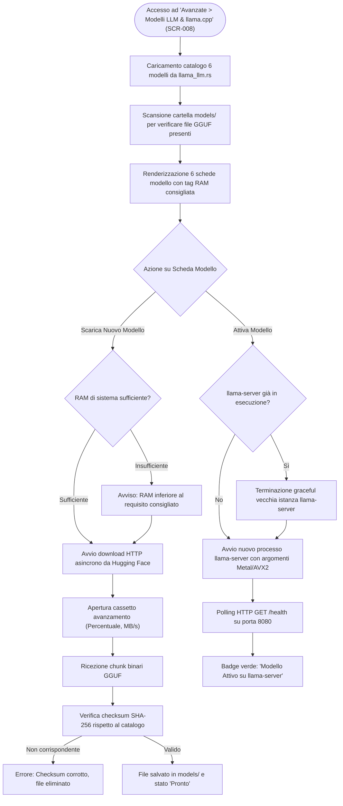

---

### 11. MMD-011: WF-009 — Sincronizzazione Cloud S3/R2
*File sorgente: `04_MERMAID/WF-009.mmd`*

```mermaid
graph TD
    Trigger(["Accesso ad 'Avanzate > Sincronizzazione Cloud' (SCR-009)"]) --> LoadConfig["Lettura parametri S3/R2 da configurazione"]
    LoadConfig --> CheckCreds{"Credenziali S3 configurate?"}

    CheckCreds -->|No| PromptInput["Inserimento Endpoint, Bucket, Access Key, Secret Key"]
    PromptInput --> SaveConfig["Salvataggio sicuro delle credenziali locali"]
    CheckCreds -->|Sì| ReadySync["Pannello pronto per la sincronizzazione"]
    SaveConfig --> ReadySync

    ReadySync --> UserSyncAction{"Azione di Sincronizzazione"}

    UserSyncAction -->|Carica su Cloud (Push)| ScanLocal["Scansione snapshot e note locali"]
    ScanLocal --> EncryptPayload["Cifratura opzionale del payload"]
    EncryptPayload --> UploadS3["Invio blocchi su bucket compatibile S3"]
    UploadS3 --> PushDone["Notifica: 'Backup remoto completato'"]

    UserSyncAction -->|Scarica da Cloud (Pull)| QueryRemote["Interrogazione lista oggetti su bucket S3"]
    QueryRemote --> SelectRemote["Selezione archivio da ripristinare"]
    SelectRemote --> DownloadS3["Scaricamento blocchi compressi"]
    DownloadS3 --> ApplyLocal["Integrazione nel Vault locale (previo consenso)"]
    ApplyLocal --> PullDone["Notifica: 'Sincronizzazione completata'"]
```

---

### 12. MMD-012: WF-010 — Compilazione Manuale Rete Zero
*File sorgente: `04_MERMAID/WF-010.mmd`*

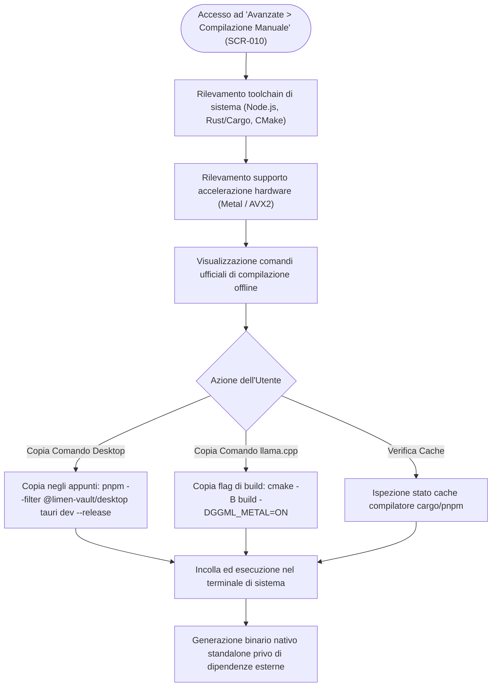

---

### 13. MMD-013: WF-011 — Commutazione Lingua Interfaccia (IT / EN)
*File sorgente: `04_MERMAID/WF-011.mmd`*

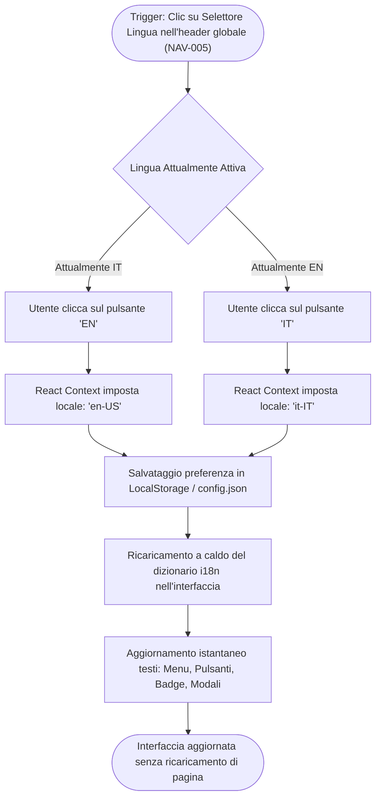

---

### 14. MMD-014: WF-012 — Apertura Diretta del Vault in Obsidian
*File sorgente: `04_MERMAID/WF-012.mmd`*

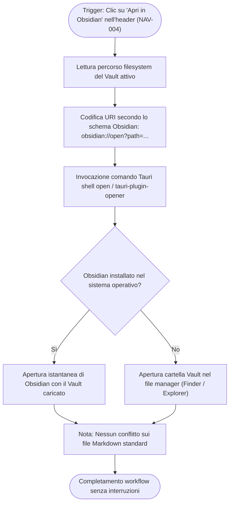

---

### 15. MMD-015: PIPE-001 — Ingestione, Chunking ed Embedding bge-m3
*File sorgente: `04_MERMAID/PIPE-001.mmd`*

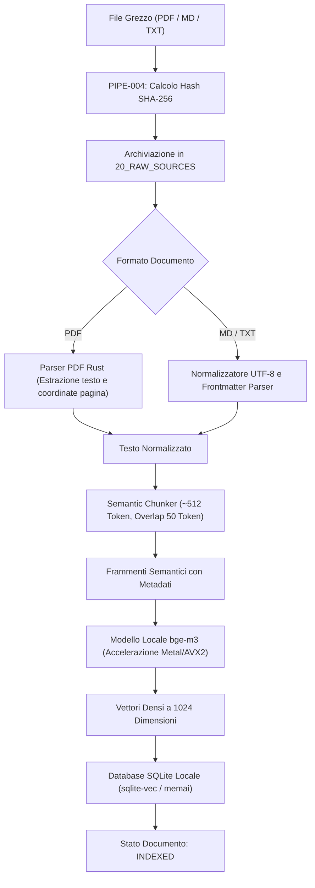

---

### 16. MMD-016: PIPE-002 — Generazione Risposte e Routing Ibrido
*File sorgente: `04_MERMAID/PIPE-002.mmd`*

```mermaid
flowchart TD
    UserQuery["Domanda Utente"] --> QueryEmbed["Embedding Query tramite bge-m3"]
    QueryEmbed --> TopK["Ricerca Vettoriale Top-K nel Database Locale"]
    TopK --> Assembly["Composizione Context Prompt RAG"]

    Assembly --> ModeCheck{"Configurazione Modalità Attiva"}
    
    ModeCheck -->|100% Locale| LocalCheck{"llama-server Attivo su 127.0.0.1:8080?"}
    ModeCheck -->|Ibrida (Cloud)| KeyCheck{"Chiave OPENAI_API_KEY Presente e Valida?"}

    KeyCheck -->|Sì| OpenAICall["Invocazione OpenAI API /v1/chat/completions"]
    KeyCheck -->|No| LocalCheck

    LocalCheck -->|Sì| LlamaCall["Invocazione HTTP POST 127.0.0.1:8080/v1/chat/completions"]
    LocalCheck -->|No| SpawnServer["Avvio Automatico Processo llama-server con Modello GGUF"]
    SpawnServer --> HealthWait["Attesa Risposta GET /health (Porta 8080)"]
    HealthWait --> LlamaCall

    OpenAICall --> StreamEvents["PIPE-003: Ricezione Stream Server-Sent Events"]
    LlamaCall --> StreamEvents
```

---

### 17. MMD-017: PIPE-003 — Streaming SSE e Reasoning Trace
*File sorgente: `04_MERMAID/PIPE-003.mmd`*

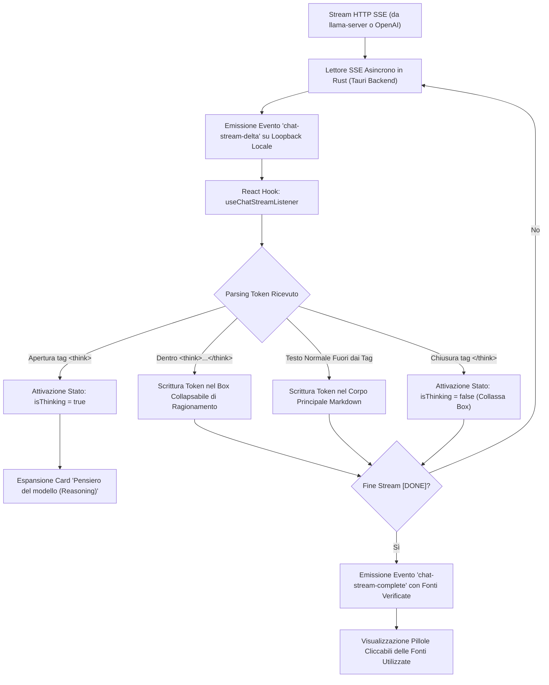

---

### 18. MMD-018: PIPE-004 — Integrità Crittografica SHA-256
*File sorgente: `04_MERMAID/PIPE-004.mmd`*

```mermaid
flowchart TD
    subgraph RawDocHashing ["A. Ingestione Documentale Raw"]
        FileIn["File immesso nel Vault"] --> ComputeDocHash["Calcolo SHA-256 binario"]
        ComputeDocHash --> StoreDocHash["Salvataggio hash in database e metadati"]
        ViewerOpen["Apertura nel DocumentReader"] --> RecheckDocHash["Ricalcolo a caldo SHA-256"]
        RecheckDocHash --> CompareDoc{"Coincide con db?"}
        CompareDoc -->|Sì| BadgeGreen["Integrità Verificata"]
        CompareDoc -->|No| BadgeRed["Allarme Manomissione"]
    end

    subgraph ModelIntegrity ["B. Download Modelli GGUF"]
        ModelDL["Download Chunk GGUF da Hugging Face"] --> AssemblyFile["Composizione File Finale in models/"]
        AssemblyFile --> ComputeModelHash["Calcolo SHA-256 del Modello"]
        ComputeModelHash --> CompareCatalog{"Coincide con LLM_CATALOG in Rust?"}
        CompareCatalog -->|Sì| MarkReady["Stato: Pronto per Inferenza"]
        CompareCatalog -->|No| PurgeFile["Eliminazione Immediata File Corrotto"]
    end

    subgraph SnapshotHashing ["C. Generazione e Ripristino Snapshot"]
        SnapTrigger["Trigger Creazione Snapshot"] --> WalkTree["Scansione albero cartelle 00, 10, 20"]
        WalkTree --> GenManifest["Generazione Manifest SHA-256 complessivo"]
        GenManifest --> ZipVault["Creazione Archivio Cifrato / Compresso"]
        RestoreTrigger["Trigger Ripristino Snapshot"] --> VerifyZip["Verifica Integrità Manifest prima dell'estrazione"]
    end
```
