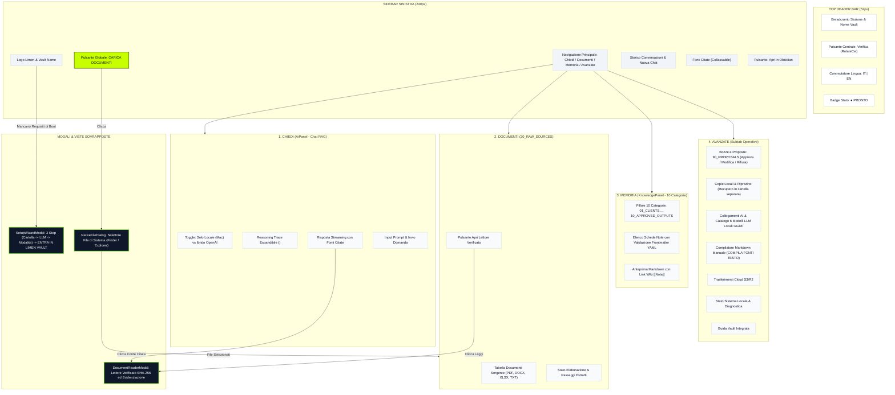
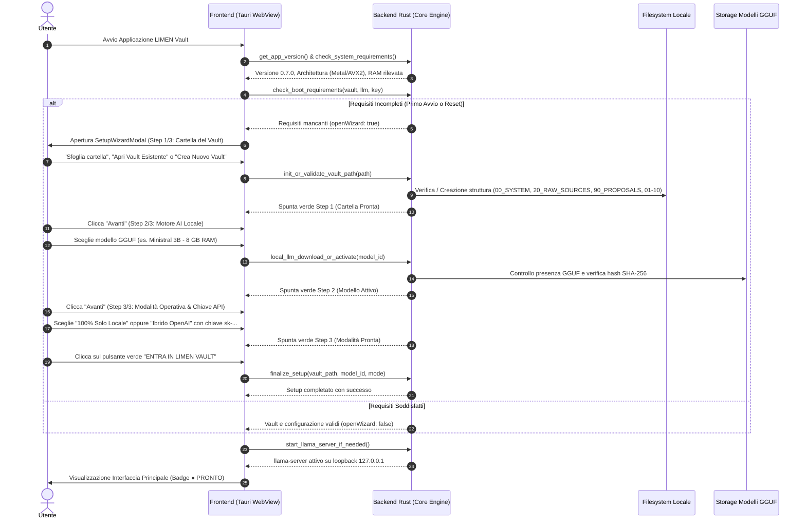
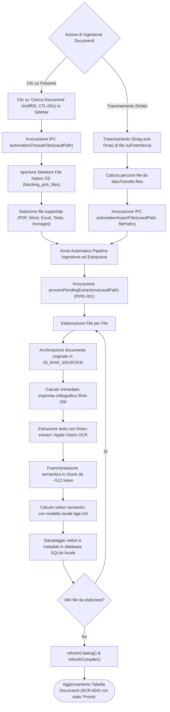
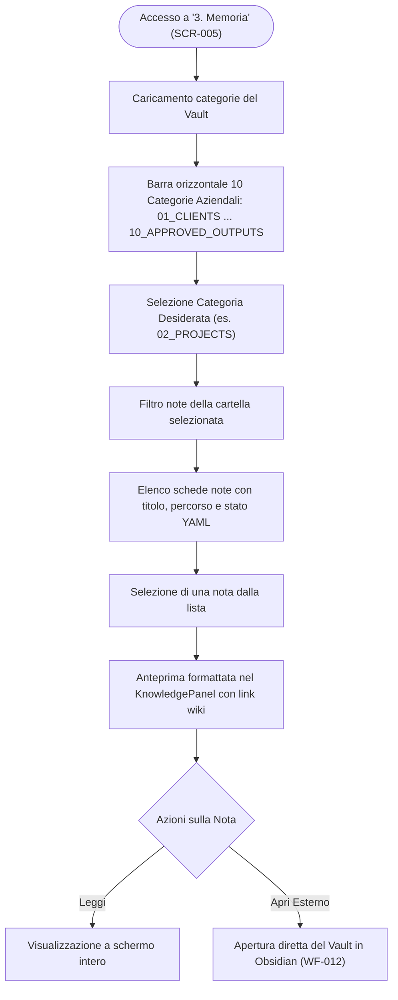
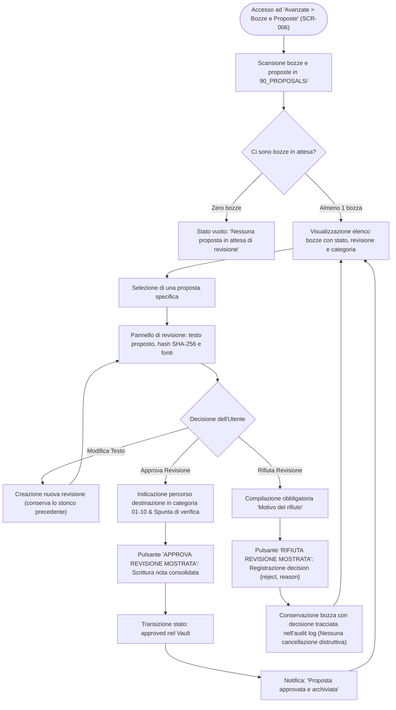
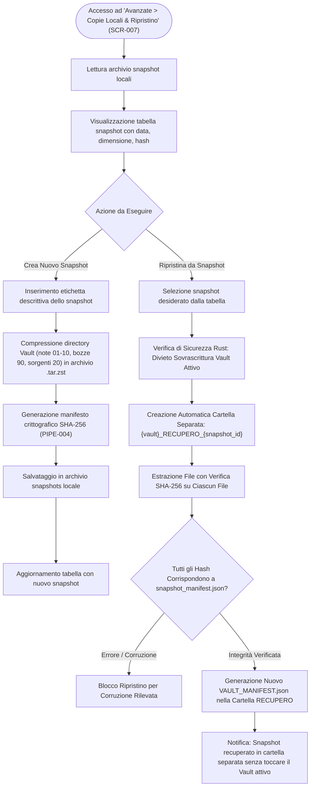
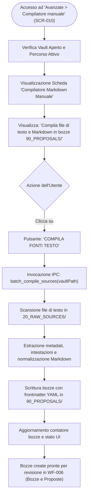
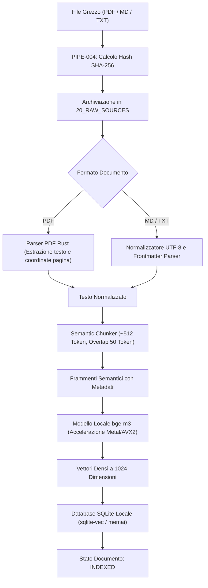
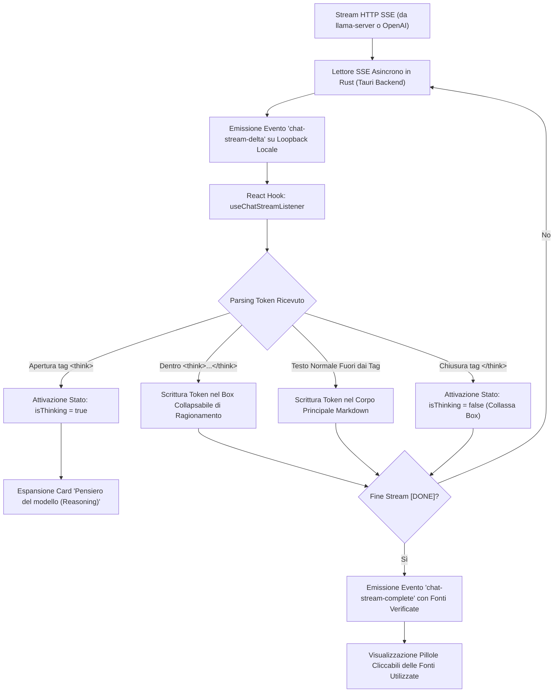

# Raccolta Ufficiale di Tutti i Diagrammi Mermaid — LIMEN Vault v7Mini

Il presente documento raccoglie in un unico file esportabile tutti i 18 diagrammi Mermaid del pacchetto di documentazione, generati direttamente dai rispettivi file sorgente in `04_MERMAID/`.

---

## Indice dei Diagrammi

1. [**MMD-001:** Navigazione Globale e Topologia Interfaccia](#1-mmd-001-system_navigationmmd)
2. [**MMD-002:** Ciclo di Avvio, Controllo Requisiti e Setup Wizard](#2-mmd-002-auth_lifecyclemmd)
3. [**MMD-003:** WF-001 — Configurazione Iniziale (Setup Wizard)](#3-mmd-003-wf-001mmd)
4. [**MMD-004:** WF-002 — Chiedi al Vault (Ricerca RAG e Chat)](#4-mmd-004-wf-002mmd)
5. [**MMD-005:** WF-003 — Ispezione Fonti nel Lettore Documenti SHA-256](#5-mmd-005-wf-003mmd)
6. [**MMD-006:** WF-004 — Ingestione Documenti (Selettore Nativo / Drag-and-Drop)](#6-mmd-006-wf-004mmd)
7. [**MMD-007:** WF-005 — Esplorazione e Navigazione Memoria (01-10)](#7-mmd-007-wf-005mmd)
8. [**MMD-008:** WF-006 — Revisione e Approvazione Bozze (90_PROPOSALS)](#8-mmd-008-wf-006mmd)
9. [**MMD-009:** WF-007 — Gestione Snapshot e Ripristino Sicuro (Cartella RECUPERO)](#9-mmd-009-wf-007mmd)
10. [**MMD-010:** WF-008 — Gestione Catalogo Modelli LLM e llama.cpp](#10-mmd-010-wf-008mmd)
11. [**MMD-011:** WF-009 — Sincronizzazione Cloud S3/R2 (BYOB)](#11-mmd-011-wf-009mmd)
12. [**MMD-012:** WF-010 — Compilatore Fonti Testo da 20_RAW_SOURCES a 90_PROPOSALS](#12-mmd-012-wf-010mmd)
13. [**MMD-013:** WF-011 — Commutazione Istantanea Lingua (IT | EN)](#13-mmd-013-wf-011mmd)
14. [**MMD-014:** WF-012 — Apertura Diretta del Vault in Obsidian](#14-mmd-014-wf-012mmd)
15. [**MMD-015:** PIPE-001 — Ingestione ed Embedding Locale (bge-m3)](#15-mmd-015-pipe-001mmd)
16. [**MMD-016:** PIPE-002 — Routing della Risposta e Fallback RAG](#16-mmd-016-pipe-002mmd)
17. [**MMD-017:** PIPE-003 — Streaming Asincrono Token e Reasoning Trace](#17-mmd-017-pipe-003mmd)
18. [**MMD-018:** PIPE-004 — Catena di Integrità e Validazione SHA-256](#18-mmd-018-pipe-004mmd)

---

### 1. MMD-001: Navigazione Globale e Topologia Interfaccia
*File sorgente: `04_MERMAID/SYSTEM_NAVIGATION.mmd`*



---

### 2. MMD-002: Ciclo di Avvio, Controllo Requisiti e Setup Wizard
*File sorgente: `04_MERMAID/AUTH_LIFECYCLE.mmd`*



---

### 3. MMD-003: WF-001 — Configurazione Iniziale (Setup Wizard)
*File sorgente: `04_MERMAID/WF-001.mmd`*

```mermaid
graph TD
    Start(["Avvio Setup Wizard (SCR-002)"]) --> Step1["Step 1: Cartella del Vault"]
    Step1 --> ChoosePath{"Azione Cartella Vault"}
    ChoosePath -->|Sfoglia Cartella| BrowseFolder["Selezione Cartella da File Dialog Nativo"]
    ChoosePath -->|Apri Esistente| OpenExisting["Validazione Struttura Directory Esistente"]
    ChoosePath -->|Crea Nuovo| CreateDirs["Creazione Struttura (00_SYSTEM, 20_RAW_SOURCES, 90_PROPOSALS, 01-10)"]

    BrowseFolder --> Step1Ready["Spunta Verde Step 1 (Cartella Pronta)"]
    OpenExisting --> Step1Ready
    CreateDirs --> Step1Ready

    Step1Ready --> Step2["Step 2: Motore AI Locale (Catalogo LLM GGUF)"]
    Step2 --> SelectModel{"Selezione Modello"}
    SelectModel -->|Ministral 3B (8 GB RAM)| CheckModel{"File GGUF Presente & SHA-256 Valido?"}
    SelectModel -->|Ministral 8B / Qwen / Llama / DeepSeek| CheckModel

    CheckModel -->|Sì| Step2Ready["Spunta Verde Step 2 (Modello Attivo)"]
    CheckModel -->|No| TriggerDownload["Download Streaming da Hugging Face con Barra Avanzamento"]
    TriggerDownload --> VerifyHash["Verifica Hash SHA-256 Integrità"]
    VerifyHash --> Step2Ready

    Step2Ready --> Step3["Step 3: Modalità Operativa e Chiave API"]
    Step3 --> SelectMode{"Scelta Modalità"}
    SelectMode -->|100% Solo Locale (Rete Zero)| LocalMode["Nessuna Chiave Richiesta - Calcolo On-Device"]
    SelectMode -->|Ibrida OpenAI| HybridMode["Inserimento Chiave sk-... Salvata nel Portachiavi"]

    LocalMode --> Step3Ready["Spunta Verde Step 3 (Modalità Configurate)"]
    HybridMode --> Step3Ready

    Step3Ready --> Finish["Clicca 'ENTRA IN LIMEN VAULT'"]
    Finish --> MainUI(["Apertura Interfaccia Principale (Badge ● PRONTO)"])
```

---

### 4. MMD-004: WF-002 — Chiedi al Vault (Ricerca RAG e Chat)
*File sorgente: `04_MERMAID/WF-002.mmd`*


---

### 5. MMD-005: WF-003 — Ispezione Fonti nel Lettore Documenti SHA-256
*File sorgente: `04_MERMAID/WF-003.mmd`*


---

### 6. MMD-006: WF-004 — Ingestione Documenti (Selettore Nativo / Drag-and-Drop)
*File sorgente: `04_MERMAID/WF-004.mmd`*



---

### 7. MMD-007: WF-005 — Esplorazione e Navigazione Memoria (01-10)
*File sorgente: `04_MERMAID/WF-005.mmd`*



---

### 8. MMD-008: WF-006 — Revisione e Approvazione Bozze (90_PROPOSALS)
*File sorgente: `04_MERMAID/WF-006.mmd`*



---

### 9. MMD-009: WF-007 — Gestione Snapshot e Ripristino Sicuro (Cartella RECUPERO)
*File sorgente: `04_MERMAID/WF-007.mmd`*



---

### 10. MMD-010: WF-008 — Gestione Catalogo Modelli LLM e llama.cpp
*File sorgente: `04_MERMAID/WF-008.mmd`*


---

### 11. MMD-011: WF-009 — Sincronizzazione Cloud S3/R2 (BYOB)
*File sorgente: `04_MERMAID/WF-009.mmd`*

```mermaid
graph TD
    Trigger(["Accesso ad 'Avanzate > Sincronizzazione Cloud' (SCR-008)"]) --> LoadConfig["Lettura parametri S3/R2 da configurazione"]
    LoadConfig --> CheckCreds{"Credenziali S3 configurate?"}

    CheckCreds -->|No| PromptInput["Inserimento Endpoint, Bucket, Access Key, Secret Key"]
    PromptInput --> SaveConfig["Salvataggio sicuro delle credenziali locali"]
    CheckCreds -->|Sì| ReadySync["Pannello pronto per la sincronizzazione"]
    SaveConfig --> ReadySync

    ReadySync --> UserSyncAction{"Azione di Sincronizzazione"}

    UserSyncAction -->|Carica su Cloud (Push)| ScanLocal["Scansione snapshot e note locali"]
    ScanLocal --> EncryptPayload["Cifratura opzionale del payload"]
    EncryptPayload --> UploadS3["Invio blocchi su bucket compatibile S3"]
    UploadS3 --> PushDone["Notifica: 'Backup remoto completato'"]

    UserSyncAction -->|Scarica da Cloud (Pull)| QueryRemote["Interrogazione lista oggetti su bucket S3"]
    QueryRemote --> SelectRemote["Selezione archivio da ripristinare"]
    SelectRemote --> DownloadS3["Scaricamento blocchi compressi"]
    DownloadS3 --> ApplyLocal["Integrazione nel Vault locale (previo consenso)"]
    ApplyLocal --> PullDone["Notifica: 'Sincronizzazione completata'"]
```

---

### 12. MMD-012: WF-010 — Compilatore Fonti Testo da 20_RAW_SOURCES a 90_PROPOSALS
*File sorgente: `04_MERMAID/WF-010.mmd`*



---

### 13. MMD-013: WF-011 — Commutazione Istantanea Lingua (IT | EN)
*File sorgente: `04_MERMAID/WF-011.mmd`*


---

### 14. MMD-014: WF-012 — Apertura Diretta del Vault in Obsidian
*File sorgente: `04_MERMAID/WF-012.mmd`*


---

### 15. MMD-015: PIPE-001 — Ingestione ed Embedding Locale (bge-m3)
*File sorgente: `04_MERMAID/PIPE-001.mmd`*



---

### 16. MMD-016: PIPE-002 — Routing della Risposta e Fallback RAG
*File sorgente: `04_MERMAID/PIPE-002.mmd`*

```mermaid
flowchart TD
    UserQuery["Domanda Utente"] --> QueryEmbed["Embedding Query tramite bge-m3"]
    QueryEmbed --> TopK["Ricerca Vettoriale Top-K nel Database Locale"]
    TopK --> Assembly["Composizione Context Prompt RAG"]

    Assembly --> ModeCheck{"Configurazione Modalità Attiva"}
    
    ModeCheck -->|100% Locale| LocalCheck{"llama-server Attivo su 127.0.0.1:8080?"}
    ModeCheck -->|Ibrida (Cloud)| KeyCheck{"Chiave OPENAI_API_KEY Presente e Valida?"}

    KeyCheck -->|Sì| OpenAICall["Invocazione OpenAI API /v1/chat/completions"]
    KeyCheck -->|No| LocalCheck

    LocalCheck -->|Sì| LlamaCall["Invocazione HTTP POST 127.0.0.1:8080/v1/chat/completions"]
    LocalCheck -->|No| SpawnServer["Avvio Automatico Processo llama-server con Modello GGUF"]
    SpawnServer --> HealthWait["Attesa Risposta GET /health (Porta 8080)"]
    HealthWait --> LlamaCall

    OpenAICall --> StreamEvents["PIPE-003: Ricezione Stream Server-Sent Events"]
    LlamaCall --> StreamEvents
```

---

### 17. MMD-017: PIPE-003 — Streaming Asincrono Token e Reasoning Trace
*File sorgente: `04_MERMAID/PIPE-003.mmd`*



---

### 18. MMD-018: PIPE-004 — Catena di Integrità e Validazione SHA-256
*File sorgente: `04_MERMAID/PIPE-004.mmd`*

```mermaid
flowchart TD
    subgraph RawDocHashing ["A. Ingestione Documentale Raw"]
        FileIn["File immesso nel Vault"] --> ComputeDocHash["Calcolo SHA-256 binario"]
        ComputeDocHash --> StoreDocHash["Salvataggio hash in database e metadati"]
        ViewerOpen["Apertura nel DocumentReader"] --> RecheckDocHash["Ricalcolo a caldo SHA-256"]
        RecheckDocHash --> CompareDoc{"Coincide con db?"}
        CompareDoc -->|Sì| BadgeGreen["Integrità Verificata"]
        CompareDoc -->|No| BadgeRed["Allarme Manomissione"]
    end

    subgraph ModelIntegrity ["B. Download Modelli GGUF"]
        ModelDL["Download Chunk GGUF da Hugging Face"] --> AssemblyFile["Composizione File Finale in models/"]
        AssemblyFile --> ComputeModelHash["Calcolo SHA-256 del Modello"]
        ComputeModelHash --> CompareCatalog{"Coincide con LLM_CATALOG in Rust?"}
        CompareCatalog -->|Sì| MarkReady["Stato: Pronto per Inferenza"]
        CompareCatalog -->|No| PurgeFile["Eliminazione Immediata File Corrotto"]
    end

    subgraph SnapshotHashing ["C. Generazione e Ripristino Snapshot"]
        SnapTrigger["Trigger Creazione Snapshot"] --> WalkTree["Scansione albero cartelle 00, 10, 20"]
        WalkTree --> GenManifest["Generazione Manifest SHA-256 complessivo"]
        GenManifest --> ZipVault["Creazione Archivio Cifrato / Compresso"]
        RestoreTrigger["Trigger Ripristino Snapshot"] --> VerifyZip["Verifica Integrità Manifest prima dell'estrazione"]
    end
```



---
