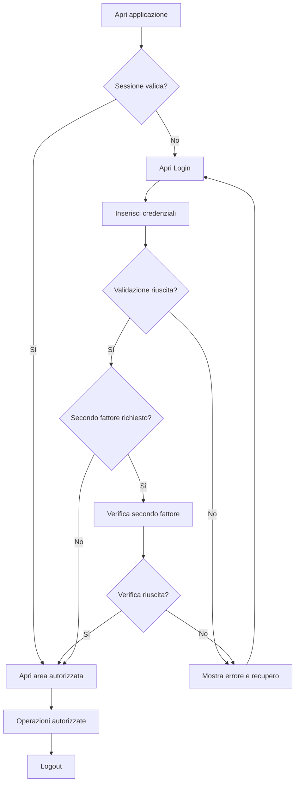
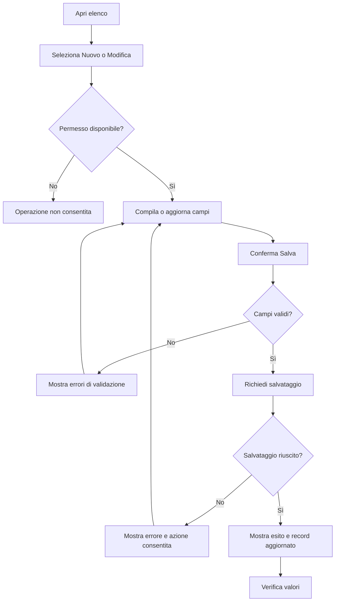
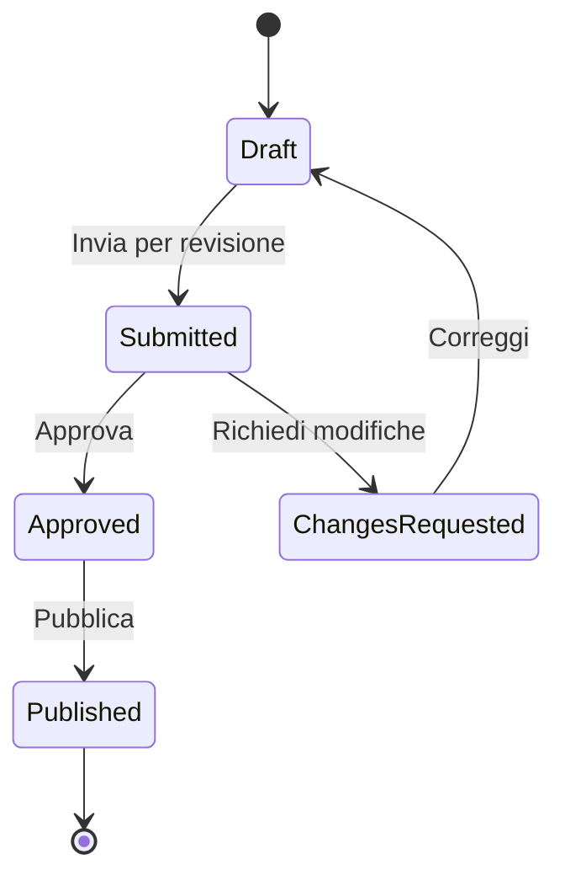
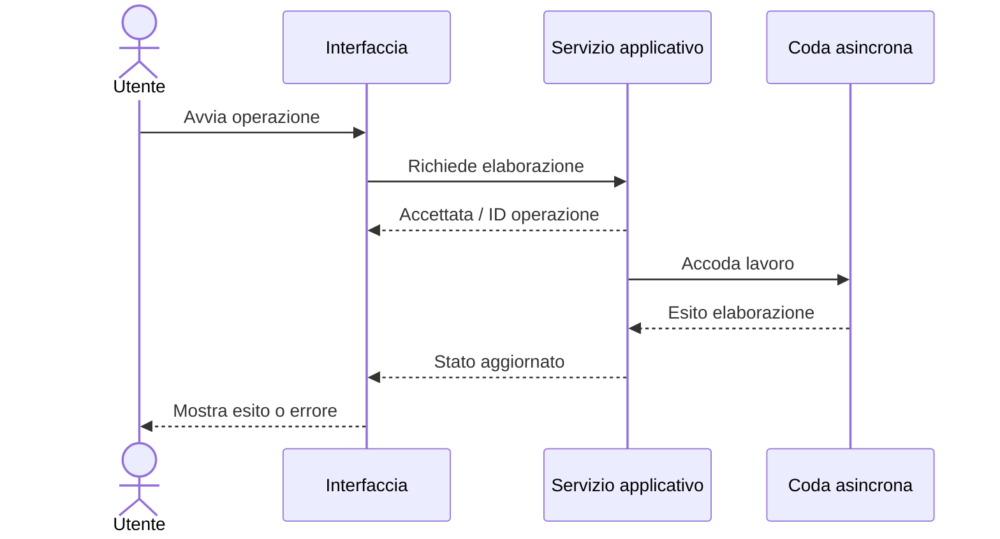
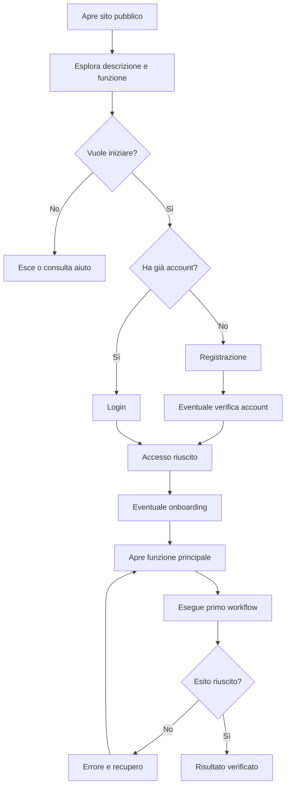

# CODER DOCUMENTATION EXTRACTION OS
## Protocollo operativo universale per analizzare un'applicazione e produrre le fonti del Manuale Utente

**Versione:** 1.0.0  
**Stato:** direttiva operativa / master riutilizzabile  
**Lingua di consegna predefinita:** italiano; localizzare solo se richiesto  
**Destinatario:** coding agent / lead developer che conosce o ha accesso al codice dell'applicazione  
**Ambito:** web app, SaaS, PWA, CRM, ERP, app desktop, app mobile, strumenti AI, marketplace e applicazioni interne  
**Riferimento editoriale:** `BIBBIA_MANUALI_UTENTE_v0.2.0.md` (se disponibile)  
**Riferimento di metodo:** `MANUALE_OPERATIVO_LIMEN_COMPLETO_v1.pdf` (105 pagine, usato per studiare struttura e qualità, **non** per copiare brand e contenuti)

> **ORDINE VINCOLANTE AL CODER:** analizza sistematicamente l'applicazione che hai sviluppato e genera l'intero pacchetto **DOCUMENTATION SOURCE PACKAGE** necessario a redigere un Manuale Utente completo. **Il deliverable principale deve chiamarsi esattamente `MANUALE_UTENTE.txt`.** Produci separatamente tutti i diagrammi Mermaid sorgente `.mmd`, gli inventari, i file dati e il registro delle verifiche. **Non creare il PDF premium in questa fase**, non inventare funzioni e non copiare il Design System di un'altra app.

---

# 00. SCOPO, RISULTATO E LINEA DI CONFINE

Questo protocollo crea un contratto di consegna tra due ruoli:

1. **CODER / DOCUMENTATION EXTRACTOR**: legge e analizza il prodotto reale, ricostruisce con prove tutte le funzioni, percorsi, stati e procedure; fornisce testi, dataset dimostrativi, screenshot autorizzati e Mermaid sorgenti.
2. **TECHNICAL WRITER / EDITOR PREMIUM**: prende il pacchetto del coder, applica la `BIBBIA_MANUALI_UTENTE`, legge il **Design System specifico dell'app**, costruisce il manuale grafico, verifica leggibilità e produce PDF e altri formati.

**Il coder non deve impaginare il PDF e l'editor non deve inventare UI o logiche non documentate.**

Il pacchetto deve consentire a una persona nuova di comprendere:

- Che cos'è il prodotto, a chi è rivolto e che cosa **fa effettivamente** nella release indicata.
- Che cosa succede dalla prima visita alla homepage o al download/installazione.
- Come si accede, ci si registra, si recupera l'accesso, si cambia profilo e si esce.
- Quali menu, pagine, controlli e campi sono visibili **per ruolo, ambiente, piano e stato**.
- Quali operazioni può svolgere: creare, visualizzare, trovare, modificare, duplicare, condividere, esportare, approvare, archiviare, cancellare, ecc. **solo dove esistono**.
- Come si sviluppano i workflow completi e quali condizioni interrompono o cambiano il percorso.
- Quali errori, avvisi, permessi, limiti, scadenze, dipendenze e condizioni particolari sono previsti.
- Quale risultato visibile conferma che ogni procedura è riuscita.
- Quando una funzione è reale, dimostrativa, incompleta, non testata o non disponibile.

**Obiettivo di copertura:** tutte le superfici e le operazioni utente effettivamente presenti nella release devono essere **inventariate e tracciate**; ogni omissione deve risultare come esclusione esplicita nel report, non come assenza silenziosa.

**Non è una richiesta di sviluppo funzionale.** Non aggiungere nuove funzionalità, dati, controlli, modal o endpoint per semplificare la produzione del manuale. Modifiche al codice, deploy, migrazioni, invii, pagamenti e cancellazioni richiedono autorizzazione separata.

---

# 01. PARAMETRI DI ESECUZIONE DA COMPILARE PRIMA DI INIZIARE

```yaml
app_id: "[ID UNIVOCO PRODOTTO]"
app_name: "[NOME APP]"
owner: "[SOGGETTO RESPONSABILE]"
repo: "[URL O PERCORSO REPOSITORY VERIFICATO]"
branch: "[BRANCH ESAMINATO]"
commit_sha: "[SHA COMPLETO]"
release_version: "[VERSIONE O BUILD]"
release_date: "[DATA VERIFICATA O NOT_VERIFIED]"
environments:
  - "[DEV / STAGING / PRODUCTION]"
public_url: "[URL VERIFICATO O NOT_VERIFIED]"
authenticated_url: "[URL VERIFICATO O NOT_VERIFIED]"
target_audiences: []
locales: []
platforms: []
roles: []
plans: []
feature_flags: []
visual_audit_authorized: false
non_destructive_testing_authorized: false
demo_account_source: "[SANDBOX / FIXTURE / NONE]"
design_system_source: "[PERCORSO O LINK VERIFICATO / MISSING]"
output_language: "it-IT"
output_directory: "DOCUMENTATION_SOURCE_PACKAGE"
requested_scope: "ALL_USER_VISIBLE_FUNCTIONALITY"
```

Compila soltanto con valori scoperti da fonti concrete o forniti dal proprietario. Per campi non accertati usa `NOT_VERIFIED`; per fonti mancanti usa `MISSING`.

## 01.1 Stop conditions

Interrompi l'azione specifica e registra un blocco se:

- Non hai accesso alla repository corretta o non è identificabile il commit.
- La navigazione o i test nel browser sono vietati dalle policy applicabili.
- Un'azione ha effetti reali su clienti, finanze, documenti fiscali, ordini, dati personali o destinatari esterni.
- Non hai account demo autorizzato o dati fittizi per un flusso che scrive dati.
- Un comando implica produzione, cancellazione, invio email/SMS, webhook esterni, pagamento, migrazione o variazione dei permessi reali.
- Non hai evidenza sufficiente per descrivere una funzione come utilizzabile.
- Il Design System ufficiale è assente: **non blocca l'estrazione tecnica**, ma blocca la dichiarazione di prontezza per l'impaginazione premium finale.

Non aggirare policy del workspace, autenticazione, paywall o controlli applicativi. Non chiedere credenziali in chiaro e non includerle nel pacchetto.

---

# 02. FONTI DA ESAMINARE E GERARCHIA DELLE PROVE

Analizza nell'ordine più efficiente **solo le fonti effettivamente presenti**:

1. Repo e metadati Git: tag, commit, branch, release, changelog, README, ADR e configurazioni pertinenti.
2. Route/screen/view/controller/config della UI (web, mobile, desktop).
3. Navigazione: header, sidebar, tab, breadcrumb, footer, command palette, bottom bar, link contestuali, modali, wizard.
4. Componenti UI condivisi: menu, form, input, pulsanti, tabelle, filtri, upload, wizard, notifiche, drawer e dialog.
5. State management, route guards, auth, RBAC/ABAC, tenancy, feature flags, entitlements e limiti per piano.
6. Funzioni server, API pubbliche/interne, background jobs, automazioni, provider/integrazioni, webhooks ed eventi.
7. Modelli, migrazioni e schema DB **quando accessibili e necessari per capire stati e persistenza**; non dedurre tabelle da nomi ipotetici.
8. Test esistenti (unitari, integrazione, end-to-end), fixtures, error codes, i18n strings e validazioni.
9. Applicazione in esecuzione e sessioni autorizzate in browser/emulatore; dati demo e risultati osservati.
10. Design System dell'app: Figma o altri sorgenti, token, Tailwind/CSS/theme, assets di brand, icone e font dichiarati/licenziati.
11. Manuali precedenti, help center e ticket: utili per confronto, **non** sufficienti da soli per validare la release corrente.

**Divieto di assumere un framework:** individua la tecnologia dal repository. Se una componente usa file-based routing, esamina i file; se usa router dichiarativo, esamina la configurazione; se è desktop/mobile, esamina screen graph, navigator e window logic.

## 02.1 Classi di evidenza tassative

| Stato | Significato | Impiego nel manuale |
|---|---|---|
| `LIVE_PASS` | Interazione eseguita in ambiente autorizzato, risultato osservato | Procedura attestata in quell'ambiente |
| `CODE_VERIFIED` | Comportamento riscontrato nel codice o test affidabili, senza prova live | Documentare con avvertenza appropriata |
| `TEST_VERIFIED` | Caso coperto da test eseguito, log disponibile e contesto identificato | Conferma limitata a ciò che il test dimostra |
| `STATIC_INFERRED` | Interpretazione ragionevole, non dimostrata in modo conclusivo | Non presentare come comportamento certo |
| `DEMO_ONLY` | Mock, fixture, comportamento simulato, placeholder | Etichettare sempre come dimostrativo |
| `PLANNED` | Roadmap, TODO, codice disabilitato o interfaccia futura | Escludere dalle istruzioni come funzione attiva |
| `NOT_VERIFIED` | Fonte mancante, ambiguità o accesso non disponibile | Dichiarare limite e richiesta di verifica |
| `LIVE_FAIL` | Interazione effettuata con esito errato / diverso da atteso | Segnalare come problema, non documentare come successo |
| `NOT_APPLICABLE` | Funzione assente per progetto o ruolo verificato | Non inventare; indicare esclusione se pertinente |

### Regola essenziale

**Uno screenshot prova solo lo stato rappresentato, non l'esito di un'intera operazione.** Una pagina HTML o un componente React non dimostrano da soli la persistenza nel database. Un unit test non dimostra layout mobile, accessibilità o invio reale. Una chiamata a un provider in codice non dimostra che l'integrazione di produzione sia abilitata.

## 02.2 Evidence record obbligatorio

Ogni dichiarazione rilevante deve collegarsi a un `EVIDENCE_ID`:

```yaml
evidence_id: "EVD-0001"
entity_ids: ["SCR-001", "ACT-004", "WF-001"]
evidence_type: "code|browser|test|configuration|screenshot|document"
status: "CODE_VERIFIED"
environment: "[AMBIENTE]"
release: "[VERSIONE / COMMIT]"
source_path_or_url: "[PERCORSO E CONTEXT]"
code_symbol_or_range: "[FUNZIONE / LINEE SE DISPONIBILI]"
role: "[RUOLO O N/A]"
preconditions: "[REQUISITI]"
action_performed: "[ESATTAMENTE COSA È STATO FATTO]"
observed_result: "[RISULTATO REALE / NOT_OBSERVED]"
limitations: "[VINCOLI]"
recorded_at: "[DATA/ORA E TIMEZONE]"
reviewer: "[AGENTE / REVISORE]"
```

Le citazioni ai file nel report devono includere percorso e, dove disponibili, intervallo di righe e commit. Non inventare linee precise se non note.

---

# 03. REGOLE PER L'AUDIT SICURO

## 03.1 Permessi e ambiente

- Preferisci sandbox, staging o account demo isolati per ogni azione che scrive.
- Non modificare produzione per produrre il manuale.
- Evita invii email/SMS effettivi; se necessario, usa provider mock/sandbox autorizzato.
- Non effettuare charge/checkout veri, SdI/tributi, ordini a fornitori, eliminazioni permanenti, reset di account e permessi reali.
- Per funzionalità sensibili, verifica percorso UI e logica in codice; registra come `CODE_VERIFIED` finché non si esegue un test sicuro end-to-end.
- Screenshot solo con dati sintetici autorizzati e non riconducibili a clienti reali.
- Non inserire password, chiavi, token, segreti, query di tabelle private, contenuti riservati o session cookie in manuali, Mermaid, evidenze o archivi.
- In caso di policy che vieta browser testing, **non cambiare la policy autonomamente**: documenta il blocco e prepara le istruzioni per l'auditor autorizzato.

## 03.2 Fixture sintetiche

Per ogni modulo crea fixture sintetiche sufficienti a mostrare `empty`, `populated`, `loading`, `validation_error`, `permission_denied`, `success`, `failure`, `partial_success` se gli stati esistono.

Usa domini `.invalid` e identificativi sandbox; non generare P.IVA, IBAN, account o codici che possano appartenere a soggetti reali. Quando un campo impone una validazione reale, usa soltanto valori di test ufficiali del provider o un ambiente con convalida fittizia esplicitamente configurata.

Per ogni fixture indica: `FIXTURE_ID`, record sintetici, percorso di import, schema rilevato, istruzioni di reset, quali test/shot la usano, **nessuna informazione autentica**.

---

# 04. METODO UNIVERSALE DI INVENTARIO: NON FERMARTI AI MENU

Cerca sistematicamente **tutte le superfici raggiungibili**, comprese quelle non esposte nella sidebar. L'elenco delle route non esaurisce le schermate; una stessa route può contenere decine di stati dell'interfaccia.

## 04.1 Tipologie di superfici

- Landing page, homepage marketing, footer, pricing, CTA, demo, waitlist, help/FAQ.
- Installazione/download, first run, splash, welcome, onboarding.
- Login, registrazione, social/SSO, MFA, inviti, conferma email, reset, recovery, logout, timeout.
- Dashboard, home autenticata, widgets, attività recenti, stati vuoti.
- Selettori organizzazione/workspace/progetto, profilo e impostazioni personali.
- CRUD: list, grid, Kanban, detail, create, edit, duplicate, delete, archive, restore.
- Tabelle, sorting, searching, filtering, pagination, bulk operations, saved views.
- Wizard multistep, form dinamici, dialog, modali, side panel, tooltip, confirmation, keyboard shortcuts.
- Upload, import, preview, mappatura CSV/Excel, OCR/parsing, drag&drop, esportazione, stampa/PDF.
- Notifiche in-app, email, push, inbox, menzioni, reminder.
- Collaborazione, commenti, ruoli, autorizzazioni, revisioni, approvazioni.
- Billing, piano, prova, fatture di abbonamento, upgrade/downgrade, cancellazione, checkout **se esistono**.
- Integrazioni, autorizzazioni OAuth/consenso, webhook, sync, disconnessione e retry.
- Tool AI, upload contestuale, prompt, review dell'output, fonti, limiti, fallback.
- Mobile/responsive, PWA install, offline, sync/conflict, desktop-specific controls **se implementati**.
- Accessibilità, lingue, modalità dark/light, validazioni, error boundaries, 403/404/500, maintenance e feature flags.
- Setup amministrativo, tenant, audit log, backup/restore ove esposti all'utente, report.

## 04.2 Copertura dimensionale

Per ogni superficie, valuta la matrice:

`route/screen × ruolo × piano × feature flag × stato record × lingua × viewport × environment`

Non è necessario testare tutte le combinazioni cartesiane se ridondanti: **devi però elencare ogni dimensione che può modificare UI, permessi o comportamento** e testare una selezione giustificata. Ogni combinazione non testata deve essere esplicitamente distinta da quelle provate.

## 04.3 Crawl statico e collegamenti

Ricostruisci un grafo diretto di navigazione:

- entry points (URL, menu, deep link, notifiche, inviti);
- destinazioni (route, dialog, drawer, state transition, external destination);
- condizioni di visibilità (autenticazione, ruolo, piano, feature flag, tenant, stato);
- link/CTA e azioni contestuali;
- parametri URL e query che modificano la schermata;
- percorsi di ritorno, annullamento, reload e perdita sessione.

Le route dinamiche vanno rappresentate con pattern veritiero, ad esempio `/items/[id]`, e documentate per i possibili stati (`found`, `not_found`, `forbidden`). Non inventare valori concreti.

---

# 05. PACCHETTO FINALE OBBLIGATORIO: FILE E CARTELLE

Crea la struttura seguente nella cartella output convenuta. Se un artefatto non è applicabile, crea una nota di esclusione nel manifest e non un file fittizio che sembri contenere dati.

```text
DOCUMENTATION_SOURCE_PACKAGE/
├── README_HANDOFF.md
├── MANUALE_UTENTE.txt                   # OBBLIGATORIO: testo completo utilizzabile
├── MANUALE_UTENTE.md                    # OBBLIGATORIO: master con riferimenti incrociati
├── 00_PROJECT/
│   ├── PROJECT_FACTS.yml
│   ├── RELEASE_AND_ENVIRONMENT.md
│   ├── SOURCE_INVENTORY.csv
│   ├── EVIDENCE_LEDGER.csv
│   ├── ASSUMPTIONS_AND_GAPS.md
│   ├── EXCLUSIONS.md
│   ├── CHANGELOG_DOCUMENTATION.md
│   └── DOC_DECISIONS.md
├── 01_PRODUCT_DISCOVERY/
│   ├── PRODUCT_OVERVIEW.md
│   ├── AUDIENCES_AND_PERSONAS.md
│   ├── USER_GOALS_AND_JOURNEYS.csv
│   ├── FULL_NAVIGATION_MAP.md
│   ├── ROUTE_INVENTORY.csv
│   ├── SCREEN_INVENTORY.csv
│   ├── MENU_AND_NAV_ITEMS.csv
│   ├── ROLE_PERMISSION_MATRIX.csv
│   ├── FEATURE_ENTITLEMENT_MATRIX.csv
│   ├── UI_STATE_MATRIX.csv
│   ├── USER_ACTION_INVENTORY.csv
│   └── COVERAGE_MATRIX.csv
├── 02_UI_REFERENCE/
│   ├── SCREEN_CATALOG.md
│   ├── CONTROL_AND_FIELD_DICTIONARY.csv
│   ├── VALIDATION_AND_ERROR_MESSAGES.csv
│   ├── EMPTY_LOADING_ERROR_SUCCESS_STATES.md
│   ├── KEYBOARD_MOBILE_ACCESSIBILITY.md
│   ├── LANGUAGES_AND_LOCALIZATION.md
│   └── UI_TERMS_GLOSSARY.md
├── 03_WORKFLOWS/
│   ├── WORKFLOW_CATALOG.csv
│   ├── WORKFLOW_COVERAGE.md
│   ├── USER_JOURNEYS.md
│   ├── WF-001-[slug].md
│   ├── WF-002-[slug].md
│   ├── ...
│   └── PIPELINES_AND_AUTOMATIONS.md
├── 04_MERMAID/
│   ├── MERMAID_INDEX.csv
│   ├── SYSTEM_NAVIGATION.mmd
│   ├── ROLE_ACCESS.mmd
│   ├── AUTH_LIFECYCLE.mmd
│   ├── ONBOARDING.mmd
│   ├── WF-001-[slug].mmd
│   ├── WF-002-[slug].mmd
│   ├── ...
│   ├── PIPE-001-[slug].mmd
│   ├── ERR-001-[slug].mmd
│   └── VALIDATION_REPORT.md
├── 05_SCREENSHOTS/
│   ├── SCREENSHOT_PLAN.csv
│   ├── SCREENSHOT_MANIFEST.csv
│   ├── desktop/                       # immagini autentiche se autorizzate
│   ├── mobile/
│   ├── tablet/
│   └── CAPTURE_BLOCKERS.md
├── 06_DEMO_AND_TEST/
│   ├── FIXTURE_MANIFEST.csv
│   ├── fixtures/                      # esclusivamente dati sintetici
│   ├── MANUAL_TEST_CASES.csv
│   ├── AUTOMATED_TEST_REFERENCES.csv
│   ├── BROWSER_AUDIT_LOG.md
│   └── KNOWN_ISSUES.md
├── 07_SUPPORT_AND_REFERENCE/
│   ├── FAQ.md
│   ├── TROUBLESHOOTING.md
│   ├── GLOSSARY.md
│   ├── ROLES_AND_SECURITY_FOR_USERS.md
│   ├── LIMITATIONS.md
│   ├── SUPPORT_ESCALATION.md
│   └── ADMIN_AND_INTEGRATIONS_REFERENCE.md
├── 08_DESIGN_SYSTEM_HANDOFF/
│   ├── DESIGN_SYSTEM_SOURCES.md
│   ├── DESIGN_TOKENS_EXTRACTED.yml
│   ├── ASSET_RIGHTS_AND_FONTS.md
│   ├── BRAND_ASSET_MANIFEST.csv
│   ├── VISUAL_UI_REFERENCE.md
│   └── EDITORIAL_MAPPING_REQUIRED.md
├── 09_QA_AND_RELEASE/
│   ├── COVERAGE_REPORT.md
│   ├── TRACEABILITY_REPORT.md
│   ├── LINK_AND_DIAGRAM_CHECK.md
│   ├── SECURITY_PRIVACY_REVIEW.md
│   ├── DOCUMENTATION_QA.md
│   ├── RELEASE_CHANGE_IMPACT.md
│   └── FINAL_HANDOFF_CHECKLIST.md
└── 10_EXPORT/
    ├── ALL_MERMAID_SOURCES.md         # raccolta leggibile in Markdown
    ├── QUICK_START_USER.txt
    └── PACKAGE_MANIFEST.json
```

### 05.1 Regola d'identificazione

- `SCR-001` schermata (surface ID, non soltanto URL).
- `NAV-001` voce di menu o collegamento navigazione.
- `CTL-001` controllo o campo UI.
- `ACT-001` azione utente.
- `WF-001` workflow end-to-end.
- `PIPE-001` processo tecnico o automatismo.
- `ERR-001` errore/ramo negativo.
- `STATE-001` stato di UI o record.
- `ROLE-001` ruolo.
- `EVD-001` evidenza.
- `FIX-001` fixture sintetica.
- `SHOT-001` screenshot.

Gli ID devono essere univoci, stabili nel tempo e usati in tutti i file. Non riciclare un ID quando una funzione viene rimossa: marcarlo `DEPRECATED`.

### 05.2 Naming

- Sorgenti Mermaid: `WF-001-creazione-record.mmd`, `PIPE-003-sincronizzazione.mmd`.
- Schede: `03_WORKFLOWS/WF-001-creazione-record.md`.
- Screenshot: `SCR-001-landing-desktop-default.png`.
- Solo lettere ASCII minuscole, numeri e trattini nello slug; conserva titoli italiani nel contenuto.
- Non chiamare un file `video.mp4` se il contenuto è un WebP animato; registrare estensione, MIME, durata e frame effettivi.

---

# 06. INVENTARI STRUTTURATI — SCHEMI DA RIEMPIRE

**Scrivi CSV UTF-8 con intestazioni stabili.** Le righe di esempio seguenti illustrano lo schema, non sono dati reali di alcuna app.

## 06.1 Route inventory

`route_id,route_pattern,entry_point,screen_ids,auth_required,roles_allowed,plans_allowed,feature_flag,locale_variants,viewport_notes,implementation_source,evidence_ids,status,documentation_chapter`

Rileva route pubbliche, private, deep link, callback OAuth (senza token), modali route-backed, error/404/unauthorized, endpoint user-facing, pagine nascoste e redirect. L'eventuale callback tecnica che non è un'interfaccia utente va marcata `TECHNICAL_ONLY`.

## 06.2 Screen inventory

`screen_id,title_exact,route_id,screen_type,role,record_state,ui_state,primary_goal,controls_count,actions_count,screenshot_id,code_source,evidence_ids,verification_status,manual_section`

Uno screen state differente deve essere tracciato anche se la route non cambia (tab, wizard step, modale, menu contestuale, popup, mobile view, filtro, errore, loading).

## 06.3 Menu & navigation

`nav_id,label_exact,location,parent_nav_id,source_screen_id,destination,visibility_condition,role,plan,feature_flag,external,back_path,evidence_ids,status`

Includi menu top, sidebar, footer, account menu, hamburger, bottom nav, breadcrumb, CTA, quick actions, notifiche cliccabili, collegamenti dai documenti e keyboard navigation.

## 06.4 Dizionario di controlli e campi

`control_id,screen_id,form_id,label_exact,control_type,data_type,required,default_value,allowed_values,validation_rule,conditional_visibility,read_only_condition,help_text_exact,error_message_exact,submit_effect,evidence_ids,status`

Per ogni select recupera i valori **dal codice o dal browser**; se è alimentata dinamicamente indica la fonte e non elencare opzioni che non hai visto. Per input condizionali documenta il trigger di visibilità. Per campi di testo spiega limiti di lunghezza, formato, placeholder e validazioni soltanto se accertati.

## 06.5 Azioni

`action_id,screen_id,control_id,label_exact,trigger,preconditions,roles,record_state_before,side_effects,confirmation_required,success_state,error_states,linked_workflow_ids,evidence_ids,status`

Conta anche azioni non CRUD: apertura modale, selezione, ordinamento, refresh, import, export, tooltip che spiega una decisione, switch contesto, cambio vista, undo, restore, download, drag&drop.

## 06.6 Stati UI e business

`state_id,entity_or_screen,state_label_exact,entry_trigger,exit_trigger,allowed_transitions,forbidden_transitions,side_effects,user_visible_indicator,evidence_ids,status`

Distingui stati visuali (`loading`, `empty`, `error`) da stati dominio (`draft`, `pending`, `approved`, `sent`) e dagli stati infrastrutturali (`queued`, `failed`, `retrying`).

## 06.7 Ruoli e permessi

`role_id,role_name_exact,screen_id,action_id,can_view,can_create,can_edit,can_delete,can_approve,can_export,visibility_condition,tenancy_scope,verified_source,status`

Valori sì/no solo dopo verifica; usa `UNKNOWN` per autorizzazioni non verificabili. Non assumere che la presenza di un pulsante equivalga a permesso backend.

## 06.8 Entitlement e configurazione

`feature_id,feature_name,available_in_release,plans,roles,feature_flag,environment,quota,quota_reset,upgrade_message,documentation_status,evidence_ids`

## 06.9 Catalogo dei workflow

`workflow_id,title,actor_role,start_screen_id,preconditions,trigger,steps_count,branch_count,end_states,actions,systems_touched,mermaid_filename,procedure_filename,evidence_ids,status,priority,manual_chapter`

## 06.10 Errori, limiti e diagnostica

`error_id,screen_or_action_id,visible_message_exact,trigger,probable_causes_verified,user_can_retry,recovery_steps,requires_support,security_notes,evidence_ids,status`

**Testi esatti:** riproduci letteralmente l'etichetta di UI, compresa la lingua, ma non inventare un errore generico per coprire un caso non osservato.

---

# 07. ALBERO DEL MANUALE_UTENTE.txt

Il file `MANUALE_UTENTE.txt` è il **master testuale umano** delle operazioni utente: completo, strutturato e leggibile senza software di impaginazione. `MANUALE_UTENTE.md` ne riproduce i contenuti in Markdown con link agli screenshot/diagrammi e metadati.

**Indice base adattivo (le sezioni non applicabili vanno rimosse esplicitamente nel report):**

```text
MANUALE UTENTE — [APP]
Versione app / commit / ambiente / data verifica
Destinatari / ruoli / lingua / ambito
Limiti di verifica e funzioni demo

01  INTRODUZIONE AL PRODOTTO
02  PRIMA DI INIZIARE: REQUISITI E PREREQUISITI
03  LANDING / SITO PUBBLICO / PRIMA VISITA
04  INSTALLAZIONE / FIRST RUN (SE PRESENTI)
05  REGISTRAZIONE E VERIFICA ACCOUNT
06  LOGIN, MFA, SSO, RECUPERO ACCESSO, LOGOUT
07  ONBOARDING INIZIALE E CONFIGURAZIONE
08  TOUR DELL'INTERFACCIA E MAPPA DEI MENU
09  RUOLI, ACCESSI, ORGANIZZAZIONI, PIANI
10  DASHBOARD E ATTIVITÀ QUOTIDIANE
11  COSA TI SERVE? — INDICE PER OBIETTIVI
12  COME FARE — SCHEDE PER OGNI TASK
13  MODULI — ELENCO COMPLETO PER NAVIGAZIONE
14  OPERAZIONI TRASVERSALI
15  WORKFLOW, PIPELINE, APPROVAZIONI E STATI
16  AUTOMAZIONI, NOTIFICHE, INTEGRAZIONI (SE PRESENTI)
17  CONDIVISIONE, IMPORT/EXPORT, FILE, STAMPA (SE PRESENTI)
18  MOBILE, PWA, OFFLINE, ACCESSIBILITÀ (SE PRESENTI)
19  AMMINISTRAZIONE E SICUREZZA UTENTE (SE PRESENTI)
20  PROBLEMI COMUNI E RECUPERO
21  FAQ / GLOSSARIO
22  CONTROLLI PERIODICI E CHECKLIST
23  COSA NON È DISPONIBILE / LIMITI CONOSCIUTI
24  SUPPORTO ED ESCALATION
25  VERSIONE, RELEASE, REGISTRO EVIDENZE
APPENDICE A  RIFERIMENTI AI DIAGRAMMI MERMAID
APPENDICE B  CATALOGO SCHERMATE E FIGURE
APPENDICE C  TABELLE CAMPI E PERMESSI
```

Le intestazioni sono un modello generale, **non un elenco di funzioni da attribuire automaticamente all'app**.

## 07.1 Doppio indice obbligatorio

Prepara due viste di navigazione:

1. **Indice menu**: "Dove si trova la funzione nell'app" (route/menu, riferimento capitolo, screen ID).
2. **Indice `COSA TI SERVE?`**: "Quale risultato vuoi ottenere?" (obiettivo quotidiano, percorso, scheda workflow, diagramma).

Il secondo indice deve essere orientato ai compiti, non alla struttura del codice. Nel PDF LIMEN di riferimento la distinzione è chiaramente visibile nelle pagine 3 e 6; questo principio diventa standard per ogni app.

## 07.2 Persona alle prime armi

L'utente deve poter seguire le istruzioni senza conoscere l'architettura del software. Evita termini interni (`hook`, `RLS`, `mutation`, `tenant_id`) nelle procedure ordinarie; usali eventualmente in un allegato tecnico riservato.

---

# 08. TEMPLATE OBBLIGATORIO DI OGNI SCHEDA «COME FARE»

Creare una scheda autonoma **per ogni operazione rilevante**, non una scheda unica per ogni menu.

```text
WF-### — [VERBO ALL'INFINITO + RISULTATO CONCRETO]

SCENARIO / A CHI SERVE
[Quale necessità reale risolve questa operazione.]

OBIETTIVO
[Stato finale desiderato, osservabile.]

RUOLO / PERMESSI
[Chi può farlo; eventuali limiti per piano, tenant, stato.]

DOVE ANDARE
[PERCORSO MENU ESATTO] → [PAGINA] → [AZIONE]

PRIMA DI INIZIARE
[Login, dati necessari, stato del record, autorizzazioni, eventuali file.]

COME FARE
1. [Azione con etichetta esatta del pulsante/menu.]
2. [Azione.]
3. [Azione.]
...

SE L'INTERFACCIA MOSTRA [CONDIZIONE]
[Descrivere il ramo alternativo e dove proseguire.]

RISULTATO ATTESO
[Conferma visiva o comportamento osservabile.]

CONTROLLO FINALE
[Come verificare che l'operazione sia effettivamente riuscita.]

ERRORI E RECUPERO
- [Errore preciso] → [Controllo e sequenza di ripristino provati].

PASSO SUCCESSIVO
[Workflow successivo collegato per ID].

ATTENZIONE
[Duplicati, effetti non reversibili, dati riservati, costi, invii.]

EVIDENZE
[EVD-... con stato LIVE_PASS, CODE_VERIFIED, ecc.]

SCHERMATE
[SCR-...]

SCREENSHOT
[SHOT-... oppure NOT_CAPTURED]

DIAGRAMMA MERMAID
[04_MERMAID/WF-###-[slug].mmd]

RELEASE / VARIANTI
[Versione, locale, piano e ruolo a cui si applica.]
```

## 08.1 Ogni scheda deve coprire anche il caso negativo

Un manuale che descrive "clicca Salva" ma non dice cosa succede con campi mancanti, autorizzazioni insufficienti, duplicati e sessione scaduta **non è completo**. Per ogni procedura prova o documenta (se nel codice) almeno:

- precondizione non soddisfatta;
- validazione rifiutata;
- annullamento prima della conferma;
- conferma riuscita;
- esito errore/retry, se implementato;
- stato dopo ricaricamento, se la persistenza è prevista.

Se un ramo non esiste, `NOT_APPLICABLE`. Se non è verificato, `NOT_VERIFIED`.

---

# 09. METODO DI RICOSTRUZIONE DEI WORKFLOW END-TO-END

Per ogni user goal identifica **inizio → azioni → condizioni → salvataggio → risultato → controlli → recovery**.

## 09.1 Elementi obbligatori

- Identificatore workflow stabile.
- Attore e ruolo.
- Evento di ingresso (CTA, menu, deep link, evento, notifica).
- Condizioni iniziali (auth, permesso, oggetto, stato, piano, quota).
- Schermate attraversate con ID.
- Azioni clic/submit esatte con ID.
- Validazioni e stati transitori.
- Diramazioni, errori e annullamento.
- Dati salvati, documenti generati, notifiche o chiamate esterne (**con prove**).
- Conferma finale dell'utente e possibilità di ripetere o annullare.
- Evidenze per i nodi/rami critici.
- File `.mmd` e scheda `WF-###.md` corrispondenti.

## 09.2 Pipeline versus workflow

- **User workflow:** azioni dell'utente e risposte visibili. È il diagramma da usare nel manuale ordinario.
- **Business pipeline:** cambi di stato del lavoro (per esempio bozza → in revisione → approvato), attori e responsabilità. Può essere utile nella sezione «Come funziona».
- **Technical pipeline:** eventi, code, API, webhook, backend, provider e fallimenti. Va in un **allegato tecnico** o guida admin soltanto quando appropriato; non diffondere indirizzi, segreti, nomi di tabelle riservate o architettura sensibile nel manuale pubblico.

Un workflow utente potrebbe attivare più pipeline tecniche; non confonderle e non presentare le pipeline interne come passi che l'utente deve eseguire.

## 09.3 Grafo di copertura

Per ogni `WF` devi poter risalire a:

`obiettivo utente → workflow → azioni → controlli → schermate → stati → evidenze → testo MANUALE_UTENTE.txt → Mermaid → screenshot`

L'assenza di un collegamento è una lacuna da registrare, non da riempire per supposizione.

---

# 10. REGOLE MERMAID (OBBLIGATORIE E VALIDABILI)

**Ogni workflow catalogato deve possedere il proprio `.mmd`.** Conserva il sorgente testuale. L'editor potrà generare SVG/PNG coerenti con il Design System dell'app, ma non deve ricostruire a mano il diagramma.

## 10.1 Convenzioni di sintassi

1. Per flussi generali inizia con `flowchart TD` oppure `flowchart LR`.
2. Per decisioni usa `ID{"Domanda?"}`; per azioni usa `ID["Azione"]`.
3. Metti le etichette in virgolette e usa ID ASCII senza spazi.
4. Le condizioni in arco devono essere esplicite: `A -->|"Sì"| B` e `A -->|"No"| C`.
5. Mostra **almeno** ramo di successo, rifiuto/errore o dichiarane l'assenza verificata.
6. Se il flusso è lungo, suddividilo in subgraph o più diagrammi legati a un indice, senza perdere fasi.
7. Nessun collegamento a nodi inesistenti e nessun nodo orfano non giustificato.
8. Nessun colore di brand hardcoded nel `.mmd` universale. La resa cromatica finale sarà derivata dal Design System in fase editoriale.
9. Nei diagrammi tecnici non inserire URL con token, ID cliente reali, chiavi, query private o dati sensibili.
10. Ogni `.mmd` deve passare parsing/rendering con il tool Mermaid **realmente disponibile nel workspace**. Non sostenere di averlo verificato se non hai eseguito la validazione.
11. Usa `stateDiagram-v2` per lifecycle di stato e `sequenceDiagram` per scambi fra attori/sistemi solo quando utili; non imporre tutti i tipi a ogni app.
12. Registra versione del parser o renderer con cui è stata eseguita la validazione.

## 10.2 Esempio generico: accesso utente

Salva come `AUTH_LIFECYCLE.mmd` **solo se corrisponde alla realtà dell'app; questo è un modello da adattare**.



Elimina il ramo MFA se non esiste; non raccontarlo comunque come funzione della specifica app.

## 10.3 Esempio: creazione / modifica di un record



## 10.4 Esempio: pipeline di approvazione



**Attenzione:** i nomi degli stati sono *esemplificativi*; usa sempre quelli rilevati da codice/UI, identificando eventuali transizioni non permesse e i ruoli autorizzati.

## 10.5 Esempio: pipeline asincrona



**Usa solo quando il sistema possiede realmente questo schema.** Non introdurre code o provider ipotetici.

## 10.6 Mermaid index

`diagram_id,workflow_or_pipeline_id,file_path,diagram_type,screen_ids,role,branches,errors_covered,render_verified,renderer_version,design_aware_render_required,evidence_ids`

Ogni diagramma compare una sola volta nell'indice, con almeno un ID di workflow/operazione di riferimento. Diagrammi generali come `SYSTEM_NAVIGATION.mmd` possono avere `workflow_or_pipeline_id=GLOBAL`.

## 10.7 ALL_MERMAID_SOURCES.md

Crea una raccolta per i revisori: titolo, ID, perché esiste, screenshot/procedura collegati e relativo blocco fenced `mermaid`. **Non usare il file raccolta come unico archivio dei diagrammi:** i `.mmd` separati restano obbligatori.

---

# 11. MATRICE COMPLETA DEI WORKFLOW DA CERCARE

L'elenco seguente è una **checklist di discovery**. Per ogni voce scrivi `PRESENT / NOT_APPLICABLE / NOT_VERIFIED / DEMO_ONLY / PLANNED`, con evidence ID. Non attribuire funzioni non presenti.

## 11.1 Accesso pubblico e acquisition

- Homepage/landing: header, navbar, menu, hero, CTA primaria/secondaria, demo, prezzo, FAQ, footer.
- Navigazione pubblica, cambio lingua, link esterni, anchor scroll, condizioni d'uso.
- CTA «Prova», «Registrati», «Accedi», «Scarica», «Contatta», «Prenota demo», «Inizia».
- Lead/contact form, validazione, consensi, captcha se presente, conferma invio e relativo canale.
- SEO landing pages e guide visibili agli utenti (non confondere con funzioni core).
- Waitlist/early access; eventuale uscita e rimozione dalla lista.

## 11.2 Installazione e primo accesso

- Download / install / update / launch, PWA installability, onboarding device (se pertinente).
- Registrazione email/password, social login, SSO/OAuth, magic link, passkey.
- Conferma email, invito, accettazione invito, scadenza link, link riutilizzato.
- Login, MFA, remembered sessions, session timeout, auto logout.
- Password dimenticata/reset, modifica credenziali, disattivazione account.
- Logout e ritorno allo stato pubblico.
- Ingresso dopo primo login, profilo, creazione tenant/azienda/workspace, associazione team.
- Tour guidato, checklist onboarding, collegamento di servizi, import dei primi dati.
- Utente già registrato, email duplicata, account disabilitato, ruolo insufficiente.

## 11.3 Navigazione ordinaria e ricerca

- Dashboard: lettura, widget interattivi, grafici, range temporali, filtri e viste vuote.
- Menu laterale, top nav, hamburger, breadcrumb, tabs, back, quick actions.
- Global search, ricerca locale, ordinamento, filtro, reset filtri e paginazione.
- Vista lista, griglia, Kanban, calendario, board, mappa, timeline (solo se presenti).
- Personalizzazione colonne, preferenze vista, salvataggio filtri.
- Cambio contesto workspace/tenant/progetto, permessi e scope.
- Notifiche, badge, inbox, lettura, mark read, link a oggetto associato.

## 11.4 Gestione di oggetti/dati

- Crea nuovo elemento.
- Visualizza dettagli e dati correlati.
- Modifica e salva.
- Salva bozza, annulla, indietro, undo.
- Duplica, archivia, ripristina, elimina e conferma.
- Stato record; quali cambiamenti sono consentiti e da chi.
- Relazioni con altro oggetto (lead → cliente, progetto → task, documento → ordine), se esistenti.
- Operazioni bulk e relative conferme.
- Lock concorrenza, versione record, conflitto aggiornamenti (se implementati).
- Autosave, persistenza locale, bozza e perdita sessione (se implementati).

## 11.5 Wizard, file e documenti

- Wizard: ciascun passaggio, progress bar, validation before next, back, save draft, resume, abort.
- Upload drag&drop / select file, formati, dimensioni, preview, replace, remove.
- Import CSV/Excel: scelta file, header detection, mapping, gestione errori, righe saltate, controllo duplicati, completamento.
- OCR, parser, AI extraction: distingui riconoscimento ottico reale, parsing testuale, risultato suggerito, conferma manuale.
- Editor rich-text/blocchi; allegati, versioning, PDF, stampa, esportazione e download.
- Condivisione: pubblico/privato, link, scadenza, revoca, invio email se attivo.
- Template: elenco, anteprima, selezione, personalizzazione, salvataggio.
- Generazione report, preview, esportazione, notifiche di completamento.
- Recupero di file scaduti/non presenti e permessi negati.

## 11.6 Collaborazione e permessi

- Invitare un utente, assegnare e cambiare ruolo, rimuovere o sospendere.
- Approva/rifiuta/richiedi correzioni/delega/escalation.
- Commenta, menziona, allega file, notifica persona.
- Chi può vedere un record o allegato e con quali filtri di contesto.
- Workspace cliente/fornitore/partner, condivisione esterna e limiti.
- Audit trail visibile all'utente e controlli d'accesso.

## 11.7 Automazioni, integrazioni, comunicazioni

- Attivazione/disattivazione automazione, trigger, schedule, condizioni, errori/retry.
- Notifiche email, in-app, push/SMS e relative preferenze.
- Connessione OAuth e consensi, stato collegamento, scadenza token/consenso, reconnect, disconnect.
- Sincronizzazione, refresh, conflitti, risultati parziali, deduplica.
- Webhook: significato per l'utente, se visibile; dettagli tecnici in allegato riservato.
- Provider esterni: limiti reali, permessi, ambienti sandbox, date e stati (no promesse uniformi).
- API keys user-managed solo se la UI le espone: generazione, scope, revoca senza riportare i valori.

## 11.8 Piani, fatturazione, commercio

- Pricing, attivazione prova, trial expiry, limiti, quota/esaurimento.
- Upgrade, downgrade, prorata **solo se comportamento verificato**, cancellation e rinnovo.
- Checkout e pagamento solo in sandbox autorizzata.
- Storia fatture abbonamento, download e modalità fiscali solo se confermate.
- Inviti team e limiti per piano.
- Acquisto prodotti/ordini/rimborsi/resi se l'app prevede e-commerce.

## 11.9 Funzioni AI

- Apertura assistente/chat, perimetro conoscenza, selezione contesto.
- Caricamento fonti, selezione modello o modalità solo se esistono.
- Input, elaborazione, citation/fonte, feedback, rigenerazione, revisione.
- Limiti di utilizzo, timeout, provider failure, fallback, errori.
- Conferma umana prima di azioni reali, gestione output errati.
- Cronologia, eliminazione conversazioni, visibilità per ruolo.

## 11.10 Mobile e accessibilità

- Layout responsive, top/bottom navigation, menu mobile, swipe solo se supportato.
- Permessi device (camera, file, notifiche), upload da mobile, preview, zoom.
- PWA install/uninstall, offline/read-only/sync conflict se operativi.
- Keyboard-only navigation, focus management, labels, screen reader essentials, zoom/text scaling.
- Lingue, date, timezone, valuta, RTL se supportato, tema chiaro/scuro.

## 11.11 Amministrazione e assistenza

- Impostazioni globali, organizzazione, ruoli, sicurezza, preferenze.
- Gestione policy, integrazioni, quota, audit, dati, export GDPR se previsto.
- Backup/restore, log e disaster recovery soltanto nel perimetro **utente/admin verificato**.
- Stato del servizio, error log visibili, notifiche amministrative.
- Support/contact/report issue, FAQ, help center, escalation.
- Chiusura account, cancellazione e data portability se implementate.

## 11.12 Settori verticali

Se l'app ha funzioni di settore, aggiungi **tutte** le operation catalog e pipeline specifiche ricavate dalla realtà del dominio (esempi non prescrittivi):

- CRM: lead, qualification, scoring, follow-up, conversion, campagne.
- ERP/contabilità: anagrafica, preventivo, ordine, DDT, fattura, scadenziario, prima nota, riconciliazione, report.
- Quality control: campionamento, ispezione, difetti, non conformità, CAPA, approvazione.
- Studio professionale: commessa, preventivo, disegni, BOQ, revisioni, invio documenti.
- School/training: studente, classe, presenze, iscrizioni, lezioni, pagamento.
- Event booking: disponibilità, prenotazione, rinvio, cancellazione, check-in.

**I nomi di moduli verticali devono provenire dall'app, non dall'elenco precedente.**

---

# 12. COME TESTARE UN WORKFLOW SENZA INVENTARE RISULTATI

Per ogni `WF-###`, utilizza questa sequenza:

1. **Source inspection:** individua route, componenti, action handler, validazioni, guard, API ed errori realmente usati.
2. **Precondizioni:** definisci dati, ruolo, ambiente, stato e fixture.
3. **Navigazione:** accedi nel browser autorizzato o nel client reale; annota viewport, lingua, versione.
4. **Initial screenshot:** cattura punto di ingresso senza dati sensibili.
5. **Step log:** registra etichette precise, tap/clic, transizioni, campo richiesto e stati.
6. **Branch log:** esegui alternative non distruttive e controlli di validazione.
7. **Success outcome:** conferma il risultato solo se visibile e verificabile.
8. **Persistence check:** se previsto, ricarica/reapri e verifica; in sandbox può essere ammessa una query read-only autorizzata.
9. **Compare with code:** segnala differenze UI/codice e comportamento runtime.
10. **Documentation:** crea `WF-###.md`, `.mmd`, riferimenti in `MANUALE_UTENTE.txt`, inventari, evidenze e screenshot.
11. **QA:** verifica link, edge Mermaid, corrispondenza ID e accuratezza.
12. **Rollback test data:** rimuovi solo dati sintetici quando autorizzato, senza cancellare dati reali.

Non considerare il test superato se il browser restituisce una schermata di errore, un mock o una modale aperta direttamente via URL che aggira un flusso non percorso. Puoi registrare questi stati come evidenza di UI separata.

## 12.1 Dati da registrare per test

`test_id,workflow_id,release,environment,role,fixture_id,start_url,viewport,steps_performed,expected,observed,pass_fail,console_errors,network_errors_if_authorized,screenshot_ids,evidence_ids,notes`

Un errore di rete non significa necessariamente bug applicativo: annota status e contesto. Non recuperare payload contenenti dati sensibili.

---

# 13. SCREENSHOT E IMMAGINI: MATERIALI TECNICI, NON MARKETING

Lo scopo degli screenshot per il manuale è **mostrare dove l'utente deve agire**, non soltanto rappresentare l'app in modo gradevole.

## 13.1 Shot plan obbligatorio

Per ogni `SCR-###` prevedi, quando utile:

- overview della schermata;
- focus sul controllo principale;
- modale/wizard step completo;
- validazione/errore;
- esempio di risultato e stato finale;
- variante mobile **se effettivamente supportata**.

Campi `SCREENSHOT_PLAN.csv`:

`shot_id,screen_id,workflow_id,role,environment,record_state,viewport,locale,fixture_id,capture_action,focus,redaction_required,output_filename,capture_status,evidence_id`

## 13.2 Requisiti

- Cattura autentica dal runtime autorizzato, senza alterare layout o generare false UI.
- Non cancellare elementi in screenshot se cambia il significato dell'interfaccia; oscurare soltanto informazioni sensibili ed etichettare la redazione quando serve.
- Usa ritaglio non distruttivo in fase editoriale, mantenendo una copia originale.
- Risoluzioni consigliate **non vincolanti**: desktop 1920×1080; mobile 390×844; tablet secondo viewport supportata. Registra la dimensione reale, anche quando differisce dalla richiesta.
- Se gli elementi sono troppo piccoli, crea catture a zoom adeguato o crop contestuale, senza ridurre il testo a dimensioni illeggibili.
- Non spacciare immagini promozionali/AI per screenshot d'uso.
- Salva file PNG e manifest; se una cattura non è possibile segna `NOT_CAPTURED` e blocco.

## 13.3 Video e registrazioni

Le registrazioni possono supportare l'analisi ma **non sostituiscono** procedure, ID, Mermaid e screenshot. Un file `.webp` potrebbe essere un'immagine o un WebP animato, non un video MP4. Verifica tecnicamente codec/durata/frame; non rinominare estensioni per simulare conversioni.

---

# 14. WORKFLOW ESEMPIO: LANDING → REGISTRAZIONE → PRIMO RISULTATO

Quest'esempio costituisce il modello di **journey trasversale** per un'app con account. Va rimosso/adattato dove non applicabile.



**Regola:** se l'app non richiede login o onboarding, il journey deve rappresentare realmente il percorso diretto. Nessuna finzione di account, verifica email o assistente.

---

# 15. INTERFACCE CON STATI COMPLESSI

Un modulo con una sola route può richiedere molte schede, diagrammi e screenshot. Il coder deve isolare almeno:

- `default`, `empty`, `loading`, `error`, `success`.
- Primo accesso vs utente con dati esistenti.
- Utente autorizzato vs non autorizzato.
- Ruolo e piano differente.
- Record bozza, definitivo, archiviato, respinto, scaduto, modificabile/non modificabile.
- Form iniziale, validation failure, convalida riuscita, submit, finish.
- Modale aperta/chiusa, tab attiva, drawer visibile.
- Filtro attivo, risultati vuoti, pagination, sorting.
- Import completato, parziale, con righe rifiutate o duplicati.
- Download in preparazione e completato, dove applicabile.
- Errore temporaneo, rate limit, network offline, sessione scaduta.

In `UI_STATE_MATRIX.csv` registra `screen_id`, `state_id`, trigger, actor, UI difference, entry/exit e prove. Non descrivere stati costruiti solo come ipotesi di test senza conferma da codice o runtime.

---

# 16. FORM, VALIDAZIONI E TABELLE DEL MANUALE

Per ciascun modulo, produce almeno le seguenti tabelle **se applicabili**:

### Tabella controlli

| Campo / comando esatto | A cosa serve | Obbligatorio | Vincoli osservati | Esempio demo | Errore / esito |
|---|---|---|---|---|---|
| `[UI LABEL]` | `[FUNZIONE VERIFICATA]` | `YES/NO/CONDITIONAL/UNKNOWN` | `[VALIDAZIONE]` | `[FIX-ID]` | `[ERR-ID]` |

### Tabella degli stati

| Stato reale | Come si raggiunge | Cosa l'utente può fare | Cosa non può fare | Stato successivo |
|---|---|---|---|---|

### Tabella ruoli

| Azione | Pubblico | Utente | Manager | Admin | Evidenza |
|---|---|---|---|---|---|

Non usare la tabella ruoli di esempio come se i quattro ruoli fossero universali: costruiscila con i **nomi reali** trovati.

Per ogni messaggio di errore, cita il testo esatto e fornisci azioni di recupero realmente disponibili. Non suggerire cancellazioni, reinstallazioni o workaround generici non richiesti e non verificati.

---

# 17. NOTIFICHE, AUTOMAZIONI, CODA E INTEGRAZIONI

Per ogni automazione/provider identificato, registra:

`source action → trigger → precondizione → operazione asincrona → esito → effetto visibile → recupero → eventuale ripetizione`

Scopri se esistono:

- scheduler/cron realmente configurati, code/worker e retry;
- webhook inbound/outbound e firma/verifica (senza segreti);
- consenso e scadenza delle connessioni;
- messaggi automatici realmente attivati;
- notifiche email/in-app e preferenze utente;
- importazioni notturne/sync e limiti;
- addebiti, rimborsi, eventi fiscalmente significativi;
- operazioni AI asincrone e stato di revisione;
- offline queue e conflitti alla riconnessione.

Non descrivere nel manuale pubblico implementazioni interne non necessarie alla procedura. Per i tecnici usa un allegato separato con livello di divulgazione adeguato; vietato esportare `.env`, token o credenziali.

## 17.1 Pipeline technical record

`pipeline_id,trigger,actors_or_services,steps,retry_policy,timeout,observable_status,error_states,user_action_needed,visibility_class,evidence_ids`

`visibility_class = USER / ADMIN / INTERNAL_ONLY / SECURITY_RESTRICTED`.

---

# 18. RUOLI, TENANCY, SICUREZZA E CASI MULTI-UTENTE

Il coder deve analizzare come il prodotto separa accessi e dati, ma il manuale deve limitarsi alle istruzioni **utili e divulgabili**.

Documenta:

- accesso autorizzato per menu/azione (UI e backend quando osservabili);
- invito, approvazione, revoca e disattivazione account se presenti;
- scope organizzazione, progetto, workspace, cliente e team;
- criteri di visibilità documenti (interno, condiviso, pubblico, cliente, ecc.);
- rischi di selezionare organizzazione/progetto sbagliato;
- sicurezza sessione, logout, dispositivi condivisi;
- operazioni che hanno effetti irreversibili e come confermare;
- backup, esportazioni, audit e retention solo per le funzioni user-facing documentate.

Non affermare che una funzione è sicura, conforme o certificata sulla sola base di una UI. Dichiarazioni tecniche/legali richiedono prove specifiche e validazione appropriata.

---

# 19. FAQ, TROUBLESHOOTING ED ESCALATION

Per ogni problema, documenta la sequenza:

`SINTOMO VISIBILE → CAUSE EFFETTIVAMENTE PROVATE O RAGIONEVOLI → PRIMO CONTROLLO → PASSI CONSENTITI → QUANDO FERMARSI → SUPPORTO`

## 19.1 Copertura minima da verificare

- pagina non trovata, accesso negato, ruolo mancante;
- login fallito, password reset, verifica invito, sessione scaduta;
- elemento mancante a causa di filtri o permessi;
- form che rifiuta dati, duplicati, autosave/persistenza;
- caricamento/import che fallisce, formato/dimensione limite;
- download/PDF che non si apre, browser popup/print se pertinente;
- notifiche non ricevute, invii duplicati, email di test;
- connessioni esterne scadute, retry/errori provider;
- dati non aggiornati, cache, sync/offline se implementato;
- AI non risponde o cita fonti non pertinenti;
- pagamenti e servizi terzi non disponibili (se pertinenti);
- differenze mobile e browser supportati, se verificate.

Non inventare cause probabili come fatti verificati. Distingui `VERIFIED_CAUSE` da `POSSIBLE_CAUSE`.

## 19.2 Segnalazione al supporto

La scheda deve indicare di raccogliere, senza informazioni riservate:

- versione app e dispositivo/browser;
- ruolo e ambiente;
- pagina o percorso;
- data/ora con fuso;
- azione eseguita e stato iniziale;
- esito atteso e reale;
- messaggio d'errore;
- screenshot censurato e ID richiesta se esposto all'utente.

**Non** chiedere di inviare password, token, codice OTP, dettagli carta, dump DB o screenshot con dati personali.

---

# 20. DESIGN SYSTEM HANDOFF (OBBLIGATORIO PER IL REDATTORE)

Il coder non deve scegliere autonomamente una palette “premium” predefinita. Deve **consegnare le fonti esatte** del Design System della propria app, anche quando non c'è Figma.

## 20.1 Fonti ammesse

- Design System ufficiale Figma/Sketch/altro, con versione e accesso autorizzato.
- File token e tema usati nel codice (CSS variables, design tokens JSON, theme configuration, component library).
- Brand book e logo ufficiali, varianti e guide di uso.
- UI kit, icone effettivamente utilizzate e riferimento di licenza.
- Tipografia effettivamente scelta, pesi e fonte di licenza; **non distribuire file di font protetti**.
- Screenshot reali rappresentativi desktop/mobile.

## 20.2 DESIGN_SYSTEM_SOURCES.md

Per ogni fonte annota:

`source_name | exact_path/url | version/commit | maintainer | authoritative? | available_to_editor? | limitations`

Se il design system manca o è incompleto, scrivi `MISSING` e crea una `DESIGN_GAP` nel report. Non inferire token HEX, family o dimensioni da immagini, né trattare un PDF di un'altra app come sorgente ufficiale.

## 20.3 DESIGN_TOKENS_EXTRACTED.yml

```yaml
app: "[APP]"
release: "[VERSION/COMMIT]"
authoritative_source: "[PERCORSO VERIFICATO]"
colors:
  primary: "[TOKEN/HEX VERIFICATO O NOT_VERIFIED]"
  secondary: "[TOKEN/HEX VERIFICATO O NOT_VERIFIED]"
  text: "[TOKEN/HEX VERIFICATO O NOT_VERIFIED]"
  surface: "[TOKEN/HEX VERIFICATO O NOT_VERIFIED]"
  success: "[TOKEN/HEX VERIFICATO O NOT_VERIFIED]"
  warning: "[TOKEN/HEX VERIFICATO O NOT_VERIFIED]"
  error: "[TOKEN/HEX VERIFICATO O NOT_VERIFIED]"
typography:
  families: []
  weights: []
  sizing_tokens: []
  embedding_licensing_status: "NOT_VERIFIED"
logo:
  approved_variants: []
  source_paths: []
icon_set:
  name: "NOT_VERIFIED"
  licensing: "NOT_VERIFIED"
component_library:
  source_paths: []
layout:
  spacing_tokens: []
  radius_tokens: []
  breakpoints: []
source_evidence_ids: []
```

**Importante:** questo file registra il DS digitale. Le scelte per la stampa (dimensioni e colori stampabili, griglia A4, margini, callout, livelli di contrasto) saranno approvate dall'editor in un successivo `design-to-document-map`, secondo la Bibbia. Il coder non deve inventarle.

## 20.4 Rapporto con LIMEN

Il manuale LIMEN da 105 pagine è riferimento del **metodo** (orientamento, «Cosa ti serve?», «Come fare», diagrammi, moduli, controllo e troubleshooting). **Ogni nuova app deve avere il proprio brand e il proprio Design System.** Non usare font/colori/logo LIMEN per altre app, salvo identità espressamente condivisa e autorizzata.

---

# 21. VERIFICA AUTOMATICA E QUALITÀ DEI DATI

Prima della consegna, automatizza tutti i controlli possibili nel linguaggio che il repository supporta, **senza installare pacchetti invasivi o modificare l'app non autorizzata**.

## 21.1 Controlli strutturali

- [ ] Esiste `MANUALE_UTENTE.txt` con titolo, versione, perimetro e procedure.
- [ ] Esiste `MANUALE_UTENTE.md` con collegamenti relativi validi.
- [ ] Tutti i CSV hanno header esatto, UTF-8 e righe non malformate.
- [ ] Gli ID sono univoci nel loro tipo e stabili.
- [ ] Tutti i workflow esistenti nell'indice hanno `.md` e `.mmd`.
- [ ] Ogni `.mmd` appare in `MERMAID_INDEX.csv`.
- [ ] Non esistono link a screenshot assenti, salvo `NOT_CAPTURED` dichiarato.
- [ ] Nessuna procedura cita una route o un menu non inventariato.
- [ ] Nessuna azione descritta manca del relativo `ACT-ID`.
- [ ] Nessuna evidenza `NOT_VERIFIED` viene presentata come fatto certo.
- [ ] Non ci sono password, token, API key, cookie o PII non autorizzati negli output.
- [ ] Ogni tabella ruolo e piano è limitata agli stati osservati.
- [ ] L'eventuale Design System è tracciato a fonte ufficiale identificabile.

## 21.2 Controllo Mermaid

Per ogni `.mmd`:

1. Verifica che contenga un tipo Mermaid supportato.
2. Esegui un parser/renderer Mermaid realmente installato, ove disponibile.
3. Registra comando, versione, exit code e log in `04_MERMAID/VALIDATION_REPORT.md`.
4. Se il renderer non è disponibile, fai un controllo testuale limitato e marca **`NOT_RENDER_VERIFIED`**.
5. Controlla manualmente che l'algoritmo corrisponda alla logica documentata.
6. Se il diagramma è tecnicamente valido ma descrive un flusso non verificato, resta `STATIC_INFERRED`/`NOT_VERIFIED`.

### Pseudocodice di copertura (non script eseguibile)

```text
FOR each documented_screen:
    ASSERT screen has route/navigation reference OR explicit entry point
    ASSERT screenshot plan exists OR justified exclusion
    FOR each visible user_action:
        ASSERT action exists in inventory
        ASSERT action has a resulting state or explicit unknown

FOR each workflow in WORKFLOW_CATALOG:
    ASSERT procedure file exists
    ASSERT dedicated Mermaid file exists
    ASSERT steps point to known ACT and SCR identifiers
    ASSERT end_state is described
    ASSERT non-happy paths are accounted for or explicitly NOT_APPLICABLE
    ASSERT evidence level is attached

FOR each claim in MANUALE_UTENTE.txt:
    ASSERT source evidence or non-verified label exists

REPORT omissions, duplicates, broken references, stale screenshots,
missing design sources, security leaks and open decisions.
```

## 21.3 Controlli manuali di coerenza

- Verifica a campione che ogni etichetta UI sia identica alla release documentata.
- Controlla in live le procedure principali **solo se autorizzato**.
- Controlla che screenshot e testo mostrino la stessa lingua, ruolo, piano e stato.
- Accertati che nessuna sezione "Coming Soon" sia descritta come operativa.
- Verifica che il flusso non salti passaggi indispensabili.
- Verifica che la descrizione di una pagina mobile non confonda viewport ridotta con funzionalità completa.

---

# 22. COVERAGE GATES / DEFINITION OF DONE

La completezza **non** si misura contando pagine o immagini, ma confrontando perimetro reale e pacchetto consegnato.

## 22.1 Denominatori verificabili

- `N_ROUTE`: tutte le route/screen patterns riconosciute.
- `N_SCR`: tutte le superfici/stati UI unici nel perimetro approvato.
- `N_ACT`: azioni user-facing individuate nei componenti e runtime.
- `N_WF`: workflow user-facing individuati dall'analisi.
- `N_ROLE`: ruoli effettivi e differenze documentabili.
- `N_ERR`: error state e validazioni osservabili/implementati.

## 22.2 Misurazioni

```text
ROUTE_ACCOUNTED = route con inventario o esclusione / tutte le route in scope
SCREEN_ACCOUNTED = schermate con catalogo o esclusione / tutte le schermate in scope
ACTION_ACCOUNTED = azioni con descrizione o esclusione / tutte le azioni trovate
WF_DOCUMENTED = workflow con scheda e diagramma / tutti i workflow catalogati
WF_VERIFIED_LIVE = workflow LIVE_PASS / workflow testabili in ambiente autorizzato
MERMAID_PARSE_PASS = file .mmd parse-validati / file .mmd totali
EVIDENCE_LINKED = affermazioni verificabili con fonte / affermazioni verificabili censite
```

**Gate richiesto per consegna tecnica completa:** `ROUTE_ACCOUNTED`, `SCREEN_ACCOUNTED`, `ACTION_ACCOUNTED`, `WF_DOCUMENTED` devono essere **100% accounted for** (dove le esclusioni sono documentate). Non pretendere che il 100% sia verificato live: indica con trasparenza il tasso reale. Se mancano prove, la consegna può essere **DRAFT / WITH_GAPS**, mai `FULLY_VERIFIED`.

## 22.3 Stati rilascio documentazione

- `READY_FOR_EDITOR`: tutti i file previsti, indici e diagrammi presenti, gap esplicitati, Design System originale identificato e accessibile.
- `READY_WITH_GAPS`: struttura completa, ma alcuni test/asset/DS non verificati. L'editor può lavorare in bozza, non attestare il manuale finale.
- `BLOCKED`: mancano repository/commit, inventario affidabile, origine delle schermate o evidenze essenziali.
- `REJECTED_QA`: contraddizioni, diagrammi non validi senza nota, dati sensibili o funzioni inventate.

**Il redattore potrà pubblicare la versione premium solo dopo il gate del Design System e la revisione editoriale previsti nella Bibbia.**

---

# 23. GESTIONE VERSIONI E AGGIORNAMENTO AUTOMATICO

Il pacchetto deve poter essere rigenerato **incrementalmente** quando l'app cambia.

## 23.1 Metadati di versione

Salva in `PROJECT_FACTS.yml` e `PACKAGE_MANIFEST.json`:

- repository, branch, commit e release;
- data/ora estrazione e ambiente;
- versioni di browser/test engine/documentation script, se realmente usati;
- versioni dei Design System sources;
- funzionalità disabilitate, demo, non verificate;
- stato del pacchetto e numero di evidenze.

## 23.2 Diff-driven update

A ogni rilascio successivo:

1. Confronta la revisione precedente con quella corrente.
2. Mappa file toccati → route/componenti → `SCR`/`ACT`/`WF`/`ERR`.
3. Evidenzia label, validazioni, ruoli, piani, flags, menu e stati cambiati.
4. Aggiorna **soltanto** procedure, diagrammi, screenshot e riferimenti coinvolti, evitando cancellazioni di contenuto valido non impattato.
5. Esegui nuovamente i test autorizzati su feature ad alto impatto.
6. Segnala funzioni deprecate e rinomina eventuali sezioni soltanto quando la UI è cambiata davvero.
7. Rigenera manifest, indici, copertura, changelog e handoff.
8. Non auto-pubblicare PDF o sito documentazione senza autorizzazione specifica.

## 23.3 Trigger di revisione obbligatori

Una modifica a navigazione, testo pulsante, passo di wizard, ruolo, autorizzazione, piano, stato, quota, import/export, integrazione, pagamento, email, AI prompt behavior user-facing o layout mobile deve attivare una verifica dell'impatto documentale.

---

# 24. DOCUMENTAZIONE DI ERRORI, AMBIGUITÀ E DEBITO TECNICO

Non nascondere i problemi di prodotto per consegnare una documentazione apparentemente perfetta.

In `ASSUMPTIONS_AND_GAPS.md` usa:

```text
GAP-ID: GAP-001
SEVERITY: BLOCKER / HIGH / MEDIUM / LOW
AREA: [SCR-ID / WF-ID / MODULO]
PROBLEM: [COSA NON PUOI VERIFICARE]
EVIDENCE: [LINK/CODICE/TEST]
IMPACT_ON_MANUAL: [CHE COSA RISCHIA DI ESSERE ERRATO]
REQUESTED_ACTION: [CHI / COSA SERVE]
STATUS: OPEN / RESOLVED / ACCEPTED_RISK
```

In `KNOWN_ISSUES.md` tieni separati bug **osservati**, limitazioni **documentate**, miglioramenti **proposti** e blocchi **dell'ambiente di test**. Non correggere il codice senza mandato.

---

# 25. CONSEGNA AL REDATTORE DEL PDF PREMIUM

Al termine scrivi `README_HANDOFF.md` con:

1. Nome app, versione, commit e ambiente documentati.
2. Perimetro coperto e differenze per ruolo/piano/flag.
3. Dove trovare esattamente `MANUALE_UTENTE.txt` e il master `.md`.
4. Numero route, schermate, azioni e workflow contabilizzati.
5. Numero Mermaid `.mmd`, percentuale di validazione e indici.
6. Screenshot originali, manifest, buchi di cattura e qualità.
7. File delle fixture e limiti del dataset demo.
8. Registro evidenze, bug e funzioni demo/planned/non verificate.
9. Design System originale dell'app: percorsi, versione, autorevolezza, logo, tipografia, licenze.
10. Decisioni aperte, interventi dell'auditor e richieste al responsabile prodotto.
11. Raccomandazione di stato `READY_FOR_EDITOR`, `READY_WITH_GAPS` o `BLOCKED`.
12. Istruzione esplicita a leggere la Bibbia dei manuali prima della composizione.

### Nota vincolante per il redattore

> Il presente pacchetto costituisce una base documentale tracciabile. La resa grafica finale (copertina, gerarchie, palette, diagrammi colorati, screenshot annotati, A4 orizzontale e PDF) deve seguire **il Design System specifico dell'app**, fornito e approvato separatamente. Il PDF LIMEN è un riferimento di metodo, non una skin universale. Nessuna funzione va presentata come operativa senza stato di evidenza adeguato.

---

# 26. CHECKLIST FINALE DA CONSEGNARE AL PROPRIETARIO

## Identificazione

- [ ] Nome app e repository verificati.
- [ ] Commit esatto e release registrati.
- [ ] Ambienti e ruoli conosciuti o gap marcati.
- [ ] Funzioni demo, previste e non verificate separate.

## Copertura UI

- [ ] Landing e ogni percorso pubblico censiti.
- [ ] Installazione/onboarding se presenti.
- [ ] Registrazione, login, MFA/SSO, recovery, logout se presenti.
- [ ] Dashboard, sidebar, top bar, footer, mobile nav e quick actions censiti.
- [ ] Tutte le route, modali, schede e wizard in scope contabilizzate.
- [ ] Tutti i campi, filtri, controlli e messaggi sono nel dizionario.
- [ ] Ogni ruolo/piano/flag che modifica la UI è tracciato.

## Operazioni

- [ ] Ogni operazione principale ha scheda autonoma.
- [ ] Per ogni operazione sono indicati prerequisiti, steps, risultato e recovery.
- [ ] Stati, transizioni e permessi sono documentati.
- [ ] Import/export, notifiche, file, AI, billing, integrazioni, admin controllati se presenti.
- [ ] Esecuzioni distruttive e dati reali non sono stati utilizzati senza permesso.

## Diagrammi

- [ ] Ogni workflow ha un `.mmd` separato.
- [ ] Esistono mappa generale e flussi auth/onboarding dove applicabili.
- [ ] Le pipeline technical sono separate da quelle utente.
- [ ] Ogni `.mmd` è indicizzato e validato, o la validazione mancante è dichiarata.
- [ ] Il diagramma non aggiunge passaggi o errori immaginari.

## Evidenze e Design System

- [ ] Ogni claim importante collega un'evidenza.
- [ ] Screenshot autentici o blocchi di acquisizione documentati.
- [ ] Nessuna credenziale, segreto o dato personale è nei materiali.
- [ ] Design System originale dell'app individuato oppure gap bloccante dichiarato.
- [ ] Font/licenze/logo non inventati e asset del brand non copiati da altra app.

## Delivery

- [ ] `MANUALE_UTENTE.txt` completo e leggibile.
- [ ] `MANUALE_UTENTE.md` coerente, con link validi.
- [ ] `PACKAGE_MANIFEST.json` e `README_HANDOFF.md` presenti.
- [ ] Coverage report e gap list aggiornati.
- [ ] Archivio compresso creato e verificato **se richiesto**.
- [ ] Nessun codice applicativo, deployment o dato production è stato modificato per produrre il pacchetto.

---

# 27. PROMPT DI ESECUZIONE PER IL CODING AGENT

Copia la direttiva seguente nell'agente che ha accesso al progetto, allegando **questo documento** e la Bibbia, se disponibile.

> **TASK — DOCUMENTATION SOURCE PACKAGE FOR [APP]**
>
> Analizza integralmente la release corrente dell'applicazione nel repository e nell'ambiente autorizzato. Leggi e applica `CODER_PROTOCOLLO_ANALISI_APP_E_MANUALE_UTENTE_v1.0.0.md` e, se disponibile, `BIBBIA_MANUALI_UTENTE_v0.2.0.md`.
>
> Non limitarti a riassumere il codice o il menu principale. Crea il pacchetto `DOCUMENTATION_SOURCE_PACKAGE/` con `MANUALE_UTENTE.txt`, `MANUALE_UTENTE.md`, inventari completi, una scheda `.md` per ogni workflow, **un file Mermaid `.mmd` separato per ogni workflow**, diagrammi di navigazione e processi, mappe di stati/ruoli/validazioni, troubleshooting, screenshot manifest, fixture solo sintetiche, evidence ledger, tracciabilità e coverage report.
>
> Analizza dalla prima visita alla landing page fino all'uscita dall'app, attraverso login, onboarding, dashboard, percorsi menu, wizard, operazioni CRUD, automazioni, pipeline, documenti, AI, piani, mobile e amministrazione **soltanto dove effettivamente presenti**.
>
> Traccia etichette esatte di menu/pulsanti/campi ed ogni variante dipendente da ruolo, piano, tenant, feature flag, lingua e stato. Per ogni task documenta prerequisiti, passi numerati, rami, errori, annullamenti, risultato atteso, evidenze e diagramma Mermaid. Non associare a `LIVE_PASS` funzioni non verificate live. Distingui `LIVE_PASS`, `CODE_VERIFIED`, `TEST_VERIFIED`, `STATIC_INFERRED`, `DEMO_ONLY`, `PLANNED`, `NOT_VERIFIED`, `LIVE_FAIL`, `NOT_APPLICABLE`.
>
> Non modificare codice, regole del workspace, schema dati o produzione; non effettuare deploy, invii, pagamenti o operazioni distruttive. Se la policy vieta browser testing, crea il piano di cattura e marca esplicitamente `NOT_CAPTURED`, senza aggirare i vincoli. Usa solo dati sintetici autorizzati.
>
> Recupera e registra anche le **fonti autentiche del Design System dell'app** (file, token, Figma se accessibile, logo, tipografia e licenze). Non produrre il PDF: l'editor seguirà successivamente la Bibbia e mapperà lo stile specifico dell'app.
>
> Verifica coerenza dei cross-link e della sintassi Mermaid con tool realmente disponibili; compila `COVERAGE_REPORT.md`, `DOCUMENTATION_QA.md` e `README_HANDOFF.md`. Se un punto non è verificabile, scrivi il limite, invece di indovinare. Alla fine fornisci percorsi dei file creati, metriche di copertura, lista gap e stato di handoff. Non fermarti a produrre un piano: produci il pacchetto di file effettivi.

---

# 28. TEMPLATE PACKAGE_MANIFEST.json

Compila un JSON valido, evitando `null` ambigui: indicare perché il valore manca in un campo separato quando necessario.

```json
{
  "protocol_version": "1.0.0",
  "app_id": "APP_PLACEHOLDER",
  "app_version": "NOT_VERIFIED",
  "repository": "NOT_VERIFIED",
  "branch": "NOT_VERIFIED",
  "commit_sha": "NOT_VERIFIED",
  "generated_at": "NOT_VERIFIED",
  "documentation_status": "READY_WITH_GAPS",
  "design_system_status": "MISSING",
  "artifacts": {
    "user_manual_text": "MANUALE_UTENTE.txt",
    "user_manual_markdown": "MANUALE_UTENTE.md",
    "workflow_catalog": "03_WORKFLOWS/WORKFLOW_CATALOG.csv",
    "mermaid_index": "04_MERMAID/MERMAID_INDEX.csv",
    "coverage_report": "09_QA_AND_RELEASE/COVERAGE_REPORT.md",
    "handoff": "README_HANDOFF.md"
  },
  "coverage": {
    "routes_accounted": null,
    "screens_accounted": null,
    "actions_accounted": null,
    "workflows_documented": null,
    "mermaid_parse_pass": null,
    "live_workflows_verified": null
  },
  "gaps_count": null,
  "notes": "Compilare i valori reali dopo l'esecuzione dell'audit."
}
```

---

# 29. CRITERI DI RIFIUTO E CONTROLLO QUALITÀ

Il proprietario deve respingere una consegna se:

1. Il coder ha prodotto soltanto un indice/brief, senza `MANUALE_UTENTE.txt` e `.mmd` reali.
2. Ha compilato procedure generiche senza analizzare schermate e controlli concreti.
3. Ha preso il PDF LIMEN e sostituito il logo senza leggere il Design System della nuova app.
4. Ha dichiarato feature future/demo come operative.
5. Ha descritto tutti i workflow con un unico diagramma astratto.
6. Non ha differenziato ruoli, stati ed errori.
7. Ha usato screenshot fittizi, ritoccati o contenenti dati sensibili.
8. Ha chiamato "video" una singola immagine o ha falsato estensioni di file.
9. Non ha registrato commit e versioni del software esaminato.
10. Non ha documentato limiti, prove ed elementi non verificati.
11. Ha effettuato modifiche a produzione o a regole del progetto senza autorizzazione esplicita.
12. Ha creato un documento graficamente elaborato prima di raccogliere la documentazione tecnica completa.

---

# 30. RIFERIMENTI E TRACCIABILITÀ DEL PROTOCOLLO

**Fonti esaminate per definire questo protocollo:**

- `BIBBIA_MANUALI_UTENTE_v0.2.0.md` — standard interno esistente per manuali premium; include gate Design System per-app, processo di audit, evidenze e revisione.
- `MANUALE_OPERATIVO_LIMEN_COMPLETO_v1.pdf` — manuale campione, 105 pagine A4 orizzontali. In particolare: p. 3 indice menu, p. 6 indice «COSA TI SERVE?», pp. 8–39 schede «COME FARE» con diagrammi, pp. 40–95 schermate dei moduli, pp. 96–100 controllo e troubleshooting, pp. 101–104 architettura.

Queste fonti giustificano il metodo di documentazione e l'handoff al redattore. **Non autorizzano ad attribuire caratteristiche, UI, infrastrutture, font, colori o componenti LIMEN a un'altra app.**

## Changelog

- **v1.0.0** — prima edizione del protocollo per coding agent: estrazione totale e tracciabile delle operazioni, `MANUALE_UTENTE.txt`, inventario UI, file `.mmd` per workflow, controlli qualità, coverage gate, Design System handoff e rilascio versionato.

---

**FINE PROTOCOLLO — IL CODER CONSEGNA FONTI E MERMAID; IL REDATTORE REALIZZA IL MANUALE PREMIUM SECONDO IL DESIGN SYSTEM DELLA SINGOLA APP.**
