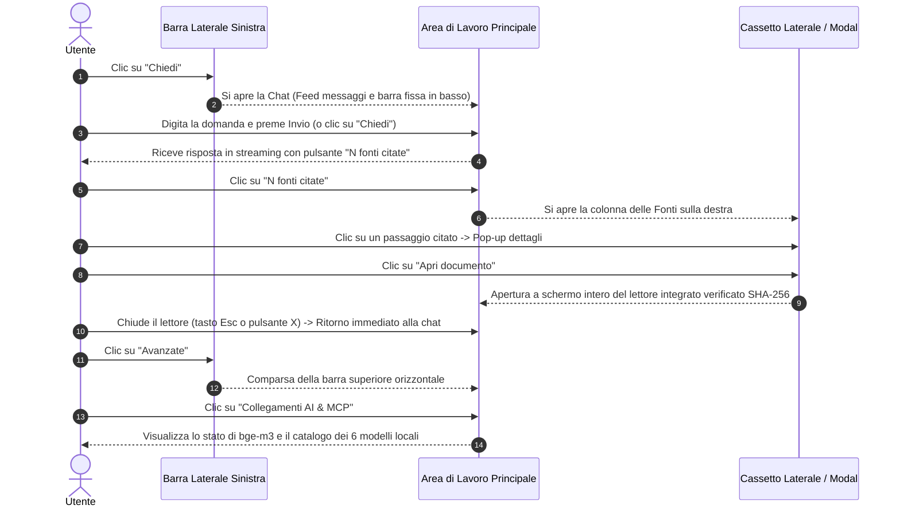
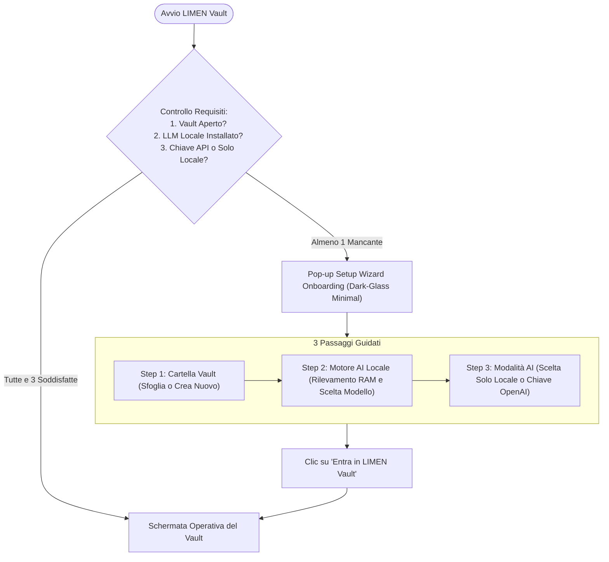
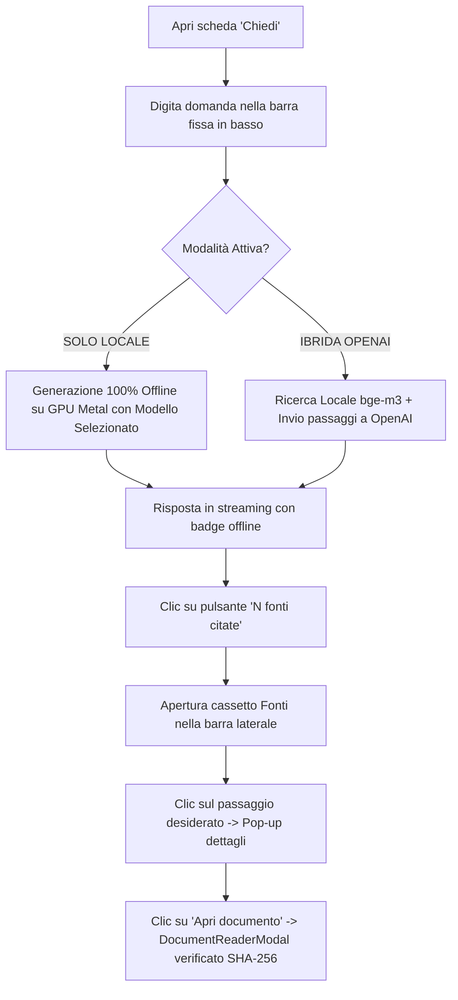
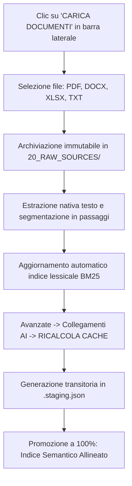
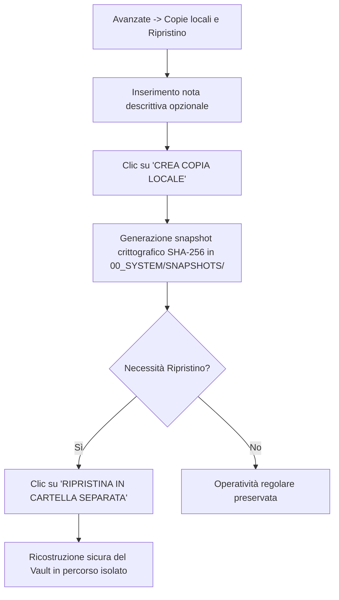

# LIMEN Vault v6Mini — Manuale Utente & Guida Operativa
Edizione italiana · Ottobre 2026 · Versione 0.6.0 (macOS / Windows)

---

## 1. Mappa di Navigazione dei Menu e Struttura dell'Interfaccia

LIMEN Vault è articolato attorno a **3 aree funzionali principali** sempre accessibili dalla barra laterale sinistra, più un pannello di gestione tecnica avanzata:

```mermaid
graph TD
    subgraph Sidebar["Barra Laterale Sinistra (Sempre Presente)"]
        UploadGlobal["🟢 PULSANTE 'CARICA DOCUMENTI' (Verde Lime)"]
        NavAsk["✦ 1. CHIEDI (Chat Continua & Ricerca Semantica)"]
        NavDocs["📁 2. DOCUMENTI (Archivio 20_RAW_SOURCES)"]
        NavMemory["📚 3. MEMORIA (Note Wiki Categorie 01-10)"]
        NavAdvanced["⚙️ 4. AVANZATE (Governance & Impostazioni)"]
        HistoryList["🕒 STORICO CONVERSAZIONI (Sessioni archiviate per data)"]
        ObsidianBtn["↗ 'Apri in Obsidian' (Apre la cartella nell'editor esterno)"]
    end

    subgraph AreaAsk["Area 1: CHIEDI"]
        ChatFeed["Feed Conversazione (Bolla Utente Verde / Assistente Bianca)"]
        ToggleLocal["Pulsante Toggle: 'SOLO LOCALE (Mac)'"]
        BarInput["Casella di Scrittura Fissa in Basso"]
        SourcesDrawer["Cassetto Laterale Destro: Fonti Citate"]
        DocReaderModal["Modal Lettore Documenti (Verifica SHA-256 e Paragrafo)"]
    end

    subgraph AreaDocs["Area 2: DOCUMENTI"]
        RawList["Tabella Documenti Grezzi (PDF, DOCX, XLSX, TXT)"]
        ExtractionStatus["Stato Estrazione & Conteggio Passaggi"]
        DocPreview["Visualizzatore Anteprima Testuale"]
    end

    subgraph AreaMemory["Area 3: MEMORIA"]
        CategoryNav["Filtro Categorie (01_CLIENTS ... 10_APPROVED)"]
        NotesGrid["Elenco Note Markdown & Validazione Frontmatter YAML"]
    end

    subgraph AreaAdvanced["Area 4: AVANZATE (Sottomenu Superiore Orizzontale)"]
        SubProposals["Bozze e Proposte (90_PROPOSALS/ - Approvazione Note)"]
        SubSnapshots["Copie Locali & Ripristino (Manifesto SHA-256 e Restore)"]
        SubTransfers["Trasferimenti (Sincronizzazione Cloud S3 / R2)"]
        SubAI["Collegamenti AI & Catalogo Modelli (bge-m3 + 6 LLM Locali)"]
        SubCompiler["Compilatore Manuale (Batch Markdown da Testo Grezzo)"]
        SubSystem["Stato di Sistema (Memoria RAM, Metal GPU, Diagnostic)"]
        SubHelp["Guida Vault (Documentazione Tecnica Integrata)"]
    end

    UploadGlobal -->|Apre il file picker nativo e porta in| AreaDocs
    NavAsk --> AreaAsk
    NavDocs --> AreaDocs
    NavMemory --> AreaMemory
    NavAdvanced --> AreaAdvanced

    ChatFeed -->|Clic su 'N fonti citate'| SourcesDrawer
    SourcesDrawer -->|Clic su 'Apri documento'| DocReaderModal
    AreaAdvanced --> SubProposals
    AreaAdvanced --> SubSnapshots
    AreaAdvanced --> SubTransfers
    AreaAdvanced --> SubAI
    AreaAdvanced --> SubCompiler
    AreaAdvanced --> SubSystem
    AreaAdvanced --> SubHelp
```



---

## 2. Come Operativamente ci si Muove nei Menu (Guida Passo-Passo)



### Regole Operative di Navigazione:
1. **Passaggio Istantaneo tra le Aree**: È sufficiente un clic sulle icone della barra laterale sinistra (**Chiedi**, **Documenti**, **Memoria**, **Avanzate**). Il passaggio non cancella il testo digitato né interrompe le risposte in streaming.
2. **Navigazione nei Sottomenu di Avanzate**: Entrando in **Avanzate**, la barra orizzontale in alto espone le 7 sezioni di governance. Un clic su ciascuna scheda apre immediatamente i relativi controlli (es. *Collegamenti AI* per scaricare modelli, *Copie locali* per creare snapshot).
3. **Cassetto Fonti e Lettore Integrato**: Cliccando su *"N fonti citate"* in calce a una risposta, la colonna destra mostra i documenti di provenienza. Cliccando su una fonte si apre il dettaglio con il testo del passaggio; cliccando su *"Apri documento"* si accede al file originale con evidenziazione del paragrafo e verifica SHA-256.
4. **Storico Conversazioni Persistente**: In fondo alla barra sinistra compare l'elenco dei thread passati. Cliccando su un titolo, l'intera conversazione viene ricaricata con tutte le sue fonti e citazioni originali.
5. **Caricamento Globale dei Documenti**: Il pulsante verde lime **"CARICA DOCUMENTI"** in alto a sinistra è sempre visibile. Permette di selezionare file da Finder/Explorer e avviare in tempo reale l'estrazione e l'indicizzazione semantica.

---

## 3. Workflow Operativi con Diagrammi Mermaid

### WORKFLOW 1: Configurazione Guidata al Primo Avvio (Setup Wizard)



---

### WORKFLOW 2: Interrogazione Aumentata, Citazione Fonti e Lettore Documenti



---

### WORKFLOW 3: Acquisizione Documenti e Ricalcolo Cache Semantica



---

### WORKFLOW 4: Gestione Snapshot Immutabili e Ripristino di Sicurezza



---

## 4. Catalogo Multi-Modello Locale e Vincoli Hardware (RAM)

LIMEN Vault supporta **6 modelli open-source instruction-tuned e reasoning** in formato GGUF (quantizzazione efficiente `Q4_K_M`):

| ID Modello | Nome Visualizzato | Peso GGUF | Context | RAM Minima | RAM Consigliata | Specializzazione |
| :--- | :--- | :--- | :--- | :--- | :--- | :--- |
| `ministral-3b` | **Ministral 3 3B Instruct** | ~2,06 GB | 32k | **8 GB** | 8–16 GB | Ultra-leggero e rapido; ideale per MacBook Air e macchine da 8 GB. |
| `ministral-8b` | **Ministral 3 8B Instruct** | ~4,92 GB | 32k | **16 GB** | 16–24 GB | Bilanciamento ottimale tra velocità su Metal GPU e ricchezza espressiva in italiano. |
| `qwen-2.5-7b` | **Qwen 2.5 7B Instruct** | ~4,68 GB | 32k | **16 GB** | 16–24 GB | Rigorosa aderenza alle istruzioni, estrazione tabelle e formattazione Markdown. |
| `llama-3.1-8b` | **Llama 3.1 8B Instruct (Meta)** | ~4,92 GB | 32k | **16 GB** | 16–24 GB | Standard industriale per sintesi esecutive, tone of voice e compiti generativi. |
| `deepseek-r1-7b` | **DeepSeek-R1-Distill-Qwen-7B** | ~4,68 GB | 32k | **16 GB** | 16–24 GB | **Ragionamento Profondo**: genera catena di pensiero (*Chain of Thought*) con blocco collassabile `<think>`. |
| `deepseek-r1-14b`| **DeepSeek-R1-Distill-Qwen-14B**| ~8,99 GB | 32k | **24 GB** | 32 GB+ | Massima potenza deduttiva locale per audit documentali e correlazioni complesse. |

---

## 5. Script di Utilità e Manutenzione Vault

All'interno del workspace sono disponibili due script Node.js collaudati ed eseguibili:

1. **Scanner e Rilevatore Automatico dei Vault:**
   ```bash
   node scripts/find_and_verify_vaults.mjs
   ```
   *Rileva in automatico tutti i Vault presenti sul Mac e verifica lo stato delle referenze.*

2. **Sanitizzatore Diretto Unico (Zero File di Backup):**
   ```bash
   # Sanitizza tutti i Vault rilevati sul sistema:
   node scripts/sanitize_vault.mjs

   # Oppure sanitizza uno specifico Vault:
   node scripts/sanitize_vault.mjs "tests/scratch/vault_collaudo_local_rag_v2"
   ```
   *Sostituisce le menzioni con `[RIFERIMENTO_RISERVATO]` preservando i file e senza generare copie di backup.*

---

## 6. Risoluzione Problemi Rapida

| Problema | Causa | Soluzione |
| :--- | :--- | :--- |
| **All'avvio si apre sempre il Setup Wizard** | Vault non aperto, o nessun modello scaricato, o chiave API mancante | Completa i 3 passaggi del Wizard: le impostazioni vengono salvate e l'onboarding non ricomparirà. |
| **Pulsante Chiedi non invia la domanda** | Consenso OpenAI disattivato in modalità cloud | Vai in **Avanzate → Collegamenti AI** e spunta il consenso, oppure attiva **"SOLO LOCALE (Mac)"**. |
| **Memoria GPU satura o rallentamenti su Mac 8 GB** | Selezionato modello troppo grande | Seleziona **Ministral 3 3B Instruct** (`ministral-3b`) progettato appositamente per configurazioni da 8 GB. |
| **Stato motore semantico: Non installato** | Modello bge-m3 non presente | In **Avanzate → Collegamenti AI**, clicca su **SCARICA MODELLO (635 MB)**. |
