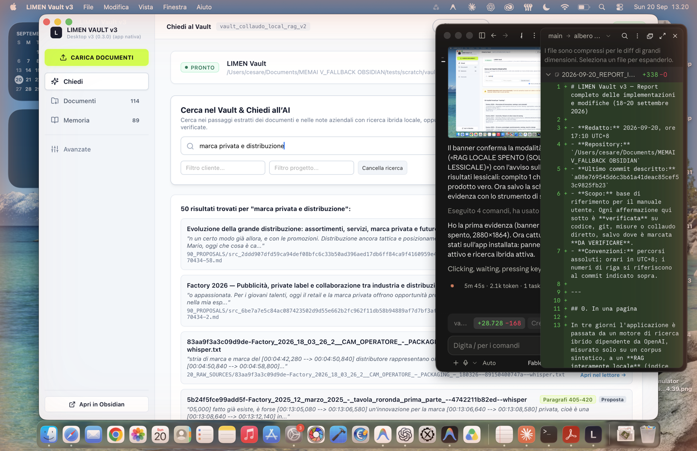
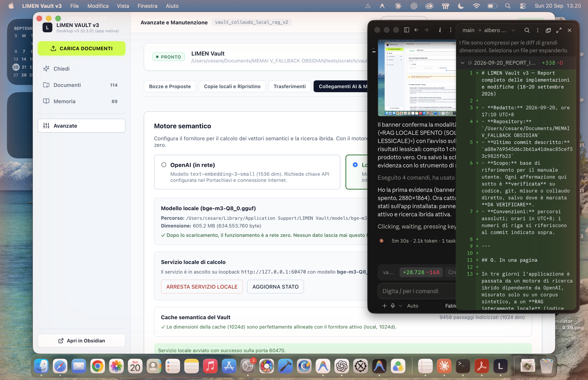
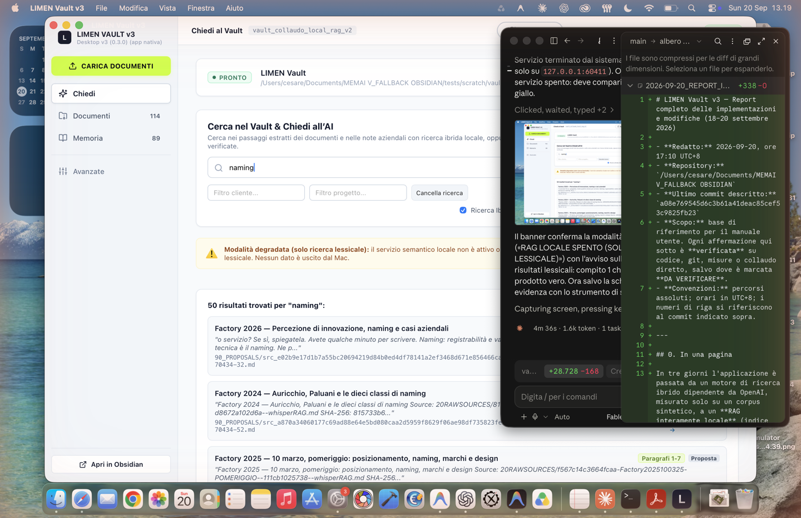
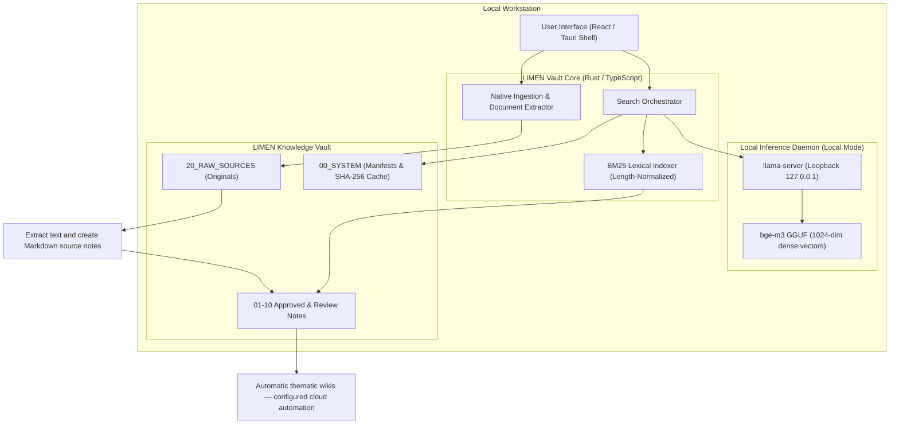

# LIMEN Vault

<p align="center">
  <strong>Turn Your Documents into Searchable Knowledge — RAG Search & Automatic Wikis</strong>
</p>

<p align="center">
  
  
  
  
</p>

---

## What is LIMEN Vault?

**LIMEN Vault** is a standalone, local-first desktop application that turns your documents into a searchable knowledge base. Import documents in supported formats: LIMEN extracts their text, converts it into Markdown, and indexes the resulting content for **RAG search**. With knowledge automation enabled and configured, it also generates **thematic wikis** from your sources.

You do not need to prepare Markdown files or use Obsidian. Markdown is the open storage format LIMEN produces from your documents; compatibility with Obsidian is optional.

## From Documents to Knowledge

1. **Import your documents.** Add supported text files, PDFs, office documents, spreadsheets, or images. Original files are preserved in the vault.
2. **Extract and convert.** LIMEN extracts readable text and creates Markdown source notes, retaining references to the originals. Supported scans and images use local OCR on macOS.
3. **Index and search.** The generated content becomes searchable through lexical BM25 and, when configured, semantic embeddings. RAG uses retrieved passages to ground AI answers in your documents.
4. **Generate wikis automatically.** The knowledge automation pipeline groups sources into thematic wiki pages with source references. Review generated content against its sources.

**Automation requirements:** The current automatic classification and wiki pipeline uses the OpenAI API and requires automation to be enabled, a configured model, an API key, and internet access. It sends source content to that provider. This is separate from local search and local generative answers; the complete automation pipeline is not an offline-only feature.

### Supported Input Formats

| Input | Formats handled by the import pipeline |
|---|---|
| Text and structured text | TXT, MD, Markdown, HTML/HTM, CSV, TSV, JSON, XML, YAML/YML, LOG, EML |
| Office documents | DOCX, PPTX, ODT; DOC and RTF conversion on macOS |
| Spreadsheets | XLS, XLSX, XLSB, ODS |
| PDF and images | PDF, PNG, JPG/JPEG, WEBP, GIF, TIF/TIFF, HEIC — native extraction/OCR on macOS |

Extraction depends on readable content, supported encodings, platform capabilities, and processing limits. Unsupported or unreadable files are not guaranteed to produce indexed text. Text extraction does not preserve every aspect of the original document layout.

---

## Who is it for?

- **People Working with Documents**: Researchers, consultants, and teams who want to search reports, notes, spreadsheets, and reference material without manually converting each file.
- **Knowledge Builders**: Anyone who wants to turn a collection of sources into linked, automatically generated thematic wikis.
- **Privacy-Sensitive Professionals**: Researchers, legal teams, and engineers whose data cannot leave the local workstation.
- **Developers & Systems Builders**: Anyone seeking a lightweight, auditable Tauri v2 application built in Rust and React instead of heavy containerized stacks.

---

## Operating Modes: Local vs. Hybrid

LIMEN Vault provides distinct architectural boundaries between local and cloud operations:

| Capability | 100% Local Mode | Hybrid Mode (Optional) |
|---|---|---|
| **Network Profile** | **Local Loopback Scope**: Semantic embedding and retrieval calls communicate over `127.0.0.1`. Network isolation was verified via socket inspection (`lsof`) on build `a08e769` (2026-09-20); a full OS-level sandbox audit has not been conducted. | Outbound HTTPS calls to external AI APIs |
| **Prerequisites (Search)** | Requires one-time local download of the `bge-m3` GGUF embedding model (~1.2 GB). | Local BM25 or optional cloud vector endpoints |
| **Prerequisites (Generative Chat)** | Requires a local generative LLM (such as `Ministral 3 3B Instruct`, ~2.5 GB). *Note: `bge-m3` is an embedding model for vector search; it does not generate natural language answers.* | User-provided API key (e.g. OpenAI) & active internet connection |
| **Data Privacy** | Notes, chunks, and embeddings are processed on the local machine via loopback daemon | Selected context excerpts are transmitted to the cloud API endpoint |

---

## Key Features

- 🔒 **Local Loopback Communication**: In Local Mode, embedding generation and vector scoring communicate over loopback `127.0.0.1`.
- ⚡ **Hybrid Search**: Fuses length-normalized BM25 lexical ranking (for exact terms, codes, and acronyms) with dense semantic vectors (`bge-m3`).
- 🛡️ **Automatic Degraded Fallback**: If the local AI inference process is unavailable or stopped, search automatically switches to lexical BM25 matching, displaying an advisory warning banner so queries can proceed against the lexical index.
- 📄 **Document-to-Knowledge Pipeline**: Preserves original documents, extracts their text, converts it into Markdown source notes, and makes the generated content available for indexing and retrieval.
- 📚 **Automatic Wiki Generation**: With knowledge automation configured, synthesizes thematic pages from multiple documents with references to supporting sources.
- 💬 **RAG Answers**: Uses retrieved document passages as context for answers from the configured local or cloud language model.
- 📂 **Open Storage & Optional Obsidian Compatibility**: Uses standard Markdown files (`.md`), YAML frontmatter, and wiki-link conventions (`[[Note]]`). No proprietary database lock-in.
- 🖥️ **Desktop Shell**: Built with **Tauri v2** (Rust backend and React webview) to avoid bundling a separate Chromium runtime as required by Electron architectures.
- 🧙 **3-Step Setup Wizard**: First-run onboarding to select your vault directory, configure the local AI engine, and select operational mode.

### Application Previews

> *Note: These are historical verification captures from desktop build v3 (0.3.0, 20 September 2026) using synthetic test data (`vault_collaudo_local_rag_v2`). The v7Mini 0.7.0 release retains this core screen layout and workflow; updated v7Mini captures are pending live GUI recording sessions.*

| Hybrid Search (Active) | Semantic Engine Settings | Degraded Fallback Mode |
|---|---|---|
|  |  |  |

---

## Architecture



---

## Platform Availability & Status

- **macOS (Apple Silicon — ARM64)**: Primary verified desktop target.
- **Windows 11 (x64)**: Preview implementation actively developed on the `windows-build` branch.
- **Linux**: Planned for future development milestones.

---

## Getting Started

### Option A: Pre-compiled Build (macOS Apple Silicon)

Heavy release binaries are intentionally omitted from the `main` source branch to keep the repository lightweight. A pre-compiled, Apple-notarized build for macOS Apple Silicon (`v7Mini 0.7.0`, ~49 MB) is hosted on GitHub and available via the direct verified link below:

📥 **[Download LIMEN-Vault-v7Mini.dmg (macOS Apple Silicon)](https://github.com/Arkai-Italia/Limen-vault/raw/windows-build/USER%20INSTALL/LIMEN-Vault-v7Mini.dmg)**

*Note: Future stable release tags will attach standalone binary packages directly to GitHub Releases.*

**Installation & First Run:**
1. Download and open `LIMEN-Vault-v7Mini.dmg`, then drag **LIMEN Vault** into your `/Applications` folder.
2. The application bundle is signed and notarized with an Apple Developer ID (`Arkitecna Hong Kong Limited`). If prompted by macOS Gatekeeper on first open, confirm to allow.
3. Complete the 3-step **Setup Wizard**:
   - **Step 1: Vault Folder**: Select the folder for your LIMEN knowledge vault; Obsidian is not required.
   - **Step 2: Local AI Engine**: Verify local loopback embedding engine (`bge-m3`) status and initialization on `127.0.0.1`.
   - **Step 3: Mode & Optional API Key**: Choose **100% Local** mode (offline) or **Hybrid** mode (cloud LLM).

---

### Option B: Build & Run from Source

#### Prerequisites
- **Node.js** (`>= 20.0.0`) & **pnpm** (`>= 9.0.0`)
- **Rust & Cargo** (latest stable release)
- **macOS** (14.0+ Apple Silicon) or **Windows 11** (preview)

```bash
# 1. Clone the repository
git clone https://github.com/Arkai-Italia/Limen-vault.git
cd Limen-vault

# 2. Install monorepo dependencies
pnpm install

# 3. Run test suites and prohibited dependency guards
pnpm test
pnpm typecheck

# 4. Run Desktop Application with Tauri backend (includes IPC & BM25 engine)
pnpm --filter @limen-vault/desktop tauri dev

# Note: For frontend-only UI layout prototyping without Tauri native backend:
# pnpm dev:desktop
```

#### Native Engine & Source Limitations Notes for Developers
- **Pre-compiled native binaries & Packaging Limitations**: Standalone release packaging for macOS Apple Silicon (`v7Mini`) relies on pre-compiled native binaries (such as `llama-server` with GGML Metal acceleration) and internal release notarization pipelines that are intentionally omitted from the public `main` branch. Creating a fully self-contained `.dmg` installer is not reproducible directly from this public repository alone; developers should use the pre-compiled installer in Option A or run the app locally via `tauri dev`.
- **Local AI Embedding Engine Lifecycle**: When local semantic retrieval is enabled, the Rust backend automatically manages its own internal `llama-server` subprocess hosting `bge-m3-Q8_0.gguf` (1024 dimensions). The binary is detected from standard system paths or via the `LLAMA_SERVER_PATH` environment variable. The backend dynamically allocates an available ephemeral loopback port on `127.0.0.1` (`find_free_port`) rather than binding to a fixed port, and does not connect to arbitrary third-party server endpoints.
- **BM25 Lexical Engine & Desktop Runtime**: Vault document indexing and BM25 lexical search are implemented in Rust within the Tauri application. In the desktop application, BM25 operates as a reliable, fully local fallback whenever semantic embeddings are offline or unconfigured. Running the frontend alone (`pnpm dev:desktop`) in a standard web browser serves only web UI assets and cannot access the local filesystem or run IPC search queries.

---

## Monorepo Structure

```text
├── apps/
│   ├── desktop/          # Tauri v2 native desktop app (React + TypeScript + Rust)
│   └── web/              # Next.js web application shell
├── packages/
│   ├── ui/               # Shared Design System
│   ├── vault-core/       # Core Vault interfaces & filesystem security guards
│   ├── vault-schema/     # Zod schemas & TypeScript domain contracts
│   ├── search-engine/    # BM25 and hybrid retrieval engine
│   └── snapshot-engine/  # Versioned snapshots & SHA-256 integrity verification
├── vault-template/       # Knowledge structure for imported sources and generated notes
├── docs/assets/          # Public documentation previews and screenshots
└── scripts/              # Monorepo build and packaging tooling
```

---

## Known Limitations

- **Automatic Wikis**: The current knowledge automation pipeline requires OpenAI configuration and internet access; local search availability does not imply offline wiki generation.
- **Document Extraction**: Support depends on format and platform. PDF/image extraction and legacy DOC/RTF conversion currently require macOS.

- **Model Download Prerequisite**: Semantic vector search requires placing the `bge-m3` GGUF model file into your local model cache before dense vector scoring is available.
- **Windows Platform**: The Windows build is currently in preview and under active testing.
- **Open Source License**: License selection is currently being finalized by the maintainer.

---

## Contributing

We welcome community feedback, bug reports, and code contributions:
1. Please open a GitHub Issue with reproducible steps for bugs or feature proposals.
2. Ensure all automated tests (`pnpm test`) pass before submitting pull requests.

---

## License

*License decision pending: The project license is currently being finalized by the maintainer.*
