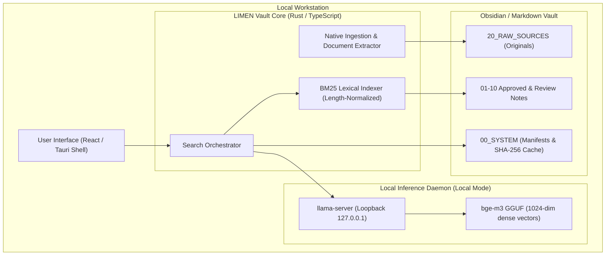

# LIMEN Vault

<p align="center">
  <strong>Local-First AI Knowledge Engine & Hybrid Search for Markdown & Obsidian Vaults</strong>
</p>

<p align="center">
  
  
  
  
</p>

---

## What is LIMEN Vault?

**LIMEN Vault** is a standalone, local-first desktop application designed to connect to Markdown knowledge bases (compatible with **Obsidian**) to provide localized AI search and document ingestion.

By utilizing an embedded `llama-server` background process, LIMEN Vault performs dense semantic vector embedding (`bge-m3`, 1024 dimensions) and combines it with length-normalized lexical search (**BM25**).

---

## Who is it for?

- **Obsidian & Markdown Users**: Anyone managing personal notes, research papers, or documentation in standard `.md` files who wants conceptual retrieval without cloud lock-in.
- **Privacy-Sensitive Professionals**: Researchers, legal teams, and engineers whose data cannot leave the local workstation.
- **Developers & Systems Builders**: Anyone seeking a lightweight, auditable Tauri v2 application built in Rust and React instead of heavy containerized stacks.

---

## Operating Modes: Local vs. Hybrid

LIMEN Vault provides distinct architectural boundaries between local and cloud operations:

| Capability | 100% Local Mode | Hybrid Mode (Optional) |
|---|---|---|
| **Network Profile** | **Local Loopback Scope**: Semantic embedding and retrieval calls communicate over `127.0.0.1`. Network isolation was verified via socket inspection (`lsof`) on build `a08e769` (2026-09-20); a full OS-level sandbox audit has not been conducted. | Outbound HTTPS calls to external AI APIs |
| **Prerequisites (Search)** | Requires one-time local download of the `bge-m3` GGUF embedding model (~1.2 GB). | Local BM25 or optional cloud vector endpoints |
| **Prerequisites (Generative Chat)** | Requires a local generative LLM (such as `Ministral 3 3B Instruct`, ~2.5 GB). *Note: `bge-m3` is an embedding model for vector search; it does not generate natural language answers.* | User-provided API key (e.g. OpenAI) & active internet connection |
| **Data Privacy** | Notes, chunks, and embeddings are processed on the local machine via loopback daemon | Selected context excerpts are transmitted to the cloud API endpoint |

---

## Key Features

- 🔒 **Local Loopback Communication**: In Local Mode, embedding generation and vector scoring communicate over loopback `127.0.0.1`.
- ⚡ **Hybrid Search**: Fuses length-normalized BM25 lexical ranking (for exact terms, codes, and acronyms) with dense semantic vectors (`bge-m3`).
- 🛡️ **Automatic Degraded Fallback**: If the local AI inference process is unavailable or stopped, search automatically switches to lexical BM25 matching, displaying an advisory warning banner so queries can proceed against the lexical index.
- 📄 **Native Document Ingestion**: Ingests PDFs, Word documents (`.docx`), Excel spreadsheets (`.xlsx`), and plain text into the vault's `20_RAW_SOURCES` directory with native text extraction.
- 📂 **Native Obsidian Compatibility**: Uses standard Markdown files (`.md`), YAML frontmatter, and wiki-link conventions (`[[Note]]`). No proprietary database lock-in.
- 🖥️ **Desktop Shell**: Built with **Tauri v2** (Rust backend and React webview) to avoid bundling a separate Chromium runtime as required by Electron architectures.
- 🧙 **3-Step Setup Wizard**: First-run onboarding to select your vault directory, configure the local AI engine, and select operational mode.

### Application Previews

> *Note: These are historical verification captures from desktop build v3 (0.3.0, 20 September 2026) using synthetic test data (`vault_collaudo_local_rag_v2`). The v7Mini 0.7.0 release retains this core screen layout and workflow; updated v7Mini captures are pending live GUI recording sessions.*

| Hybrid Search (Active) | Semantic Engine Settings | Degraded Fallback Mode |
|---|---|---|
|  |  |  |

---

## Architecture



---

## Platform Availability & Status

- **macOS (Apple Silicon — ARM64)**: Primary verified desktop target.
- **Windows 11 (x64)**: Preview implementation actively developed on the `windows-build` branch.
- **Linux**: Planned for future development milestones.

---

## Getting Started

### Option A: Standalone Pre-Release Build (macOS Apple Silicon)

A pre-compiled build for macOS Apple Silicon (`v7Mini 0.7.0`) is included in the repository tree for testing:
- **Repository path**: `USER INSTALL/LIMEN-Vault-v7Mini.dmg`
- *Note*: This binary is tracked in git as a testing build. Official standalone GitHub Release assets will be attached to future repository release tags.

**Running the macOS App:**
1. Open `USER INSTALL/LIMEN-Vault-v7Mini.dmg` and drag **LIMEN Vault** into `/Applications`.
2. First-run note: If macOS Gatekeeper alerts about an unnotarized or unsigned binary from the web, right-click (or Control-click) `LIMEN Vault.app` and choose **Open**.
3. Complete the 3-step **Setup Wizard**:
   - **Step 1: Vault Folder**: Select an existing Obsidian vault directory.
   - **Step 2: Local AI Engine**: Confirm local loopback engine configuration.
   - **Step 3: Mode & Optional API Key**: Select 100% Local mode or Hybrid mode.

### Option B: Build & Run from Source

#### Prerequisites
- **Node.js** (>= 20.0.0) & **pnpm** (>= 9.0.0)
- **Rust & Cargo** (latest stable)
- **macOS** (14.0+ Apple Silicon) or **Windows 11**

```bash
# 1. Clone the repository
git clone https://github.com/cesarenegro/Limen-vault.git
cd Limen-vault

# 2. Install monorepo dependencies
pnpm install

# 3. Run Desktop Application in development mode
pnpm dev:desktop

# 4. Run test suites and prohibited dependency guards
pnpm test
pnpm typecheck
```

---

## Monorepo Structure

```text
├── apps/
│   ├── desktop/          # Tauri v2 native desktop app (React + TypeScript + Rust)
│   └── web/              # Next.js web application shell
├── packages/
│   ├── ui/               # Shared Design System
│   ├── vault-core/       # Core Vault interfaces & filesystem security guards
│   ├── vault-schema/     # Zod schemas & TypeScript domain contracts
│   ├── search-engine/    # BM25 and hybrid retrieval engine
│   └── snapshot-engine/  # Versioned snapshots & SHA-256 integrity verification
├── vault-template/       # Standard Obsidian-compatible knowledge structure
├── docs/                 # Architectural specifications and engineering guides
├── DOCUMENTATION_SOURCE_PACKAGE/ # Exhaustive user guides, screenshots & QA packages
└── USER INSTALL/         # Pre-built release binaries (v7Mini DMG)
```

---

## Known Limitations

- **Model Download Prerequisite**: Semantic vector search requires placing the `bge-m3` GGUF model file into your local model cache before dense vector scoring is available.
- **Windows Platform**: The Windows build is currently in preview and under active testing.
- **Open Source License**: License selection is currently being finalized by the maintainer.

---

## Contributing

We welcome community feedback, bug reports, and code contributions:
1. Please open a GitHub Issue with reproducible steps for bugs or feature proposals.
2. Ensure all automated tests (`pnpm test`) pass before submitting pull requests.

---

## License

*License decision pending: The project license is currently being finalized by the maintainer.*
