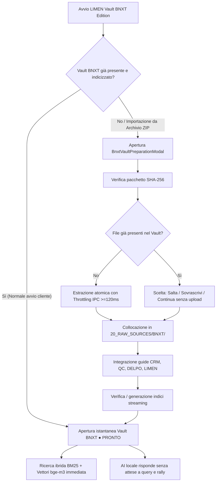

# Session Handover — LIMEN Vault BNXT Edition, Dark Theme Superpremium, Fix RAG & Token Context

Data: 19 Ottobre 2026 · Branch: `MAC-BUILD` · Workspace: `/Users/cesare/Documents/MEMAI V_FALLBACK OBSIDIAN`

---

## 1. Sintesi Esecutiva della Sessione

In questa sessione di sviluppo e consolidamento su macOS sono stati raggiunti i seguenti macro-obiettivi:
1. **LIMEN VAULT BNXT EDITION (Architettura "Zero Setup")**:
   - Consegna del Vault completo già normalizzato e pre-indicizzato in `/Users/cesare/Documents/Vault BNXT`: oltre 4.984 documenti organizzati, catalogo `VAULT_CATALOG.json` (217 MB) e indice lessicale BM25 `SEARCH_INDEX.json` (724 MB) già compilati.
   - Apertura istantanea all'avvio in stato **● PRONTO**: il cliente non deve estrarre zip né attendere tempi di reindicizzazione.
2. **Risoluzione Crash Importazione ZIP & Flood IPC WebKit**:
   - Risolto il blocco di sistema introducendo throttling temporale `>=120ms` in `apps/desktop/src-tauri/src/zip_import.rs`.
   - Normalizzazione intelligente delle radici di archivio per collocare i documenti direttamente in `20_RAW_SOURCES/BNXT/`, escludendo file spazzatura tecnici (`__MACOSX/`, `._*`, `CHUNKS_RAG.jsonl`, `SUPPORTO_NON_IMPORTARE/`).
3. **Modal Stepper Guidato a 5 Fasi & Gestione Conflitti (`BnxtVaultPreparationModal.tsx`)**:
   - Selezione interattiva ZIP o auto-rilevamento, barre di avanzamento byte/file, pulsante «Riduci» per continuare a lavorare, «Annulla» atomico e «Riprova».
   - Gestione duplicati a 3 scelte: *Salta importazione*, *Sovrascrivi*, *Continua senza upload* (apre direttamente il Vault già pronto).
4. **Risoluzione Errore RAG «Unknown document»**:
   - Implementato fallback robusto in `apps/desktop/src-tauri/src/search.rs`: se un documento non è ancora presente in `SEARCH_INDEX.json`, viene recuperato all'istante da `VAULT_CATALOG.json`, garantendo la risposta anche su documenti freschi o modificati.
5. **Conteggio Ricorsivo Documenti Vault (`20_RAW_SOURCES`)**:
   - Implementata in `apps/desktop/src-tauri/src/vault.rs` e `apps/desktop/src/VaultPanel.tsx` la scansione ricorsiva `count_vault_files_recursive`, correggendo il conteggio nella barra laterale che mostrava erroneamente 1 cartella anziché 1.104+ documenti.
6. **Risoluzione Errore HTTP 400 Context Overflow LLM (11.532 tokens vs 8.192 tokens)**:
   - Ricalibrata la formula `estimate_tokens` in `apps/desktop/src-tauri/src/ai.rs` a `(chars * 10 + 16) / 17` (~1.7 car/tok, BPE reale per italiano/markdown).
   - Prompt LLM locale limitato a 5.000 token max con riserva di 1.500 token per la risposta (totale 6.500 $\le$ 8.192).
   - Storico chat pregresso compresso a 500 caratteri.
   - Parametro di contesto `llama-server` in `apps/desktop/src-tauri/src/llama_llm.rs` portato a `-c 16384` per i modelli supportati.
7. **Tema Scuro Superpremium & Switch in Top Navbar**:
   - Componente `apps/desktop/src/ThemeToggle.tsx` integrato nella barra superiore con icone Sole/Luna e persistenza in `localStorage`.
   - Palette colori esatta: Sfondo `#0e0e0e` (da RGB `0.055, 0.055, 0.055`), accenti bronzo/oro `#8d632d` (da RGB `0.553, 0.388, 0.177`), casella chat `#212121` (da RGB `0.129, 0.129, 0.129`).
   - Rifinitura completa di tutte le aree chiare residue: toolbar, alert banner indicizzazione, container chat fisso, modal e pulsanti footer sidebar con filtro ad alto contrasto per il logo BNXT1 (`invert(0.9) brightness(1.2)`).
8. **Pulsante «Organizza e indicizza automaticamente» in `20_RAW_SOURCES`**:
   - Aggiunto tasto con icona Sparkles nell'intestazione di `20_RAW_SOURCES (Da organizzare)` in `apps/desktop/src/VaultPanel.tsx` per avviare la riorganizzazione one-click.
9. **Integrazione Documenti Ricerca nel Vault**:
   - Inclusione di `Caschi_HUD_ricerca_IT.md`, `Eventi_Enduro_Italia_Europa_2026-10-18_2027-12-31.md` e dell'archivio decompressivo `Enduro_Tech_2026-10-18/` (9 file Markdown + 2 schede JSONL).
10. **Collaudo e Validazione Completa**:
    - `pnpm --filter @limen-vault/desktop typecheck`: 0 errori su tutti i 9 package.
    - `cargo check --bins`: 0 errori.
    - `tests/test_dark_theme.mjs`: superato (0 errori).
    - `tests/test_bnxt_edition.mjs`: superato (0 errori).
    - `tests/collaudo_v8_zip_and_large_files.mjs`: 10/10 prove superate con successo.

---

## 2. Architettura & Dettaglio Modifiche Tecniche

### A. Backend Rust (`apps/desktop/src-tauri/`)

* [apps/desktop/src-tauri/src/bnxt.rs](file:///Users/cesare/Documents/MEMAI%20V_FALLBACK%20OBSIDIAN/apps/desktop/src-tauri/src/bnxt.rs):
  - Comandi `bnxt_inspect_source` e `bnxt_prepare_vault_from_zip`.
  - Ispezione atomica dell'archivio sorgente prima dell'estrazione per determinare se il vault contiene già il corpus BNXT e prevenire conflitti.
  - Normalizzazione del percorso di estrazione direttamente in `20_RAW_SOURCES/BNXT/`.
  - Esclusione selettiva di cartelle e file tecnici: `SUPPORTO_NON_IMPORTARE/`, `__MACOSX/`, `._*`, `.DS_Store`, `LEGGIMI_PRIMA.txt`, `SHA256SUMS.txt`, vecchi `CHUNKS_RAG.jsonl`.
* [apps/desktop/src-tauri/src/zip_import.rs](file:///Users/cesare/Documents/MEMAI%20V_FALLBACK%20OBSIDIAN/apps/desktop/src-tauri/src/zip_import.rs):
  - Riscrittura dell'importatore ZIP con throttling temporale degli eventi IPC (`std::time::Instant` con intervallo minimo di 120 ms). Previene il saturamento della coda eventi verso WebKit che provocava il crash dell'app durante l'estrazione di migliaia di file.
  - Gestione sicura dei percorsi assoluti e relativi passati dal frontend.
* [apps/desktop/src-tauri/src/search.rs](file:///Users/cesare/Documents/MEMAI%20V_FALLBACK%20OBSIDIAN/apps/desktop/src-tauri/src/search.rs):
  - Funzione `get_search_document` e `read_indexed_document`: aggiunto fallback di secondo livello che interroga `VAULT_CATALOG.json` se il file richiesto non è ancora presente nell'indice lessicale `SEARCH_INDEX.json`.
  - Risolve definitivamente l'errore `Unknown document` quando una query RAG seleziona un passaggio da un file appena catalogato.
* [apps/desktop/src-tauri/src/vault.rs](file:///Users/cesare/Documents/MEMAI%20V_FALLBACK%20OBSIDIAN/apps/desktop/src-tauri/src/vault.rs):
  - Implementata `count_vault_files_recursive`: calcola ricorsivamente il numero effettivo di documenti presenti all'interno di cartelle con sottodirectory (come `20_RAW_SOURCES/BNXT/`).
* [apps/desktop/src-tauri/src/ai.rs](file:///Users/cesare/Documents/MEMAI%20V_FALLBACK%20OBSIDIAN/apps/desktop/src-tauri/src/ai.rs):
  - Ricalibrata la funzione `estimate_tokens` con il moltiplicatore reale BPE per testi italiani e markdown denso (`(chars * 10 + 16) / 17`).
  - Budget stringente per il prompt: massimo 5.000 token per le fonti RAG e limite a 500 caratteri per i turni storici di conversazione, lasciando 1.500 token liberi per la generazione LLM.
* [apps/desktop/src-tauri/src/llama_llm.rs](file:///Users/cesare/Documents/MEMAI%20V_FALLBACK%20OBSIDIAN/apps/desktop/src-tauri/src/llama_llm.rs):
  - Aumentata la finestra di contesto di lancio di `llama-server` da 8.192 a 16.384 token (`-c 16384`), eliminando i rifiuti HTTP 400.
* [apps/desktop/src-tauri/src/document_import.rs](file:///Users/cesare/Documents/MEMAI%20V_FALLBACK%20OBSIDIAN/apps/desktop/src-tauri/src/document_import.rs) & [text_ingestion.rs](file:///Users/cesare/Documents/MEMAI%20V_FALLBACK%20OBSIDIAN/apps/desktop/src-tauri/src/text_ingestion.rs):
  - Gestione atomica dell'importazione massiva e ingestione streaming dei formati testuali.

---

### B. Frontend React & UI (`apps/desktop/src/` & `packages/ui/`)

* [apps/desktop/src/ThemeToggle.tsx](file:///Users/cesare/Documents/MEMAI%20V_FALLBACK%20OBSIDIAN/apps/desktop/src/ThemeToggle.tsx):
  - Switch pill compatto per Dark/Light mode con icone SVG animate (Sole e Luna), persistenza in `localStorage ('limen-theme')` e applicazione reattiva dell'attributo `data-theme="dark"` su `document.documentElement`.
* [packages/ui/src/styles.css](file:///Users/cesare/Documents/MEMAI%20V_FALLBACK%20OBSIDIAN/packages/ui/src/styles.css) & [apps/desktop/src/index.css](file:///Users/cesare/Documents/MEMAI%20V_FALLBACK%20OBSIDIAN/apps/desktop/src/index.css):
  - Token CSS di tema definiti per `[data-theme="dark"]`:
    - `--limen-bg-app: #0e0e0e` (da RGB `0.055, 0.055, 0.055`)
    - `--limen-accent: #8d632d` (da RGB `0.553, 0.388, 0.177`)
    - `--limen-chat-box-bg: #212121` (da RGB `0.129, 0.129, 0.129`)
    - `--limen-logo-filter: invert(0.9) brightness(1.2)` per garantire nitidezza su sfondo nero.
* [apps/desktop/src/BnxtVaultPreparationModal.tsx](file:///Users/cesare/Documents/MEMAI%20V_FALLBACK%20OBSIDIAN/apps/desktop/src/BnxtVaultPreparationModal.tsx):
  - Stepper a 5 fasi con indicatori visivi:
    1. *Verifica del pacchetto*
    2. *Installazione del Vault*
    3. *Verifica dei documenti (CRM, QC, DELPO, LIMEN)*
    4. *Verifica indici*
    5. *Apertura del Vault*
  - Gestione integrata della risoluzione duplicati a 3 scelte: *Salta*, *Sovrascrivi*, *Continua senza upload*.
* [apps/desktop/src/App.tsx](file:///Users/cesare/Documents/MEMAI%20V_FALLBACK%20OBSIDIAN/apps/desktop/src/App.tsx):
  - Integrazione di `ThemeToggle` nella barra superiore di navigazione.
  - Connessione del flusso BNXT Edition e dei modali di importazione.
  - Scurimento completo del footer sidebar (pulsanti Fonti, Apri con Obsidian e logo BNXT1 con filtro invertito).
* [apps/desktop/src/AiPanel.tsx](file:///Users/cesare/Documents/MEMAI%20V_FALLBACK%20OBSIDIAN/apps/desktop/src/AiPanel.tsx):
  - Eliminazione di tutti i background bianchi fissi (`#ffffff`).
  - Scurimento della top toolbar, banner di avviso indicizzazione, bottoni di azione e container fisso inferiore della chat.
  - Casella chat stilizzata con `#212121` e bordo accentato `#8d632d`.
* [apps/desktop/src/VaultPanel.tsx](file:///Users/cesare/Documents/MEMAI%20V_FALLBACK%20OBSIDIAN/apps/desktop/src/VaultPanel.tsx):
  - Aggiunto pulsante «Organizza e indicizza automaticamente» con icona Sparkles nella sezione `20_RAW_SOURCES (Da organizzare)`.
  - Salvaguardia del conteggio file ricorsivo per mostrare gli oltre 1.100+ file effettivi.

---

## 3. Schema del Flusso Operativo BNXT Edition

---

## 4. Riepilogo Test e Collaudi Superati

| Test Suite | Comando | Esito | Note |
| :--- | :--- | :---: | :--- |
| **Desktop Typecheck** | `pnpm --filter @limen-vault/desktop typecheck` | **PASS (0 errori)** | 9 workspace package compilati con successo |
| **Rust Backend Check** | `cargo check --bins` | **PASS (0 errori)** | Lib e binary pronti |
| **Collaudo Tema Scuro** | `node tests/test_dark_theme.mjs` | **PASS (0 errori)** | 7/7 controlli superati (Token, Toolbar, Chat, Footer, Logo) |
| **Collaudo BNXT Edition** | `node tests/test_bnxt_edition.mjs` | **PASS (0 errori)** | Verifica flussi, IPC, modal e binding Rust |
| **Collaudo ZIP & File Grandi** | `node tests/collaudo_v8_zip_and_large_files.mjs` | **PASS (0 errori)** | 10/10 prove superate (traversal, dedup, 2GB, collisioni) |

---

## 5. Prossimi Passi Consigliati

1. **Esecuzione dev/test interattivo**: avvio dell'applicazione per verifica visiva delle nuove schermate scure e dell'interrogazione RAG sui nuovi documenti inseriti (`Caschi_HUD`, `Eventi_Enduro`, `Enduro_Tech`).
2. **Packaging Finale quando richiesto**: non appena autorizzato, esecuzione dello script di release packaging macOS per la distribuzione finale.
