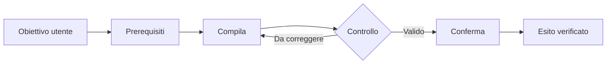

# APP USER MANUAL OS
## Bibbia operativa per manuali utente premium, verificabili, aggiornabili e coerenti fra tutte le applicazioni

> **Versione:** 0.2.0 — Brand Design System Gate + LIMEN PDF benchmark  
> **Data:** 11 ottobre 2026  
> **Ambito:** qualsiasi software prodotto dall'organizzazione: web app, SaaS, CRM, ERP, PWA, desktop, mobile, AI, marketplace e applicazioni verticali.  
> **Stato:** standard operativo aggiornato con ispezione del PDF LIMEN finale; non certifica la corrispondenza pixel-perfect fra PDF e frontend perché il Design System sorgente non è stato fornito.  
> **Regole primarie:** (1) nessuna schermata, opzione, procedura, integrazione o risultato può essere descritta come funzionante senza prova adeguata; **(2) ogni manuale deve acquisire, versionare e applicare il Design System della propria applicazione prima dell'impaginazione finale**.

---

## 00 — Perché esiste questo manuale

Questo documento governa **come realizziamo manuali utente**, non come si usa una specifica app. Ogni nuovo prodotto deve poter generare un manuale con la stessa grammatica editoriale, lo stesso livello di qualità, la stessa procedura di acquisizione e le stesse regole di aggiornamento; **aspetto, tipografia, palette e componenti si derivano dal Design System specifico della singola app**, non da un tema fisso. Il brand e i contenuti funzionali cambiano di prodotto in prodotto.

**Obiettivo:** produrre da una fonte controllata un manuale premium che un nuovo utente possa seguire davvero, leggibile a video e su carta, accurato rispetto alla release documentata, verificabile e mantenibile.

### Che cosa significa «manuale premium»

- **Utilità verificabile:** consente di completare le operazioni senza interpretare schermate o inventare passaggi.
- **Design editoriale:** composizione ordinata, testo leggibile, immagini nitide, gerarchia tipografica coerente, ritmo e spazio bianco.
- **Navigazione:** indice, sezioni e procedure reperibili, segnalibri/link ove supportati.
- **Fedeltà al prodotto:** tutti i nomi di pulsanti, campi, stati e messaggi corrispondono alla release osservata.
- **Trasparenza:** operazioni testate live, verificate solo nel codice, simulate, non provate e non disponibili sono differenziate.
- **Continuità:** si può rigenerare dopo una nuova release, senza ricostruire a mano l'intero documento.

### Standard di partenza ricavato da LIMEN CRM

**Fonte direttamente esaminata:** `MANUALE UTENTE CRM LIMEN.md` (29 agosto 2026, 1.336 righe, nella Libreria ChatGPT). È una documentazione operativa di un CRM reale con sezioni, tabelle, screenshot referenziati a `./manuale_crm_limen_assets/`, diagrammi Mermaid, procedure, avvisi, troubleshooting, registro delle verifiche e riferimenti tecnici.

**Seconda fonte esaminata:** `MANUALE UTENTE M3MAI IN CRM LIMEN.MD`, anch'esso nella Libreria, dedicato al sottosistema di memoria e ai relativi workflow.

**Terza fonte esaminata direttamente (11/10/2026):** `MANUALE_OPERATIVO_LIMEN_COMPLETO_v1.pdf`, 105 pagine, formato PDF A4 orizzontale misurato a circa **841,9 × 595,3 pt**. La copertina riprende il logo LIMEN e il linguaggio grafico del progetto; il corpo usa titoli di sezione con un accento vivace, layout arioso, tabelle, diagrammi e screenshot. Le pagine 2–7 orientano l'utente; le pagine 8–39 contengono **16 schede “Come fare”**, ciascuna articolata in pagina procedura + pagina diagramma; le pagine 40–95 documentano i moduli e le schermate; le pagine 96–105 contengono controlli, troubleshooting e architettura.

**Misurazioni effettuate sul PDF, non sul frontend:** le pagine campione contengono font identificati nel PDF come `NotoSerif-Regular`, `NotoSerif-Bold` e, in alcuni casi, `NotoSerif-Italic`, non Inter. Nei campioni sono presenti accenti come `#FFD400` (giallo), `#36CFE3` (ciano), `#FF8B72` (corallo), `#00B978` (verde), oltre a `#111111` (testo) e `#667085` (grigio secondario). **Questi sono rilievi dell'artefatto impaginato: non sono dichiarati token ufficiali del Design System dell'app.** La copertina contiene elementi grafici rasterizzati per i quali i font non sono direttamente identificabili nel livello testuale.

**Vincolo introdotto in v0.2.0:** la struttura e i criteri di qualità di LIMEN fungono da *benchmark di metodo*, non da skin da copiare indiscriminatamente. L'utente ha confermato che il manuale segue il Design System del frontend LIMEN; per dimostrare e replicare formalmente il mapping 1:1 servono comunque i file sorgente/token effettivi del Design System LIMEN, che **non sono presenti in questo input**.

**Riferimento storico non nuovamente ispezionato:** `MANUALE_UTENTE_LIMEN_PACKAGING_IN_ITALY_A4_ORIZZONTALE.docx`, nome citato nella precedente lavorazione. La toolchain di impaginazione originale resta da identificare se vogliamo riprodurne i sorgenti.


---

## 01 — Regole non negoziabili

1. **Truth first.** Scrivere solamente ciò che risulta da UI reali, test effettuati, codice letto o documentazione attendibile, distinguendo le fonti.
2. **UI prima del testo.** Non redigere procedure basandosi soltanto su una lista di feature o su wireframe.
3. **Termini identici alla UI.** Trascrivere lettere, maiuscole, avvisi e stati che un utente vede realmente; per localizzazioni diverse creare versioni distinte.
4. **No guessing.** Una funzionalità non trovata è `NON VERIFICATA`, non presunta.
5. **Nessuna operazione distruttiva in produzione senza autorizzazione.** Invio email, pubblicazione, fatturazione, eliminazione, modifica permessi, pagamenti e accesso a dati sensibili si provano in sandbox o ambiente demo; nelle eccezioni si registra il limite.
6. **Schermate autentiche.** Vietato spacciare una UI generata o modificata artificialmente per una schermata dell'app funzionante.
7. **Dati protetti.** Screenshot e demo non devono esporre informazioni personali, credenziali, token, segreti, numeri di conto o dati del cliente senza base, autorizzazione e minimizzazione.
8. **Un unico master versionato.** Evitare modifiche esclusive nel PDF finale non riportate alla sorgente.
9. **Nessuna falsa certificazione.** Un manuale non certifica qualità del codice, conformità normativa o correttezza fiscale.
10. **Revisione umana finale.** Nessun manuale è “pubblicabile” solo perché esportato correttamente.
11. **Design System obbligatorio per ogni app.** Il manuale deve acquisire una fonte identificabile del Design System dell'app (versione, autore, collegamento o file allegati) **prima** dell'avvio del design editoriale. Il PDF di un'altra app non sostituisce la fonte.
12. **Fedeltà al brand, non clonazione dei layout.** Tipografia, logo, iconografia, palette, superfici e componenti documentali devono derivare dalle regole della singola app; la grammatica dei task resta comune.
13. **Gate bloccante.** Se non esiste un Design System approvato o font/licenze non sono verificabili, si può produrre solo un **DRAFT PROVVISORIO**, chiaramente marcato come tale; la pubblicazione premium è `HOLD` fino alla risoluzione.

### Matrice delle evidenze

| Stato | Definizione | Come scriverlo nel manuale |
|---|---|---|
| `LIVE_PASS` | Workflow percorso e concluso nel prodotto reale, con esito osservato | Procedura operativa attestata |
| `UI_OBSERVED` | Controllo visto/aperto, ma azione finale non eseguita | Descrivere solo la parte osservata |
| `CODE_VERIFIED` | Comportamento dedotto da codice specifico, non testato end-to-end | Indicazione qualificata, non promessa di risultato |
| `SANDBOX_PASS` | Operazione conclusa in ambiente test | Dichiarare esplicitamente l'ambiente |
| `DEMO_ONLY` | Dati o funzioni simulati | Etichettare chiaramente “dimostrativo” |
| `PLANNED` | Previsto per una release successiva | Non includere fra le procedure operative |
| `FAIL` | Percorso provato con errore | Riportare prerequisiti, errore e workaround solo se verificato |
| `NOT_TESTED` | Mancanza di prova | Non trasformare in istruzione certa |

Per ogni affermazione critica conservare: ambiente, release/commit, data, ruolo, percorso, risultato, evidenza, responsabile e note.

---

## 02 — Quale manuale produrre

Non ogni applicazione richiede 100 pagine. La stessa grammatica editoriale deve funzionare per quattro prodotti documentali:

| Prodotto | Utente | Contenuto | Distribuzione |
|---|---|---|---|
| **Quick Start** | Primo accesso | 5–10 operazioni essenziali | PDF breve / Help Center |
| **User Manual Premium** | Utente operativo | Tutte le funzioni rilasciate, procedure, schermate, errori | PDF principale |
| **Administrator Guide** | Admin / IT | Ruoli, configurazioni, integrazioni, backup, audit, sicurezza | PDF separato o appendice riservata |
| **Workflow Playbook** | Ruolo verticale | Procedure métier end-to-end: lead→cliente, documento→approvazione, QC→CAPA ecc. | Schede e PDF tematico |

Produrre una variante *Reference/API/Technical* soltanto se il target ha bisogno di dettagli tecnici. Evitare di mischiare compiti semplici con configurazioni rischiose o comandi per sviluppatori.

**Unità fondamentale di documentazione:** una *procedura orientata al risultato*, non una schermata descritta isolatamente.

---

## 03 — Gate del progetto: non iniziare dall'impaginazione

### Gate G0 — Identità e perimetro

Registrare: `[APP_NAME]`, `[APP_VERSION]`, `[REPO]`, `[COMMIT]`, `[ENVIRONMENT]`, `[URL]`, `[LANGUAGE]`, `[TARGET_USERS]`, `[ROLES]`, `[PLATFORMS]`, `[BRAND_ASSETS]`, `[DESIGN_SYSTEM_SOURCE]`, `[DESIGN_SYSTEM_VERSION]`, `[DESIGN_SYSTEM_APPROVER]`, `[MANUAL_OWNER]`, `[REVIEWERS]` e data prevista di pubblicazione.

### Gate G0.5 — Design System dell'app: acquisizione e approvazione **BLOCCANTE**

Prima di decidere font, copertina, template PDF o palette, acquisire **almeno una fonte primaria verificabile** dell'identità visuale del prodotto:

- file o progetto Figma accessibile e identificabile; **oppure**
- repository dell'app con design tokens, CSS variables, Tailwind theme, componenti e linee guida; **oppure**
- brand guidelines ufficiali, kit UI e documentazione di stile approvata.

Sono inoltre necessari logo ufficiale, varianti di uso, licenze dei font e alcuni screenshot reali rappresentativi. Registrare versione/data/commit e responsabile che approva la mappatura. Se il Design System non è completo, segnare i campi `NOT_VERIFIED` e chiedere l'asset mancante: **non dedurre valori HEX, font o spaziature dal ricordo di un precedente progetto**. Screenshot e PDF di riferimento possono servire a confronto, non sostituire la fonte primaria.

**Output del gate:** `DESIGN_SYSTEM/` compilata, `design-system-manifest.yml`, `design-to-document-map.yml`, e `DESIGN_APPROVAL.md` con `PASS` oppure `HOLD`. Vedere il capitolo 13.

### Gate G1 — Catalogo funzionale verificato

Produrre inventario degli schermi e dei workflow, distinguendo release, ruoli, stati e permessi.

### Gate G2 — Acquisizione evidenze

Raccogliere screenshot reali, risultati test, transizioni e messaggi di errore pertinenti.

### Gate G3 — Redazione master

Scrivere le procedure con prove, immagini, diagrammi, avvisi e troubleshooting.

### Gate G4 — Composizione premium

Applicare la grammatica editoriale comune **attraverso i token approvati del Design System di quell'app**, controllando tipografia, palette, loghi, componenti, griglia e gerarchia. Nessuna skin generica come risultato finale.

### Gate G5 — QA documento

Test di accuratezza, usabilità, leggibilità, impaginazione, privacy, export e link.

### Gate G6 — Pubblicazione e manutenzione

Archiviare master + artefatti, associare il manuale alla release, pubblicare con versioning e predisporre diff per gli aggiornamenti.

> **Stop condition:** se non è noto il commit o la versione dell'app documentata, il manuale non può essere etichettato “verificato”.

---

## 04 — Ruoli nella produzione

| Ruolo | Responsabilità |
|---|---|
| Product owner | Definisce target, lingue, perimetro e approva la release documentata |
| Developer/AG | Fornisce mappa UI, codice rilevante, schema permessi, ambiente demo e fixture; non si auto-certifica |
| Auditor browser | Verifica percorsi reali, cattura schermate e conserva prove |
| Technical writer | Trasforma evidenze in procedure chiare, evita overclaim |
| Editor/UX writer | Controlla terminologia, microcopy, ordine dei passaggi |
| Designer editoriale | Acquisisce e mappa il Design System **specifico dell’app**, applica i token autorizzati e verifica la leggibilità e la coerenza |
| Reviewer di dominio | Controlla temi fiscali, medici, legali, finanziari o altro dominio regolato |
| QA documentale | Ispeziona il PDF renderizzato pagina per pagina, link e corrispondenza delle didascalie |
| Release manager | Pubblica la versione corretta e ritira il manuale obsoleto |

Una persona può svolgere più ruoli, ma **chi ha sviluppato una funzione non dovrebbe essere l'unica persona a convalidare la propria documentazione**.

---

## 05 — Product discovery e user journey

### Informazioni minime

- Chi entra nell'app e perché?
- Che cosa deve ottenere al termine di ogni flusso?
- Quali autorizzazioni servono?
- Quali sono i prerequisiti (file, account, dati, preferenze, impostazioni)?
- Quali input sono obbligatori, facoltativi o pericolosi?
- Quali errori può commettere un utente inesperto?
- Qual è l'output osservabile dopo ogni azione?

### Catalogo schermate (template)

| Screen ID | Menu/path UI | URL | Ruolo | Stato | Versione | Evidenza | Asset |
|---|---|---|---|---|---|---|---|
| `UI-001` | `[MENU > SCHERMATA]` | `[URL]` | `[ROLE]` | `UI_OBSERVED` | `[COMMIT]` | `[LOG]` | `ui-001.png` |

### Catalogo procedure (template)

| Task ID | Bisogno utente | Da → a | Rischio | Test richiesto | Sezione manuale |
|---|---|---|---|---|---|
| `TASK-001` | `[RISULTATO]` | `[START] → [DONE]` | `[LOW/MED/HIGH]` | `[SCENARIO]` | `[CAPITOLO]` |

**Ordine dei capitoli:** dalla prima visita al lavoro quotidiano, poi eccezioni, controlli avanzati, amministrazione, problemi frequenti e supporto. Non copiare meccanicamente l'ordine delle cartelle del codice.

---

## 06 — Browser audit: procedimento standard

1. Identificare URL e ambiente ufficiale da documentare, evitando di confondere localhost, staging e produzione.
2. Creare o usare un account demo con ruolo definito.
3. Registrare dimensione viewport e dispositivo/browser impiegati.
4. Aprire ogni funzione, osservare la schermata e annotare i comandi realmente visibili.
5. Eseguire test **non distruttivi** dove possibile.
6. Per operazioni di scrittura usare fixture e sandbox; ottenere approvazione per i casi sensibili.
7. Annotare risultati, successi, errori, tempi di caricamento critici e comportamento mobile.
8. Confrontare l'effetto osservato con i requisiti e, se necessario, con il codice corrente.
9. Isolare ciò che resta non verificato senza attribuirgli stati `PASS`.
10. Preparare un record di evidenza riproducibile per ogni task documentato.

### Record standard di prova

```yaml
id: TASK-001
app: "[APP]"
release: "[VERSION/COMMIT]"
environment: "[STAGING/PRODUCTION]"
role: "[USER_ROLE]"
date: "[ISO_DATE]"
url: "[VERIFIED_URL]"
prerequisites: ["[ITEM]"]
actions:
  - "[CLICK/INPUT]"
expected_result: "[EXPECTED]"
observed_result: "[OBSERVED]"
status: LIVE_PASS # or UI_OBSERVED, CODE_VERIFIED, DEMO_ONLY, FAIL, NOT_TESTED
screenshots: ["[SCREENSHOT_FILENAME]"]
video: null
notes: "[RISKS/LIMITS]"
reviewer: "[NAME/ROLE]"
```

---

## 07 — Data fixtures e protezione dei dati

- Preferire un dataset demo stabile e documentato, con nomi, email, clienti, documenti e importi sintetici.
- Usare domini dimostrativi riservati (ad esempio `.invalid`); non inventare numeri validi di identificazione personale o fiscale.
- Non acquisire password, token, sessioni, chiavi, IBAN reali, indirizzi privati, cronologie personali o dati dei clienti senza basi appropriate.
- Nascondere o sostituire le informazioni sensibili **prima** dell'acquisizione quando possibile; le redazioni successive devono essere irreversibili nei file pubblicati.
- Vietato usare un'informazione fittizia per far credere che un risultato abbia origine da dati reali di produzione.
- Le demo devono restare coerenti fra screenshot successivi (stessi personaggi fittizi, documenti, date e stati).
- Non fare screenshot di contenuti che sono visibili solo per un ruolo privilegiato se la guida è rivolta a utenti standard.
- Conservarne la provenienza senza pubblicare i log che contengono dati riservati.

---

## 08 — Specifica screenshot ufficiale

### Tipologie

- **Overview:** pagina completa o sezione principale, leggibile.
- **Action state:** menu/modal aperti sul controllo effettivamente citato.
- **Before/after:** due screenshot coerenti per dimostrare l'effetto di un'azione.
- **Mobile:** screenshot del layout reale alla viewport di riferimento.
- **Error/empty state:** messaggio reale e percorso risolutivo.
- **Print/output:** PDF o esportazione generata realmente, non un mockup.

### Regole

1. PNG master non compresso in modo distruttivo quando possibile; derivati ottimizzati per il PDF.
2. Conservare anche file originale intatto e prova della sua origine.
3. Evitare screenshot sproporzionati o così rimpiccioliti da rendere il testo illeggibile.
4. Preparare crop editoriali *separati* senza modificare il significato dei controlli.
5. Evidenziare tramite marker numerati fuori dall'area critica, dove possibile; nessun elemento inventato.
6. Ogni screenshot deve possedere `Screen ID`, `Task ID`, descrizione, ambiente, release, viewport e data.
7. La versione mobile non è un semplice ritaglio dell'immagine desktop.

### Nomenclatura raccomandata

`[APP]_[VERSION]_[ROLE]_[TASK-ID]_[STEP]_[DESKTOP|MOBILE]_[STATE].png`

Esempio **puramente illustrativo**:

`DEMOAPP_v1.2_EDITOR_TASK-014_03_DESKTOP_MODAL-OPEN.png`

### Registro asset

| Asset ID | Nome file | Dove appare | Origine | Dimensioni reali | Stato privacy | Release |
|---|---|---|---|---|---|---|
| `IMG-001` | `...png` | `§ 4.3` | browser audit | `...` | `CLEARED` | `...` |

---

## 09 — Diagrammi, frecce e annotazioni

Il precedente manuale LIMEN include diagrammi Mermaid: adottiamo lo stesso principio, mantenendo il diagramma come **sorgente testuale versionabile** e renderizzandolo come immagine nitida nel PDF.

Quando usare un diagramma:

- un workflow coinvolge più stati o ruoli;
- un'azione richiede conferma o approvazione;
- esistono ramificazioni o condizioni;
- bisogna spiegare il passaggio fra moduli.

Quando NON usarlo: per una singola azione semplice, già chiara dallo screenshot.

### Template diagramma



I marker grafici `01`, `02`, `03` devono corrispondere esattamente ai passaggi testuali e non coprire campi o messaggi. Il giallo numerato è presente come riferimento storico nel layout LIMEN; il suo preciso codice colore e la relativa forma sono da ricavare dal PDF originale.

---

## 10 — Scrivere ogni procedura in modo identico

Ogni task meritevole di una scheda deve seguire quest'ordine:

1. **Titolo come risultato:** «Creare un nuovo [ELEMENTO]», non «Schermata Nuovo».
2. **A chi serve:** ruolo e situazione.
3. **Cosa ti serve:** account, permessi, informazioni e file prima di iniziare.
4. **Dove andare:** percorso menu esatto, verificato nella stessa lingua della UI.
5. **Procedura numerata:** azione singola per step, in ordine reale.
6. **Immagini contestuali:** una per fase importante, con riferimenti numerici coerenti.
7. **Cosa vedrai:** esito effettivamente verificato.
8. **Controllo finale:** come capire di aver concluso correttamente.
9. **Attenzione:** errori, irreversibilità, permessi, costi, invii, effetti su clienti.
10. **Se qualcosa non funziona:** condizioni note, comportamento osservato e risoluzione provata; altrimenti supporto.
11. **Riferimenti:** sezioni correlate e versione della procedura.

### Template Markdown: procedura

```markdown
## TASK-014 — [VERBO + RISULTATO]

**Destinatari:** [RUOLI]
**Release verificata:** [VERSION / COMMIT]
**Stato evidenza:** [LIVE_PASS / UI_OBSERVED / ...]

### Cosa ti serve
- [Prerequisito verificato 1]
- [Prerequisito verificato 2]

### Dove andare
`[MENU] > [SOTTOMENU] > [CONTROLLO]`

### Come fare
1. [Fare un'unica azione visibile].
2. [Inserire i valori verificati necessari].
3. [Controllare un requisito preciso].
4. [Premere il pulsante esatto].


### Risultato
[Descrivere esclusivamente l'esito provato e cosa appare].

### Controllo finale
[Verifica ripetibile].

> [!WARNING]
> [Rischio concreto e verificato].

### Se qualcosa non funziona
| Sintomo | Verifica | Soluzione verificata / Escalation |
|---|---|---|
| ... | ... | ... |

**Procedura correlata:** [LINK]
```

### Lessico consigliato

Usare **verbi operativi**: aprire, selezionare, inserire, verificare, salvare, inviare, scaricare, annullare. Evitare espressioni come «basta cliccare», «ovviamente», «semplicissimo», «funziona sempre». Per i tasti citare la stringa reale `Salva`, non inventare sinonimi.

---

## 11 — Le schede «COME FARE» a due pagine

Riferimento storico del lavoro LIMEN: 16 schede “Come fare” su due pagine. **Lo standard generalista conserva l'idea, non il numero obbligatorio di schede**.

### Pagina A — Comprendi e prepara

- Fascia identificativa con **TASK ID** e numero scheda.
- Titolo orientato all'obiettivo.
- Situazione tipica («Quando serve»).
- Box **COSA TI SERVE?**.
- Vista principale dell'interfaccia con callout 01/02/03.
- Passi iniziali 1–4, ciascuno collegato a un controllo reale.
- Avviso essenziale solo quando necessario.

### Pagina B — Completa e verifica

- Continuazione con passi 5–N.
- Screenshot dello stato finale / anteprima / risultato.
- Box **RISULTATO ATTESO** e **COME VERIFICARLO**.
- Errori frequenti e soluzione attestata.
- Collegamento a procedure correlate e assistenza.
- Footer con versione app/manuale, numerazione pagina e riferimento alla sezione.

La scansione su due pagine funziona per workflow medi. Per task più brevi scegliere una pagina; per task molto lunghi dividere in sottoprocedure. Mai comprimere il testo fino a renderlo illeggibile per rispettare un numero rigido di pagine.

---

## 12 — Architettura narrativa del manuale

Proposta di sommario generale, da adattare a ciascun prodotto:

1. Copertina e metadati release.
2. Come leggere il manuale; legenda avvisi e prove.
3. Quick Start: primo risultato in pochi minuti.
4. Accesso e orientamento; permessi e navigazione.
5. Mappa dei moduli e dei workflow.
6. Procedure di utilizzo quotidiano, organizzate per obiettivi.
7. Schede “Come fare”, con percorsi end-to-end.
8. Errori, stati vuoti e problemi frequenti.
9. Funzioni avanzate pertinenti all'utente.
10. Sicurezza e responsabilità nell'utilizzo.
11. Glossario dei termini mostrati nell'app.
12. Contatti e assistenza.
13. Appendici tecniche, solo quando utili.
14. Registro delle verifiche e changelog documentale (eventualmente in appendice interna).

**Indici consigliati:** uno per capitoli, uno per attività («Voglio fare...»). L'indice per menu può essere aggiunto se l'app ha molte sezioni. L'utente deve poter trovare un processo senza sapere in anticipo in quale modulo risiede.

---

## 13 — Sistema visivo: **un Design System per ogni app** (OBBLIGATORIO)

### 13.1 Regola fondamentale: il manuale è un'estensione dell'interfaccia

> **La Bibbia stabilisce il metodo; il Design System della singola app stabilisce lo stile.** Quando realizziamo il manuale di `[APP]`, è obbligatorio **allegare o collegare la versione ufficiale del Design System di `[APP]`** e applicarla coerentemente a copertina, gerarchie, tabelle, callout, diagrammi, screenshot e footer. Non si usa la palette o la tipografia di LIMEN per un prodotto diverso.

Il manuale deve essere riconoscibile come parte della **stessa famiglia visuale dell'app**, senza sacrificare la leggibilità in stampa. Una UI dark, per esempio, non impone di usare pagine integralmente nere: il designer documenta una *trasposizione print-safe* derivata dai token di brand, con approvazione esplicita.

### 13.2 Input obbligatori — Design Package del prodotto

| Input | Obbligatorietà | Verifica richiesta |
|---|---|---|
| `Design System` sorgente (Figma, tokens, design guideline, codice UI) | **BLOCKER** | Proprietario, URI/percorso, commit/versione, accessibilità |
| Loghi ufficiali (principale, ridotto, sfondo chiaro/scuro) | **BLOCKER** | Stato approvato e proporzioni; file vettoriali quando disponibili |
| Colori e token semantici (brand, testo, superfici, stati) | **BLOCKER** | Valori e nomenclatura dalla fonte primaria; mappatura stampa separata |
| Tipografia (famiglie, pesi, gerarchie, licensing) | **BLOCKER** | Fonte dei nomi e licenza per incorporare i glifi nel PDF; mai distribuire font come asset |
| Componenti visivi (button, card, input, badge, icone) | **RICHIESTO** | Stati e varianti, bordi, radii, ombre, spaziature |
| Esempi autentici UI (desktop/mobile) | **RICHIESTO** | Release esatta e verifica screenshot |
| Iconografia, illustrazioni, immagini e regole fotografiche | Se applicabili | Origine e diritti d'uso |
| Layout/brand guidelines per media e documenti | Se disponibili | Versione approvata, eventuali vincoli di stampa |
| Requisiti di accessibilità e localizzazione | **RICHIESTO** | Contrasto, dimensioni, alt-text e lingue per il pubblico effettivo |

**Come consegnarlo:** cartella `DESIGN_SYSTEM/` nel workspace del manuale (copia dei documenti autorizzati + un manifest di link con permessi se non si possono copiare). I link a Figma o file remoti non devono essere semplicemente annotati: **chi produce il PDF deve essere in grado di consultarli**. Se non è autorizzato a leggerli, il gate è `HOLD`.

### 13.3 Provenienza, priorità e conflitti tra fonti

Ordine di preferenza per risolvere contraddizioni:

1. **Design System approvato e versione attiva per la release documentata**.
2. Token effettivamente utilizzati nel codice della UI della stessa release.
3. Component library/UI kit verificati e file brand ufficiali.
4. Screenshot reali dell'app come **riscontro** visivo, non come unica specifica.
5. Manuali PDF storici: utili come benchmark **editoriale**, non come fonte primaria dei token dell'app.

Quando 1 e 2 differiscono, non scegliere arbitrariamente: registrare la discrepanza `DS-ISSUE`, associare screenshot/commit e ottenere una decisione dal product/design owner. Un sito in produzione può avere varianti sperimentali o stili temporanei: anche questi vanno qualificati.

### 13.4 Distinzione tra invarianti e variabili

**Invarianti del metodo aziendale:** task verificabili, struttura “Come fare”, pagina con diagramma quando serve, indice per obiettivi e per menu, riscontri dopo ogni operazione, troubleshooting, numerazione affidabile, accessibilità, uso dei dati demo, QA e gestione release.

**Variabili governate dal Design System della singola app:** loghi, palette, titoli e corpo, caratteri e pesi, iconografia, raggi e bordi, colore delle etichette, stile dei diagrammi, trattamento delle tabelle, accenti editoriali, illustrazioni, linguaggio della copertina e delle pagine interne.

**Variabili documentali/di contenuto:** lingua, ruoli, numero di schermate, formati target, lunghezza del manuale, settori e screenshot. Il contenuto può essere molto diverso (CRM vs app sanitaria vs gestionale), ma l'accuratezza e il metodo rimangono uguali.

### 13.5 Mapping UI → documento (*design-to-document*)

Prima di creare il PDF, il designer compila `design-to-document-map.yml`, con almeno:

| Fonte nel Design System | Destinazione nel manuale | Nota |
|---|---|---|
| Logo / wordmark | Copertina, testatine, retro | Solo asset ufficiale, margini di rispetto invariati |
| Brand primary / accent | Bande di sezione, numerazioni, marcatori | Assicurare contrasto in stampa e in digitale |
| Testo primario / secondario | Titoli, corpo, didascalie | Mappare su colori approvati o varianti di stampa approvate |
| Heading typography | H1/H2, sottotitoli e copertina | Stessa famiglia quando utilizzabile; gerarchia in punti adattata alla pagina |
| Body typography | Procedure, tabelle, note | Priorità alla leggibilità, licenza verificata |
| Card / border / radius | Schede task, box, griglie e pannelli | Non copiare ciecamente un'interfaccia touch nel PDF |
| Semantic state colors | `RISULTATO`, `AVVISO`, `ERRORE`, `INFO` | I significati non devono dipendere unicamente dal colore |
| Icon set | Workflow e callout | Stesso linguaggio; verifica licenze |
| Spacing scale | Griglia, margini e ritmo dei capitoli | Normalizzare in unità di stampa e mantenere relazioni |
| Screenshot UI | Figure e walkthrough | Mostrare **app vera**; evitare recolor e re-layout dello screenshot |

Consegne di mapping: palette principale + print variants, typography spec, pagina campione (copertina, task, screenshot, diagramma, troubleshooting) e confronto affiancato con UI. Il mapping deve essere approvato **prima** di comporre decine di pagine.

### 13.6 Stampa, accessibilità e fedeltà

- Lo stile deve **riflettere l'app**, ma un documento non è la trascrizione pixel-perfect di una pagina web.
- Se un testo del Design System è troppo piccolo per il PDF, scegliere una variante leggibile e registrare la decisione. Non alterare di nascosto i token canonici.
- Conservare contrasto sufficiente per testo/callout, anche in scala di grigi quando previsto; includere simboli e etichette oltre ai colori.
- Usare solo font con diritto di embedding; non inviare pacchetti/font sorgenti agli utenti finali.
- Non cambiare i colori **interni agli screenshot** per farli corrispondere a un altro brand. La UI catturata deve restare autentica.
- Usare asset vettoriali approvati e immagini ad alta risoluzione, senza deformazioni.
- La scelta A4 orizzontale è il **default documentale** derivato dal riferimento LIMEN; formato e margini possono cambiare se il target o il Design System lo richiedono, con decisione registrata.

### 13.7 Esempio osservato: manuale LIMEN di 105 pagine

Il file di riferimento `MANUALE_OPERATIVO_LIMEN_COMPLETO_v1.pdf` mostra un modello concreto, **non universale**:

- **Pagina 1:** copertina con marchio LIMEN dominante, fondo grafico chiaro e informazioni editoriali di versione.
- **Pagine 2–7:** indice generale, indice per menu, regole d'uso, ruoli e *Cosa ti serve?* orientato al compito.
- **Pagine 8–39:** 16 schede, ognuna con una pagina `COME FARE` e una pagina diagramma, numerazione e controllo del risultato.
- **Pagine 40–95:** spiegazioni dei moduli e numerosi screenshot autenticati inseriti nel layout, con caption.
- **Pagine 96–105:** checklist, troubleshooting, architettura, riferimenti e chiusura.
- **Formato misurato:** circa 841,9 × 595,3 pt, corrispondente al formato A4 orizzontale.
- **Colori osservati in pagine campione:** giallo `#FFD400`, ciano `#36CFE3`, corallo `#FF8B72`, verde `#00B978`, testo `#111111`, secondario `#667085`. Questi valori descrivono il **PDF campionato**, non certificano i token del frontend.
- **Font incorporati in pagine testuali campione:** NotoSerif-Regular/Bold/Italic; la copertina è in parte raster, quindi non consente una deduzione completa dei font del brand.

Il PDF mostra elementi di continuità con il visual language LIMEN (logo, cromie vive, interfacce autentiche); **non è stato allegato il Design System originale del frontend**. Per un audit di parità puntuale si dovrà ottenere anche quel sorgente. La scelta corretta per i manuali futuri è *metodo LIMEN + Design System proprio dell'app*, non duplicazione dei colori LIMEN.

### 13.8 Pattern consigliato di doppia pagina

- **Pagina procedura:** obiettivo, percorso menu, perché, prima di iniziare, azioni numerate, risultato atteso, passo successivo e attenzione.
- **Pagina di flusso:** diagramma coerente con gli step, controllo conclusivo e rimando al capitolo del modulo.
- Screenshot contestuali nel capitolo di riferimento; evidenziazioni ammesse solo se non alterano i controlli reali.
- Numerazione figure e schede globale e univoca: nel PDF di riferimento alcune figure hanno numeri ripetuti, quindi lo standard futuro deve prevenire duplicazioni.

### 13.9 Stop conditions e deroghe

**`HOLD` obbligatorio** quando non sono disponibili Design System identificabile, logo approvato, conferma dei font/licenze, mapping approvato o schermate reali minime; **nessun PDF va descritto come “brand aligned” senza queste evidenze**.

Se il cliente non possiede ancora un Design System, proporre prima un **mini Design System** da approvare (logo, colori, tipo, spaziatura, componenti, screenshot di riferimento), trattandolo come un deliverable autonomo. Fino all'approvazione, il manuale è solo *prototipo editoriale / bozza*.

---

## 14 — Produzione tecnica del documento

### Master-first

La fonte autorevole è Markdown con asset locali e metadati strutturati. Gli output (PDF, pagina web, eventuale DOCX) derivano dallo stesso master. Ogni correzione sostanziale torna nel master prima dell'export.

### Pipeline raccomandata (proposta, non già verificata nel repository)

```text
Codice/app + build identificato
    ↓
Audit browser + fixture
    ↓
Registro prove + screenshot PNG
    ↓
Manuale Markdown + task cards + diagrammi
    ↓
Build HTML/CSS di stampa OPPURE composizione DOCX con template
    ↓
PDF draft
    ↓
QA visivo e funzionale
    ↓
PDF ufficiale e sorgenti archiviati
```

La scelta del motore di impaginazione deve essere registrata (versione, dipendenze, comando, font autorizzati, compatibilità dei diagrammi). Non si deve supporre che un tool esporti PDF taggati, segnalibri o accessibilità senza un test reale.

### Kit sorgente minimo

- `manual.md`
- `manual.yml` con app/version/lingua/commit/owner
- `style-tokens.yml` con brand e griglia
- `asset-manifest.csv`
- `evidence-register.csv`
- cartella `assets/screenshots/`
- cartella `assets/diagrams/`
- cartella `templates/`
- `CHANGELOG.md`
- `QA_REPORT.md`
- cartella `dist/` con PDF e file finali

**Vietato** creare solo un PDF finale non riproducibile, perdendo gli asset e le procedure con cui è stato realizzato.

---

## 15 — Copertina, navigazione e accessibilità

### Copertina obbligatoria

`[APP] — Manuale Utente`; versione dell'app; versione manuale; lingua; data; produttore; eventuale dicitura “Guida all'uso” / “Manuale amministratore”; URL ufficiale.

### Front matter

- Chi deve leggere il manuale.
- Cosa è incluso/escluso.
- Versione precisa documentata e ambiente da cui provengono le schermate.
- Legenda degli avvisi e degli stati delle prove.
- Accesso all'ultima versione del manuale.

### Accessibilità editoriale

- Contrasto sufficiente anche in scala di grigi.
- Mai affidare una distinzione importante al solo colore.
- Titoli e sottotitoli strutturati, non semplicemente “ingranditi”.
- Didascalie e descrizioni alternative delle immagini nell'output digitale, quando tecnicamente supportato.
- Link descrittivi, non “clicca qui”.
- Testo selezionabile ove possibile: non convertire tutto il documento in screenshot.
- Struttura e tag del PDF verificati con un controllo dedicato prima di dichiarare accessibilità.
- Impaginazione che resta leggibile almeno allo zoom normale su computer.

---

## 16 — Tabelle dei campi, stati e permessi

Per form e processi complessi replicare il metodo di LIMEN: tabelle concrete, non prose vaghe.

### Dizionario di campo

| Campo visualizzato | Tipo | Obbligatorio? | Validazione osservata | Conseguenza | Evidenza |
|---|---|---|---|---|---|
| `[NOME ESATTO]` | `[TEXT/SELECT/...]` | `[YES/NO/CONDITIONAL]` | `[PROVA]` | `[EFFETTO]` | `[LINK]` |

### Stati di processo

| Stato UI | Quando compare | Azioni disponibili | Cambiamento successivo | Evidenza |
|---|---|---|---|---|
| `[STATO]` | ... | ... | ... | ... |

### Matrice autorizzazioni

| Task | Viewer | Operatore | Manager | Admin | Evidenza |
|---|---|---|---|---|---|
| `TASK-001` | — | ... | ... | ... | ... |

Non assumere che un pulsante nascosto equivalga a un controllo di autorizzazione backend: i permessi richiedono verifica lato UI e, quando rilevante, lato server.

---

## 17 — Troubleshooting utilizzabile

In LIMEN ogni modulo contiene una sezione di troubleshooting. Mantenerla come componente obbligatorio per i moduli con errori o stati delicati.

### Struttura

- **Cosa vede l'utente** (stringa reale, schermata o comportamento).
- **Quando può succedere** (prerequisito o condizione dimostrata).
- **Cosa controllare** (procedura non rischiosa e ripetibile).
- **Cosa fare** (soluzione testata; altrimenti contatto supporto).
- **Cosa non fare** (solo se un comportamento comporta rischio concreto).

Evitare workaround non verificati. Se non è nota la soluzione, scrivere esplicitamente che non è verificata e indicare come inoltrare segnalazione con ID/ora/versione/screenshot privi di dati sensibili.

---

## 18 — Requisiti per la revisione di dominio

Prima della pubblicazione richiedere review specialistica quando il manuale parla di:

- documenti fiscali, fatturazione elettronica, contabilità o calcoli regolati;
- contratti, firme, privacy, trattamenti e retention di dati;
- pagamenti, conti bancari, operazioni finanziarie;
- sicurezza, permessi, backup, ripristino, cancellazioni e audit;
- decisioni automatiche AI su dati regolati;
- caratteristiche mediche, ingegneristiche o normative che richiedono qualifiche specifiche.

Una schermata che mostra un campo o un importo non dimostra la correttezza legale, fiscale o tecnica dell'operazione. La review deve riportare il perimetro valutato e la data.

---

## 19 — QA della pubblicazione PDF

### QA funzionale (contenuti)

- [ ] Versione/commit esatti dell'app.
- [ ] Ogni percorso menu verificato.
- [ ] Ogni stringa UI significativa corrisponde allo screenshot.
- [ ] Nessun task `NOT_TESTED` presentato come `LIVE_PASS`.
- [ ] Ruoli e permessi coerenti con la versione documentata.
- [ ] Screenshot autenticati, privi di dati riservati.
- [ ] Demo chiaramente separata da produzione.
- [ ] Tabelle dei campi complete e con verifiche.
- [ ] Diagrammi corrispondono allo stato del prodotto.
- [ ] Errori e limiti descritti senza inventare soluzioni.

### QA grafico

- [ ] Il **Design System dell’app** è allegato/referenziato e la versione è registrata.
- [ ] `design-system-manifest.yml` e mapping UI→manuale risultano approvati e privi di valori inventati.
- [ ] Logo, palette, font, pesi, iconografia, superfici, componenti e callout corrispondono al DS della **stessa app**, non a LIMEN o a un altro prodotto.
- [ ] Per ogni adattamento di stampa, esiste una decisione e un reviewer identificato.
- [ ] Brand consistency verificata su almeno copertina, indice, task, pagina screenshot, diagramma e troubleshooting.
- [ ] Ogni figura ha un identificatore univoco, non ripetuto.
- [ ] Copertina e indice coerenti.
- [ ] Tutte le pagine renderizzate e ispezionate, non solo le prime.
- [ ] Nessun titolo orfano o corpo testo tagliato.
- [ ] Nessuno screenshot schiacciato, sfocato o tagliato nel punto sbagliato.
- [ ] Numerazione e indici corretti.
- [ ] Didascalie vicine alle rispettive immagini.
- [ ] Margini e griglia uniformi.
- [ ] Diagrammi leggibili.
- [ ] Testo selezionabile e link cliccabili, se richiesti.
- [ ] Font incorporati/licenziati quando necessario; non distribuire i file dei font.
- [ ] Stampa testata in A4 orizzontale senza ritagli.

### QA UX

Selezionare almeno 3 utenti rappresentativi non coinvolti nella scrittura. Assegnare task concreti, osservare dove si bloccano, annotare ambiguità e revisionare le schede. Il completamento di un task va verificato, non soltanto dichiarato.

### Report di approvazione

`QA_REPORT.md`: data, release, file SHA256 del PDF, checklist, prove, anomalie residue, reviewer, decisione `PUBLISH / HOLD`.

---

## 20 — Release management e aggiornamenti

### Regola generale

Un manuale appartiene a una release identificata, non a un prodotto astratto che cambia continuamente.

### Trigger di aggiornamento

- nuovo modulo o nuova azione importante;
- campo, denominazione o percorso menu modificato;
- permesso o ruolo modificato;
- redesign che rende obsoleti screenshot;
- cambiamento di comportamento di invii, import/export o autorizzazioni;
- errore grave nelle istruzioni;
- normativa o obbligo rilevante per i contenuti del manuale;
- nuova localizzazione significativa.

### Impatto sui capitoli

Ogni `TASK-ID` deve indicare schermate e componenti UI usati; per ogni release, effettuare `changed UI/components → affected tasks → updated screenshots → re-test → re-export`.

### Versioni

Consiglio `MAJOR.MINOR.PATCH` per il manuale:

- MAJOR: riorganizzazione estesa o nuova generazione dell'app;
- MINOR: nuovi flussi/capitoli;
- PATCH: refusi, chiarimenti e correzioni minori.

Conservare nel front matter anche la versione dell'app, che resta distinta da quella del manuale.

---

## 21 — Organizzazione repository e cartelle

Struttura **proposta** per un progetto documentale indipendente dal codice, oppure come sottocartella `docs/manual/` di una singola app:

```text
APP_USER_MANUAL/
├── README.md
├── manual.yml
├── CHANGELOG.md
├── MASTER/
│   ├── 00_frontmatter.md
│   ├── 01_quick_start.md
│   ├── 02_navigation.md
│   ├── modules/
│   ├── workflows/
│   ├── troubleshooting.md
│   ├── glossary.md
│   └── support.md
├── DESIGN_SYSTEM/                 # INPUT OBBLIGATORIO per ogni app
│   ├── design-system-manifest.yml # link/versione/autore/fonte
│   ├── design-to-document-map.yml # token UI → stampa
│   ├── DESIGN_APPROVAL.md         # gate PASS/HOLD
│   ├── brand-guidelines/          # documenti approvati se condivisibili
│   ├── ui-tokens/                 # JSON/CSS/config approvati
│   ├── logo/                      # file brand ufficiali autorizzati
│   └── ui-reference/              # screenshot UI autentici
├── ASSETS/
│   ├── raw_screenshots/
│   ├── edited_for_print/
│   ├── diagrams_source/
│   ├── diagrams_rendered/
│   ├── branding/
│   └── asset_manifest.csv
├── EVIDENCE/
│   ├── scope.md
│   ├── screen_inventory.csv
│   ├── task_inventory.csv
│   ├── test_evidence/
│   └── evidence_register.csv
├── TEMPLATE/
│   ├── manual_design_tokens.yml
│   ├── chapter_template.md
│   ├── task_card_template.md
│   ├── screenshot_template.md
│   └── qa_template.md
├── RELEASES/
│   └── vX.Y.Z/
│       ├── INPUTS/
│       ├── EXPORTS/
│       └── QA_REPORT.md
└── DIST/
    ├── [APP]_USER_MANUAL_[LANG]_[VERSION].pdf
    └── [APP]_QUICK_START_[LANG]_[VERSION].pdf
```

La struttura non è un percorso esistente verificato: è lo **standard da adottare**. La cartella `DESIGN_SYSTEM/` non è facoltativa: va popolata con sorgenti e manifest accessibili o dichiarata `HOLD`. Ogni asset pubblicato deve essere riconducibile a un sorgente e a un record di evidenza.

---

## 22 — Sorgenti riutilizzabili: dati strutturati

### `manual.yml`

```yaml
manual_id: "[APP]-USER-MANUAL"
manual_version: "0.1.0"
manual_status: "DRAFT"
app_name: "[APP]"
app_release: "[VERSION]"
app_commit: "[COMMIT_SHA]"
app_environment: "[STAGING/PRODUCTION]"
app_url: "[URL]"
locale: "it-IT"
product_owner: "[OWNER]"
manual_owner: "[EDITOR]"
last_audit: "[YYYY-MM-DD]"
brand_tokens: "DESIGN_SYSTEM/design-to-document-map.yml"
target_roles: ["[ROLE]"]
reviewers: ["[ROLE]", "[ROLE]"]
design_system_manifest: "DESIGN_SYSTEM/design-system-manifest.yml"
design_system_version: "[DS_VERSION_OR_COMMIT]"
design_approval: "DESIGN_SYSTEM/DESIGN_APPROVAL.md"
design_approval_status: "HOLD"  # passa a PASS solo dopo review reale
source_of_truth: "MASTER/"
publication_status: "NOT_PUBLISHED"
```

### `design-system-manifest.yml` — **OBBLIGATORIO PER OGNI APP**

```yaml
app: "[APP]"
app_release: "[APP_RELEASE]"
design_system:
  name: "[NOME UFFICIALE]"
  source_type: "figma|repository|styleguide|design-tokens"
  source_uri_or_path: "[URI_O_PERCORSO_VERIFICATO]"
  version_or_commit: "[DS_SHA_OR_VERSION]"
  owner: "[RESPONSABILE_DS]"
  status: "NOT_VERIFIED"  # NOT_VERIFIED | VERIFIED | APPROVED
sources:
  brand_guidelines: "[PERCORSO_O_URI]"
  design_tokens: "[PERCORSO_O_URI]"
  component_library: "[PERCORSO_O_URI]"
  logo_assets: "[PERCORSO_O_URI]"
  typography_spec: "[PERCORSO_O_URI]"
  ui_screenshots: "[PERCORSO_O_URI]"
license_review:
  fonts_embedding_authorized: false  # accertare prima del PDF
  images_and_icons_cleared: false
review:
  mapping_approved_by: "[DESIGN_OWNER]"
  mapping_approval_date: null
  result: "HOLD"
```

### `design-to-document-map.yml` — esempio di valori **da compilare, mai inventare**

```yaml
source_design_system: "DESIGN_SYSTEM/design-system-manifest.yml"
status: "DRAFT"
ui_to_document:
  logo_cover: { ui_token: "[LOGO_SOURCE]", document_asset: "[BRAND_LOGO]" }
  text_primary: { ui_token: "[TEXT_PRIMARY_TOKEN]", print_hex: "[APPROVED_HEX]" }
  text_secondary: { ui_token: "[TEXT_SECONDARY_TOKEN]", print_hex: "[APPROVED_HEX]" }
  accent_primary: { ui_token: "[ACCENT_TOKEN]", print_hex: "[APPROVED_HEX]" }
  success: { ui_token: "[SUCCESS_TOKEN]", print_hex: "[APPROVED_HEX]" }
  warning: { ui_token: "[WARNING_TOKEN]", print_hex: "[APPROVED_HEX]" }
  heading_font: { ui_token: "[HEADING_FONT_TOKEN]", pdf_font: "[EMBEDDABLE_FONT]" }
  body_font: { ui_token: "[BODY_FONT_TOKEN]", pdf_font: "[EMBEDDABLE_FONT]" }
  card_radius: { ui_token: "[RADIUS_TOKEN]", pdf_rule: "[APPROVED_PRINT_MAPPING]" }
  spacing_scale: { ui_token: "[SPACE_TOKEN]", pdf_rule: "[APPROVED_PRINT_MAPPING]" }
document:
  page_size: "A4-landscape"   # default editoriale, modificabile se approvato
  manual_language: "it-IT"
  procedure_layout: "task + diagram when appropriate"
  source_screen_recoloring: false
approvals:
  design_owner: "[NAME]"
  status: "HOLD"
  notes: "[CONFLITTI, VARIANTI DI STAMPA, ECCEZIONI]"
```

**I valori tra parentesi quadre sono segnaposto, non valori da consegnare in un PDF definitivo.** La mappatura è l'interfaccia contrattuale tra l'identità dell'app e il builder documentale. Ogni modifica ai token approvati richiede revisione del mapping e test sulle pagine campione.

---

## 23 — Prompt operativo per l'auditor

```text
ROLE: Independent Product Documentation Auditor

MISSION
Document [APP] [VERSION/COMMIT] using actual UI observations and permissible tests.
Do not fabricate controls, successful operations, permissions or results.

INPUTS
- Repository/ref: [REPO/COMMIT]
- App URL/environment: [URL/ENV]
- Roles: [ROLES]
- Approved fixture dataset: [DATASET]
- Allowed non-destructive browser tasks: [TASKS]
- Exclusions: [SENSITIVE ACTIONS]

DELIVER
1. Screen inventory with actual UI names and URLs.
2. Task inventory ranked by common user goals.
3. Evidence register with LIVE_PASS/UI_OBSERVED/CODE_VERIFIED/DEMO_ONLY/FAIL/NOT_TESTED.
4. Raw screenshots with metadata, exact filenames and role/release context.
5. Workflow notes: prerequisites, actions, branching states, expected/observed outcomes.
6. Privacy-cleared screenshots for editorial use.
7. Open issues and missing evidence.

SAFETY
Do not commit, deploy or change production data unless explicitly authorized.
Do not run destructive actions or expose secrets.
Do not claim external certification or compliance.
```

---

## 24 — Prompt operativo per technical writer

```text
ROLE: Senior Technical Writer — APP USER MANUAL OS

Read the current Bible, the audit evidence register, verified screenshots and release metadata, plus the app-specific Design System manifest; preserve terminology and warn if the mandatory design input is missing.
Produce a Markdown user manual for [APP] in [LOCALE] with the same editorial grammar as LIMEN CRM:
- Exact UI strings and menu paths.
- Clear prerequisites and role requirements.
- Numbered procedures oriented to user outcomes.
- Screenshot references where action details require visual context.
- Tables for fields, permissions and statuses.
- Mermaid workflow diagrams only where useful.
- Module-level troubleshooting and safe escalation.
- Explicit differentiation between tested, code-verified, demo-only and untested behavior.
- Two-page “Come fare” cards for medium-complexity workflows.

Never invent UI functions, states, buttons, prices or legal effects.
Before output, produce a coverage table: each TASK ID ↔ evidence ↔ screenshot ↔ manual section.
```

---

## 25 — Prompt operativo per designer/editor PDF

```text
ROLE: Premium Editorial Designer — APP USER MANUAL OS

INPUT (MANDATORY): approved Markdown, verified app-specific Design System (files or accessible links), versioned design-system-manifest.yml, approved design-to-document-map.yml, official brand assets, cleared screenshots, diagram renderings, release metadata.

GOAL: compose a premium user manual as a coherent **editorial extension of the specific app's Design System**, with readable screenshots and the two-page “Come fare” pattern where appropriate (A4 landscape as the default, unless approved otherwise).

RULES:
- Preserve screenshot authenticity and textual technical accuracy.
- Obtain and read the actual Design System for [APP] BEFORE selecting visual treatments.
- Match approved logo, brand palette, headings, body typography, iconography, spacing scale, radii, semantic states and component language.
- Use product-specific brand tokens; never copy another client's identity.
- Create a six-page calibrated sample: cover, TOC, how-to, diagram, UI screenshot, troubleshooting. Get design-owner approval before full composition.
- When no DS exists, STOP premium production; request it or produce a DRAFT clearly flagged as provisional.
- Keep procedural callouts consistent with steps and captions.
- Avoid microscopic text, clipping, broken tables, stretched images and orphan headings.
- Maintain navigable contents, page numbers and live links if supported by the output pipeline.
- Inspect every rendered page, including the last page of each section.
- Report measured/exported document properties; do not assume them.
- Produce PDF + build sources + rendered-page previews + QA report.

IMPORTANT: the historical LIMEN PDF has been examined (105 pages, A4 landscape). Its measured document properties do not authorize copying LIMEN styles into other apps. An exact LIMEN app-to-PDF parity audit still requires the original LIMEN frontend Design System.
```

---

## 26 — Prompt operativo per release updater

```text
ROLE: Documentation Release Updater

Compare the previous documented app commit [OLD_SHA] with [NEW_SHA].
Find changed UI labels, routes, forms, permissions, statuses, validation messages and workflows.
Map each change to affected Screen IDs and Task IDs.

Do not overwrite validated procedures blindly.
Produce:
- CHANGE_IMPACT_REPORT.md
- Updated audit/test checklist
- List of screenshots to recapture
- Proposed wording changes with evidence references
- Manual version bump recommendation
- Clear unverified areas requiring browser audit

Publish no PDF until all changed tasks pass the documentation QA gate.
```

---

## 27 — Registro delle decisioni aperte

| ID | Decisione | Stato | Evidenza necessaria |
|---|---|---|---|
| `D-001` | Rilievo grafico del PDF premium LIMEN come riferimento | **PDF ESAMINATO**; parità con frontend aperta | PDF di 105 pagine osservato; serve Design System frontend LIMEN per mappatura verificata |
| `D-002` | Toolchain editoriale definitiva (HTML/CSS→PDF oppure DOCX→PDF) | APERTA | Prova comparativa con export reale |
| `D-003` | Supporto PDF taggato, segnalibri, ricerca e accessibilità | APERTA | Test dell'output scelto |
| `D-004` | Posizione canonica del manuale nella gestione repository | APERTA | Decisione di governance aziendale |
| `D-005` | Revisore indipendente design e test utenti | APERTA | Nomi/ruoli e procedura di approvazione |
| `D-006` | Localizzazioni ufficiali e gestione stringhe UI | APERTA | Lingue supportate e processo traduzioni |
| `D-007` | Approvazione obbligatoria DS per ogni manuale | **REGOLE DEFINITE** | Manifest + DS sorgente + mappa + design sign-off per ogni prodotto |
| `D-008` | Parità verificabile tra Design System LIMEN frontend e il PDF LIMEN | APERTA | Token/Figma/CSS e loghi versionati del frontend LIMEN |

---

## 28 — Definition of Done

Un manuale utente è **PRONTO PER LA PUBBLICAZIONE** soltanto se:

- [ ] **il Design System della singola app è stato acquisito, versionato e autorizzato**;
- [ ] **mapping UI→manuale approvato dal design owner** e identità visiva verificata sulle pagine campione;
- [ ] la documentazione riusa la grammatica editoriale comune, senza importare palette, font o logo di altre app;
- [ ] perimetro e destinatari sono dichiarati;
- [ ] release/commit e ambiente sono identificati;
- [ ] ogni procedura ha evidenza e revisione;
- [ ] i percorsi citati coincidono con la UI reale;
- [ ] screenshot originali disponibili, completi, leggibili e privacy-cleared;
- [ ] le schede «Come fare» sono operative e numerate correttamente;
- [ ] sono presenti risultati, controlli finali e troubleshooting;
- [ ] ogni affermazione regolata è stata rivista dal referente pertinente;
- [ ] il PDF è stato controllato pagina per pagina;
- [ ] indice, link, numerazione, didascalie e front matter sono corretti;
- [ ] master e output restano riproducibili;
- [ ] manuale pubblicato e archiviato sotto la release corretta;
- [ ] un nuovo utente può completare almeno un campione significativo dei task senza assistenza.

### Output obbligatori

`[APP]_USER_MANUAL_[LANG]_[VERSION].pdf`, master Markdown, cartella asset, manifest, registro evidenze, report QA, changelog, **`DESIGN_SYSTEM/design-system-manifest.yml`, `DESIGN_SYSTEM/design-to-document-map.yml`, `DESIGN_SYSTEM/DESIGN_APPROVAL.md` e sorgenti del Design System dell’app allegati o riferimenti accessibili**, senza distribuire file font protetti.

---

## 29 — Come iniziare su una nuova app (SOP in una pagina)

1. Leggere questa Bibbia.
2. Identificare release, brand, ruoli e perimetro. **Richiedere subito il Design System ufficiale della singola app (Figma/tokens/CSS/component library + logo + font/licenze).**
3. Creare workspace secondo lo scheletro proposto e completare il gate **G0.5 Design System**: manifest, mapping, approvazione. Se manca, mettere il progetto in `HOLD` prima del design definitivo.
4. Avviare audit browser indipendente e scrivere prove.
5. Preparare screenshot reali e dati demo coerenti.
6. Redigere Quick Start e matrice task→prove.
7. Scrivere i capitoli per obiettivi e le schede «Come fare».
8. Approvare contenuti, rischi e terminologia.
9. Applicare i token approvati della **specifica app**; far approvare 6 pagine campione prima del layout completo.
10. Esportare PDF draft e ispezionare ogni pagina.
11. Far provare task reali a utenti campione.
12. Correggere nel master, rigenerare, approvare e pubblicare.
13. Associare versione PDF alla release e pianificare manutenzione.

---

## 30 — Policy di citazione e provenienza

**Fonte A — verificata nel testo:** `MANUALE UTENTE CRM LIMEN.md`, 29/08/2026; documento della Libreria ChatGPT. Osservati: struttura a 22 capitoli principali, prove live/code-only/not available, screenshot nominati, procedure, tabelle campo, diagrammi Mermaid, troubleshooting, riferimenti tecnici, avvisi.

**Fonte B — verificata nel testo:** `MANUALE UTENTE M3MAI IN CRM LIMEN.MD`, 29/08/2026; documento della Libreria ChatGPT. Osservati: indice dei moduli M3MAI, regole operative e diagramma dei flussi approvazione→memoria pubblicata.

**Fonte C — PDF premium ispezionato direttamente il 11/10/2026:** `MANUALE_OPERATIVO_LIMEN_COMPLETO_v1.pdf` (105 pagine; formato A4 orizzontale misurato; copertina, indici, 16 schede operative su 32 pagine, capitoli UI con screenshot, troubleshooting e architettura). Rilievi su palette e font presenti nel capitolo 13. La prova disponibile riguarda il **PDF finale**, non la relazione tecnica con il design source del frontend.

**Fonte D — documento storico citato, non ispezionato come sorgente:** `MANUALE_UTENTE_LIMEN_PACKAGING_IN_ITALY_A4_ORIZZONTALE.docx`. Non attribuiamo a questo file non analizzato caratteristiche tecniche non misurate.

**Design System LIMEN frontend:** l'utente conferma la corrispondenza stilistica. Senza Figma, token, CSS/variabili o guida ufficiale non è possibile dimostrarne pixel parity né stabilire quali colori/font misurati nel PDF siano token di prodotto.

**GitHub ispezionato al 10/10/2026:** alberi del ramo predefinito di `cesarenegro/PII_CRM` (585 path) e `cesarenegro/PII_Frontedn` (3.080 path): non risultano file con nomi `manuale`, `user guide` o `guida utente`. Non conclude che non esistano in altri branch, file locali non tracciati o archivi esterni.

**Distinzione metodologica:** contenuto ispirato a LIMEN = organizzazione documentale, terminologia del metodo, procedura/evidenza/troubleshooting. Specifiche di layout, pipeline, ruoli e KPI di qualità qui stabiliti sono una proposta di standard replicabile, non una descrizione tecnica della reale toolchain originaria di LIMEN.

---

## 31 — Evoluzione prevista della Bibbia

**v0.1.0 (versione precedente):** processo generale e contenuti basati sui sorgenti Markdown LIMEN; criteri di qualità, ruoli, evidenze, template e prompt.

**v0.2.0 (questa versione):** ispezionato il PDF premium LIMEN (105 pagine) e misurati campioni del documento; introdotto il **gate bloccante sul Design System specifico per app**, mapping brand→documento, manifest, approvazione e nuove checklist di QA.

**v1.0.0:** approvare un template realmente renderizzato, riproducibile e validato; aggiungere template sorgenti pronti per il builder scelto, con verifica automatica della documentazione e controllo visivo completo. Ogni nuova app dovrà superare i gate Design System, veridicità, output PDF e visual-parity app↔manuale.

### Changelog v0.2.0

- PDF originale LIMEN ispezionato e citato in modo puntuale (105 pagine, A4 orizzontale, sezioni per obiettivo, 16 doppie pagine task/diagramma, figure UI, QA/troubleshooting).
- Corretto il precedente riferimento non verificato alla tipografia `Inter`: il livello testuale del PDF campionato impiega `NotoSerif-*`.
- Aggiunto il Design System per-app come **input obbligatorio e gate di pubblicazione**.
- Introdotti manifest, mapping UI→documento, approvazione brand, registrazione dei conflitti e formato `HOLD` per dati mancanti.
- Aggiornati ruoli, schema cartelle, prompt per agenti, QA grafico e Definition of Done.
- Esplicitato che il PDF LIMEN documenta una realizzazione esistente, ma non certifica i token ufficiali dell'interfaccia frontend.

---

> **Principio finale:** un manuale premium non è una brochure. È un’interfaccia editoriale di assistenza all’utente: bella perché chiara, credibile perché verificata, preziosa perché permette di lavorare davvero.
